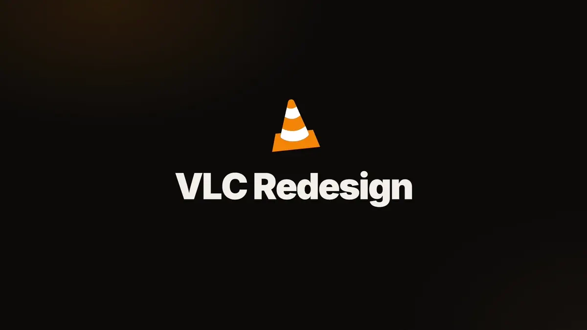
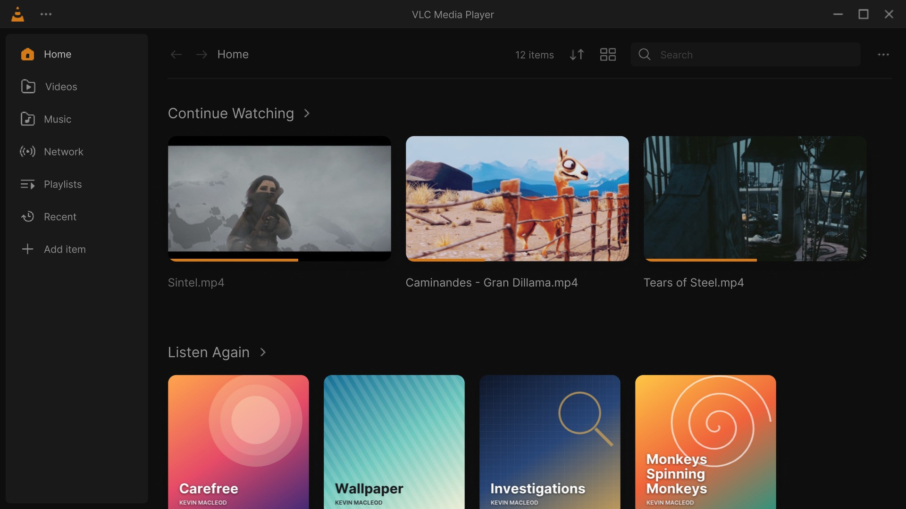
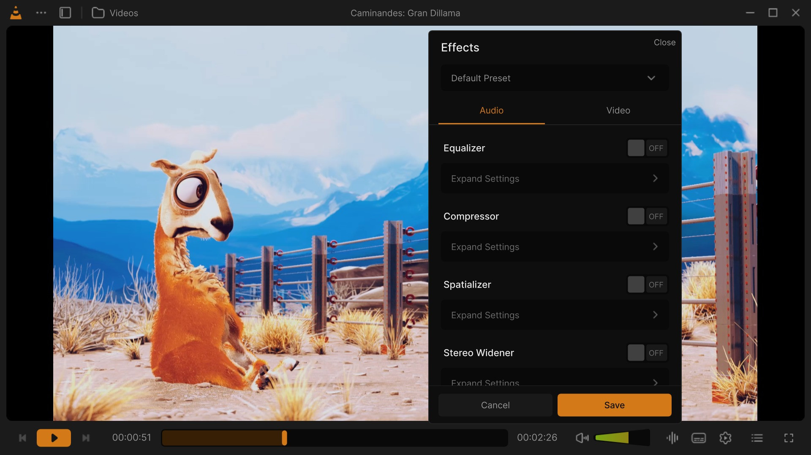
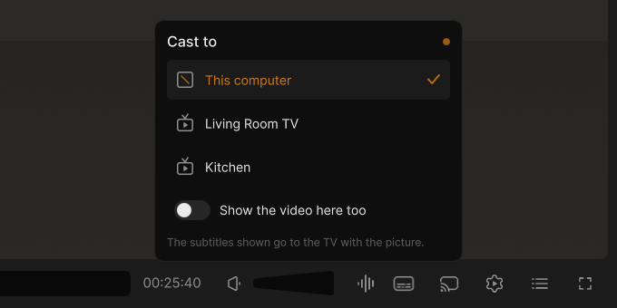
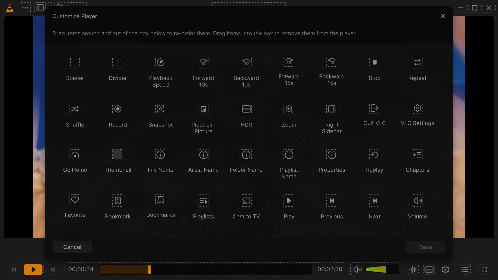
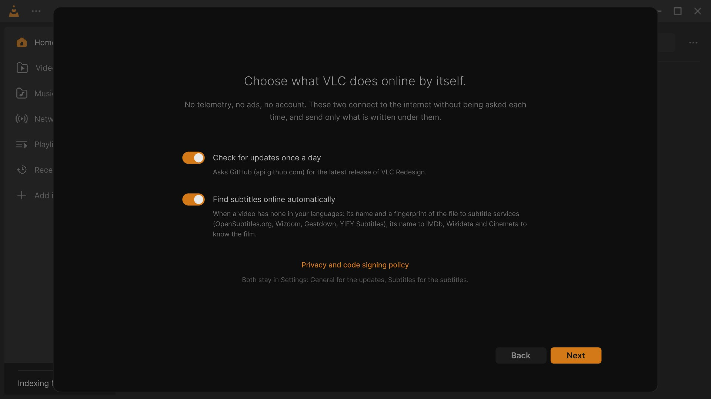
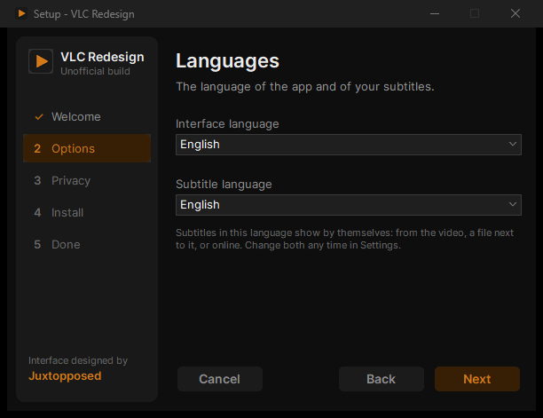

<!-- platforms:start -->
<!-- Written by extras/juxtopposed/platforms/render.py from platforms.yml: edit that file. -->
<p align="center"><sub>

**[Windows 0.3.1](https://github.com/KuchiSofts/vlc-redesign/releases/latest)** · Linux soon · macOS soon · Windows ARM64 soon · Android soon · Samsung TV soon · iPhone/iPad later

</sub></p>

<details>
<summary>Every platform and its status</summary>

| Platform | Status | Latest | Get it |
|---|---|---|---|
| Windows | 🟢 released | 0.3.1 · 2026-10-25 | [installer](https://github.com/KuchiSofts/vlc-redesign/releases/download/v0.3.1/vlc-redesign-0.3.1-win64-setup.exe) · [portable](https://github.com/KuchiSofts/vlc-redesign/releases/download/v0.3.1/vlc-redesign-0.3.1-win64.zip) |
| Linux | 🟡 in progress | — | coming soon |
| macOS | 🟡 in progress | — | coming soon |
| Windows ARM64 | 🔴 planned | — | coming soon |
| Android | ⚪ research | — | coming soon |
| Samsung TV | ⚪ research | — | coming soon |
| iPhone/iPad | ⚪ later | — | coming soon |

<sub>From [`platforms.yml`](platforms.yml) · [every platform on the website](https://kuchisofts.github.io/vlc-redesign/).</sub>

</details>
<!-- platforms:end -->

<div align="center">


# VLC Redesign <sub><sup>(unofficial)</sup></sub>

**The VLC you know, with the interface designed by [Juxtopposed](https://www.youtube.com/@juxtopposed).**<br>
The real VLC 4 engine and codecs, a new interface built screen by screen from the design, for Windows 10 and 11.

[](https://github.com/KuchiSofts/vlc-redesign/releases/latest)
[](https://github.com/KuchiSofts/vlc-redesign/releases)


[](https://hosted.weblate.org/engage/vlc-redesign/)
[](COPYING)

**[⬇ Download for Windows](https://github.com/KuchiSofts/vlc-redesign/releases/latest)** ·
[What's new](CHANGELOG.md) ·
[Wiki](https://github.com/KuchiSofts/vlc-redesign/wiki) ·
[Roadmap](ROADMAP.md) ·
[Build from source](#build-from-source)

<a href="docs/media/tour/tour.mp4"></a>

<sub>▶ <a href="docs/media/tour/tour.mp4">Watch the tour in full quality (MP4, 56 s)</a> · Every picture is the real app, with free films and music.</sub>

</div>

---

## 🎨 Design by Juxtopposed

<table>
<tr>
<td width="44%">
<a href="https://www.youtube.com/watch?v=ERFeOgqk324">

</a>
</td>
<td>

**Every screen of this interface was designed by Juxtopposed.**
This project only turns that design into working software.

▶ **[Watch the video: *I Redesigned VLC After 25 Years*](https://www.youtube.com/watch?v=ERFeOgqk324)**

[YouTube](https://www.youtube.com/@juxtopposed) ·
[Website](https://juxtopposed.com) ·
[Figma](https://www.figma.com/@juxtopposed) ·
[X / Twitter](https://twitter.com/juxtopposed) ·
[Bluesky](https://bsky.app/profile/juxtopposed.bsky.social) ·
[Instagram](https://instagram.com/juxtopposed) ·
[GitHub](https://github.com/juxtopposed)

If you like how this looks, go subscribe to Juxtopposed's channel. That's where it all comes from.

</td>
</tr>
</table>

> The design is **["VLC Redesign (Community)"](https://www.figma.com/community/file/1691465999134370980) by Juxtopposed**,
> licensed under [CC BY 4.0](https://creativecommons.org/licenses/by/4.0/).
> It was adapted to Qt/QML for this build, and its icons were redrawn and modified.
> Juxtopposed does not endorse this project. The same credit is in the app, under **⋯ → About VLC**.

> [!IMPORTANT]
> **This is an unofficial fork.** It is not made, affiliated with, or endorsed by
> [VideoLAN](https://www.videolan.org/). *VLC*, *VLC media player* and the cone logo are
> trademarks of VideoLAN. For the official player, go to [videolan.org](https://www.videolan.org/vlc/).
> This build is based on the VLC 4.0 development branch: please report problems
> [here](https://github.com/KuchiSofts/vlc-redesign/issues), not to VideoLAN.

## What makes it different

<table>
<tr>
<td width="50%" valign="top">


**Pick up where you left off.** Home opens on *Continue Watching* and *Listen Again*, with your folders and the
newest videos and music under them.
</td>
<td width="50%" valign="top">


**Frame previews on the seek bar.** Hover the seek bar and the frame at that time appears above it, decoded ahead
while you move.
</td>
</tr>
<tr>
<td valign="top">


**Subtitles that learn your languages.** The languages you pick move up the list (*Often used*). Pick one about
three times and it is chosen by itself when your default language isn't there, in the video or online.
</td>
<td valign="top">


**Move and resize subtitles, live.** − and + in the panel (or Shift+↑ and Shift+↓) move them up and down and change
their size while the film plays; the panel fades so you can see them move. Kept for the next videos.
</td>
</tr>
<tr>
<td valign="top">


**Music, with a waveform seek bar.** The cover fills the background, the seek bar shows the song's waveform, and the
title stays readable on dark and bright covers alike.
</td>
<td valign="top">


**Everything one click away.** Languages and tracks, Effects, VLC Settings, HDR and Cast open right above their
button; a click outside or on the button closes them, and the video never pauses for it.
</td>
</tr>
<tr>
<td valign="top">


**Cast to your TV.** Chromecast and DLNA TVs, with the subtitles you chose burned into the picture, and the video
on your computer too if you want. [Which TVs work](https://github.com/KuchiSofts/vlc-redesign/wiki/TV-Compatibility).
</td>
<td valign="top">


**Dark, light, and nine accent colours.** Or *System*, which follows Windows. Every screen of the design in both
themes.
</td>
</tr>
<tr>
<td valign="top">


**Make the controls yours.** Drag buttons onto the bar and off it, right on the player, and keep layouts as profiles
(Movies, Shows, Music, Work…). Any button you remove can come back from the palette.
</td>
<td valign="top">


**72 languages, switched live.** Pick one in Settings and the whole interface changes at once, no restart; a
right-to-left language lays it out right to left. [Translate it into yours on Weblate](https://hosted.weblate.org/engage/vlc-redesign/), in the browser.
</td>
</tr>
<tr>
<td valign="top">


**Private by default.** No telemetry, no ads, no account. The two things that go online by themselves (the daily
update check and online subtitles) are asked about at the start, with exactly what they send.
</td>
<td valign="top">


**A real library.** Artists, albums, tracks, genres and playlists for music; films, series and folders for video;
network shares and streams.
</td>
</tr>
</table>

And more: a sleep timer, A-B loop, speed, picture-in-picture, a mini player with its queue, volume up to 200 %,
bookmarks and chapters, audio and video effects that apply live, small in-app updates. **Every option is explained in
the [wiki](https://github.com/KuchiSofts/vlc-redesign/wiki)**, and everything new is in the [changelog](CHANGELOG.md).

## Download

**Windows 10 or 11, 64-bit.** Go to **[Releases](https://github.com/KuchiSofts/vlc-redesign/releases/latest)** and
pick one. Code signing: free code signing provided by [SignPath.io](https://about.signpath.io/), certificate by
[SignPath Foundation](https://signpath.org/) ([Code signing policy](https://github.com/KuchiSofts/vlc-redesign/blob/main/CODE_SIGNING_POLICY.md)).

| | |
|---|---|
| **Installer** · `vlc-redesign-…-win64-setup.exe` | Recommended. Installs for you only (no administrator rights needed), adds a Start menu entry, and keeps itself up to date. |
| **Portable** · `vlc-redesign-…-win64.zip` | Unzip anywhere and run `vlc.exe`. Nothing is installed; delete the folder to remove it. |

Both keep their settings, library and history in their own `portable` folder, so they never touch an installed
official VLC.

### The installer

<table>
<tr>
<td width="50%"></td>
<td width="50%"></td>
</tr>
</table>

Drawn like the app itself, in 29 languages (it offers Windows' own when it has it). On the way:

- **Languages**: the language of the interface (any of the 72, or English) and your default subtitle language.
- **Options**: open videos, music and playlists with VLC Redesign, *Play with VLC Redesign* in the right-click menu, a
  desktop shortcut, or install for everyone.
- **Privacy**: the update check and online subtitles, each with what it sends and to whom.

Silent installs take switches (`/VERYSILENT /UILANG=en /SUBLANG=en /NOUPDATECHECK` …), listed in the
[wiki](https://github.com/KuchiSofts/vlc-redesign/wiki/Install-and-Update).

### Updates

VLC Redesign checks this repository for a new release once a day (Settings → General → *Check for updates
automatically*, or ⋯ → About → *Check for updates*). When one is out, a card offers **Update now**:

- **A small update** (installed or portable copy): only the files that changed, usually a few megabytes, downloaded in
  the background and checked against the release's `SHA256SUMS.txt` file by file (from 0.3.2 on, only once that
  file's signature by the project's release key is checked). **Restart now** puts it in place in
  about two seconds and reopens VLC Redesign on what was playing, where it was; **Later** puts it in place when you
  close it. If anything goes wrong, every file goes back as it was.
- **The installer**, when no small update fits (more than three releases behind, or installed for everyone):
  downloaded, checked, and run without questions.

Until the first signed release, Windows SmartScreen may warn about an unknown publisher: *More info → Run anyway*.
Every release lists the SHA-256 of its files in `SHA256SUMS.txt`.

## Platforms

**Windows 10 and 11 (64-bit) ✅** · Windows on ARM64 🔜 · Linux 🔜 · macOS, Android, Android TV, iPhone/iPad 💡 ·
a receiver for Samsung and LG TVs 💡

What each would take and in which order is in the [platform study](docs/PLATFORMS.md); the status lives in
[`platforms.yml`](platforms.yml). Windows 7, 8, XP and 32-bit Windows are not planned (VLC 4's interface needs Qt 6,
which needs 64-bit Windows 10 or later): use the official VLC 3 there.

## Known limitations

- **Based on VLC 4.0-dev**, not on the stable VLC 3. Expect the occasional rough edge.
- **Windows only for now** (see [Platforms](#platforms)).
- 72 languages cover the whole interface; in VLC's other catalogs (listed as partial) only VLC's own texts are
  translated.
- Media Info, Bookmarks, Convert/Stream, Open Disc, Capture and Messages still use the classic VLC windows.
- The waveform seek bar works on local files up to 1 GB and 8 minutes; other media get the regular seek bar.
- HDR output offers Auto / Off / HDR10 / HLG and needs the libplacebo renderer.

## Build from source

The Windows build is a cross-compile in Docker, using VideoLAN's official build image and prebuilt
libraries. You need [Docker Desktop](https://www.docker.com/products/docker-desktop/) and Git.

```powershell
git clone https://github.com/KuchiSofts/vlc-redesign.git
cd vlc-redesign
# Development build (debug, asserts on) into %USERPROFILE%\source\vlc-win64
.\extras\juxtopposed\win64-docker.ps1
# Release: build, then the portable zip, the installer and SHA256SUMS.txt
# (needs Inno Setup 6.7+: choco install innosetup)
.\extras\juxtopposed\make-release.ps1
```

The first build takes a while; later ones only rebuild what changed (`-Quick` skips configure). Every parameter is in
the [wiki](https://github.com/KuchiSofts/vlc-redesign/wiki/Building-from-Source). The interface lives in
[`modules/gui/qt`](modules/gui/qt).

## Contributing

Bug reports, TV reports, design mismatches and translations are welcome: the
[issue forms](https://github.com/KuchiSofts/vlc-redesign/issues/new/choose) ask for what is needed. Before a pull
request, read [CONTRIBUTING.md](CONTRIBUTING.md); to translate, [Weblate](https://hosted.weblate.org/engage/vlc-redesign/) (no files or Git needed) or [TRANSLATING.md](docs/TRANSLATING.md). Security
problems: [SECURITY.md](SECURITY.md). Everyone here follows the [code of conduct](CODE_OF_CONDUCT.md).

## Staying in sync with VLC

This repository is a fork of [VLC](https://code.videolan.org/videolan/vlc), forked from the 4.0 development branch
on 2026-10-12. Fixes from VLC are merged in regularly: a weekly GitHub Action tries the merge and opens a pull request
when it applies cleanly, or an issue listing the conflicting files when it doesn't.

## Credits

- **Design:** [Juxtopposed](https://www.youtube.com/@juxtopposed). [Video](https://www.youtube.com/watch?v=ERFeOgqk324) · [Figma file](https://www.figma.com/community/file/1691465999134370980) (CC BY 4.0)
- **First implementation:** [MrDouglax](https://github.com/SrDouglax/JuxtopposedVLC), whose Linux fork this builds on
- **VLC:** the [VideoLAN](https://www.videolan.org/) team and the VLC contributors ([AUTHORS](AUTHORS))
- **Translators:** see [CREDITS.md](CREDITS.md); Brazilian Portuguese by [Kinglucas962](https://github.com/Kinglucas962)
- **Fonts:** [Inter](https://github.com/rsms/inter) and [DM Mono](https://github.com/googlefonts/dm-mono), SIL Open Font License 1.1
- **Media in the pictures and the tour:** *Caminandes: Gran Dillama* (CC BY), *Sintel*, *Tears of Steel* and *Big Buck
  Bunny* (CC BY 3.0) and *Elephants Dream* (CC BY 2.5), © Blender Foundation, pictures only; music by
  [Kevin MacLeod](https://incompetech.com/) (CC BY 4.0), with covers made for this demo.

Details in [CREDITS.md](CREDITS.md).

## Code signing policy

Free code signing provided by [SignPath.io](https://about.signpath.io/), certificate by
[SignPath Foundation](https://signpath.org/). What is signed, the team roles and the privacy policy:
[CODE_SIGNING_POLICY.md](CODE_SIGNING_POLICY.md). Until the first signed release, the files are unsigned and their
SHA-256 is listed in `SHA256SUMS.txt`.

## License

Like VLC, this is free software under the **GNU GPL version 2 or later** ([COPYING](COPYING)); libVLC is
under the LGPL 2.1 or later ([COPYING.LIB](COPYING.LIB)). The design is CC BY 4.0, and the fonts are OFL 1.1.
Every release links to the exact source it was built from.

---

<details>
<summary><b>The original VLC README</b></summary>

# VLC media player

**VLC** is a libre and open source **media player** and **multimedia engine**,
focused on **playing everything**, and **running everywhere**.

**VLC** can play most multimedia files, discs, streams, devices and is also able to
convert, encode, **stream** and manipulate streams into numerous formats.

VLC is used by many over the world, on numerous platforms, for very different use cases.

The **engine of VLC** can be embedded into 3rd party applications, and is called *libVLC*.

**VLC** is part of the [VideoLAN project](https://videolan.org) and
is developed and supported by a community of volunteers.

The VideoLAN project was started at the university [École Centrale Paris](https://www.centralesupelec.fr/) who
relicensed VLC under the GPLv2 license in February 2001. Since then, VLC has
been downloaded **billions** of times.

## License

**VLC** is released under the GPLv2 *(or later)* license.
*On some platforms, it is de facto GPLv3, because of the licenses of dependencies*.

**libVLC**, the engine is released under the LGPLv2 *(or later)* license. \
This allows embedding the engine in 3rd party applications, while letting them to be licensed under other licenses.

# Platforms

VLC is available for the following platforms:
- [Windows] *(from 7 and later, including UWP platforms and all versions of Windows 10)*
- [macOS] *(10.10 and later)*
- [GNU/Linux] and affiliated
- [BSD] and affiliated
- [Android] *(4.2 and later)*, including Android TV and Android Auto
- [iOS] *(9 and later)*, including AppleTV and iPadOS
- Haiku, OS/2 and a few others.

[Windows]: https://www.videolan.org/vlc/download-windows.html
[macOS]: https://www.videolan.org/vlc/download-macosx.html
[GNU/Linux]: https://www.videolan.org/vlc/#download
[BSD]: https://www.videolan.org/vlc/download-freebsd.html
[Android]: https://www.videolan.org/vlc/download-android.html
[iOS]: https://www.videolan.org/vlc/download-ios.html

Not all platforms receive the same amount of care, due to our limited resources.

**Nota Bene**: The [Android app](https://code.videolan.org/videolan/vlc-android/) and
the [iOS app](https://code.videolan.org/videolan/vlc-ios/) are located in different repositories
than the main one.

# Contributing & Community

**VLC** is maintained by a community of people, and VideoLAN is not paying any of them.\
The community is composed of developers, helpers, maintainers, designers and writers that want
this open source project to thrive.

The main development of VLC is done in the C language, but this repository also contains
plenty of C++, Obj-C, asm and Rust.

Other repositories linked to vlc are done in languages including Kotlin/Java [(Android)](https://code.videolan.org/videolan/vlc-android/),
Swift [(iOS)](https://code.videolan.org/videolan/vlc-ios/), and C# [(libVLCSharp)](https://code.videolan.org/videolan/libvlcsharp/).

We need help with the following tasks:
- Coding
- Packaging for Windows, macOS and Linux distributions
- Technical writing for the documentation
- Design
- Support
- Community management and communication.

Please contribute :)

We are on IRC. You can find us on the **#videolan** channel on *[Libera.chat]*.

[Libera.chat]: https://libera.chat

## Contributions

Contributions are now done through Merge Requests on our [GitLab repository](https://code.videolan.org/videolan/vlc/).

CI and discussions should be resolved before a Merge Request can be merged.

# libVLC

**libVLC** is an embeddable engine for 3rd party applications and frameworks.

It runs on the same platforms as VLC *(and sometimes on more)* and can provide playback,
streaming and conversion of multimedia files and streams.


**libVLC** has numerous bindings for other languages, such as C++, Python and C#.

# Support

## Links

Some useful links that might help you:

- [VLC web site](https://www.videolan.org/vlc/)
- [Support](https://www.videolan.org/support/)
- [Forums](https://forum.videolan.org/)
- [Wiki](https://wiki.videolan.org/)
- [Developer's Corner](https://wiki.videolan.org/Developers_Corner)
- [VLC hacking guide](https://wiki.videolan.org/Hacker_Guide)
- [Bugtracker](https://code.videolan.org/videolan/vlc/-/issues)
- [VideoLAN web site](https://www.videolan.org/)

## Source Code sitemap
```
ABOUT-NLS          - Notes on the Free Translation Project.
AUTHORS            - VLC authors.
COPYING            - The GPL license.
COPYING.LIB        - The LGPL license.
INSTALL            - Installation and building instructions.
NEWS               - Important modifications between the releases.
README             - Project summary.
THANKS             - VLC contributors.

bin/               - VLC binaries.
bindings/          - libVLC bindings to other languages.
compat/            - compatibility library for operating systems missing
                     essential functionalities.
contrib/           - Facilities for retrieving external libraries and building
                     them for systems that don't have the right versions.
doc/               - Miscellaneous documentation.
extras/analyser    - Code analyser and editor specific files.
extras/buildsystem - Different build system specific files.
extras/misc        - Files that don't fit in the other extras/ categories.
extras/package     - VLC packaging specific files such as spec files.
extras/tools/      - Facilities for retrieving external building tools needed
                     for systems that don't have the right versions.
include/           - Header files.
lib/               - libVLC source code.
modules/           - VLC plugins and modules. Most of the code is here.
po/                - VLC translations.
share/             - Common resource files.
src/               - libvlccore source code.
test/              - Testing system.
```

</details>
