<div align="center">


# VLC Redesign <sub><sup>(unofficial)</sup></sub>

**The VLC you know, with the interface designed by [Juxtopposed](https://www.youtube.com/@juxtopposed).**<br>
The real VLC 4 engine and codecs, under a new interface built screen by screen from the design.

[](https://github.com/KuchiSofts/vlc-redesign/releases/latest)
[](https://github.com/KuchiSofts/vlc-redesign/releases)
[](#-platforms)
[](https://github.com/KuchiSofts/vlc-redesign/wiki/Languages)
[](https://hosted.weblate.org/engage/vlc-redesign/)
[](COPYING)

<br>

[](https://github.com/KuchiSofts/vlc-redesign/releases/download/v0.4.1/vlc-redesign-0.4.1-win64-setup.exe)
[](https://github.com/KuchiSofts/vlc-redesign/releases/download/v0.4.1/vlc-redesign-0.4.1-winarm64-setup.exe)
[](https://github.com/KuchiSofts/vlc-redesign/releases/download/v0.4.1/vlc-redesign-0.4.1-macos-arm64.dmg)
[](https://github.com/KuchiSofts/vlc-redesign/releases/download/v0.4.1/vlc-redesign-0.4.1-macos-x86_64.dmg)
<br>
[](https://github.com/KuchiSofts/vlc-redesign/releases/download/v0.4.1/vlc-redesign-0.4.1-x86_64.AppImage)
[](https://github.com/KuchiSofts/vlc-redesign/releases/download/v0.4.1/vlc-redesign_0.4.1_amd64.deb)
[](https://github.com/KuchiSofts/vlc-redesign/releases/download/v0.4.1/vlc-redesign-0.4.1-1.x86_64.rpm)
[](https://github.com/KuchiSofts/vlc-redesign/releases/latest)

<sub>**Latest: 0.4.1** (2026-10-30) · **Next: 0.5.0** · [Roadmap](https://github.com/KuchiSofts/vlc-redesign/wiki/Roadmap) · [What's new](CHANGELOG.md) · [Wiki](https://github.com/KuchiSofts/vlc-redesign/wiki)</sub>

<br>

<a href="docs/media/tour/tour.mp4"></a>

<sub>▶ <a href="docs/media/tour/tour.mp4">Watch the tour in full quality (MP4, 56 s)</a> · Every picture is the real app, with free films and music.</sub>

</div>

> [!IMPORTANT]
> **This is an unofficial fork.** It is not made, affiliated with, or endorsed by
> [VideoLAN](https://www.videolan.org/). *VLC*, *VLC media player* and the cone logo are
> trademarks of VideoLAN. For the official player, go to [videolan.org](https://www.videolan.org/vlc/).
> This build is based on the VLC 4.0 development branch: please report problems
> [here](https://github.com/KuchiSofts/vlc-redesign/issues), not to VideoLAN.
> VLC Redesign is free software under the GPL, the use of these marks that
> [VideoLAN's trademark policy](https://www.videolan.org/legal.html) allows; it names itself
> *VLC Redesign*, never *VLC media player*, and never uses the name VideoLAN as its own.

<p align="center">
<a href="#-design-by-juxtopposed">Design</a> ·
<a href="#-highlights">Highlights</a> ·
<a href="#-see-it-in-action">In action</a> ·
<a href="#-download--install">Download</a> ·
<a href="#-platforms">Platforms</a> ·
<a href="#-roadmap">Roadmap</a> ·
<a href="#-documentation">Docs</a> ·
<a href="#-contributing--translating">Contribute</a> ·
<a href="#-build-from-source">Build</a> ·
<a href="#-credits">Credits</a> ·
<a href="#-license">License</a>
</p>

---

## 🎨 Design by Juxtopposed

<table>
<tr>
<td width="44%">
<a href="https://www.youtube.com/watch?v=ERFeOgqk324">

</a>
</td>
<td>

**Interface designed by Juxtopposed.**
Every screen of this interface was designed by Juxtopposed; this project only turns that design into working software.

▶ **[Watch the video: *I Redesigned VLC After 25 Years*](https://www.youtube.com/watch?v=ERFeOgqk324)**

[YouTube](https://www.youtube.com/@juxtopposed) ·
[Website](https://juxtopposed.com) ·
[Figma](https://www.figma.com/@juxtopposed) ·
[X / Twitter](https://twitter.com/juxtopposed) ·
[Bluesky](https://bsky.app/profile/juxtopposed.bsky.social) ·
[Instagram](https://instagram.com/juxtopposed) ·
[GitHub](https://github.com/juxtopposed)

If you like how this looks, go subscribe to Juxtopposed's channel. That's where it all comes from.

</td>
</tr>
</table>

> The design is **["VLC Redesign (Community)"](https://www.figma.com/community/file/1691465999134370980) by Juxtopposed**,
> licensed under [CC BY 4.0](https://creativecommons.org/licenses/by/4.0/).
> It was adapted to Qt/QML for this build, and its icons were redrawn and modified.
> **Juxtopposed does not endorse this project.** The same credit is in the app, under **⋯ → About VLC**.

## ✨ Highlights

<table>
<tr>
<td width="50%" valign="top"><a href="docs/media/demo/tv-zapping.mp4">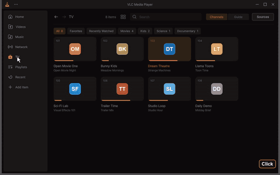</a><br><b>📺 Live TV.</b> Your own IPTV playlist or Xtream Codes account, or a free, legal list from the catalog. Page Up / Page Down to zap.</td>
<td width="50%" valign="top"><a href="docs/media/demo/tv-guide.mp4">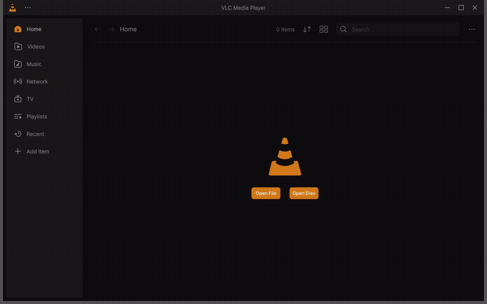</a><br><b>🗓️ The guide.</b> Every channel across the hours, with the line of now.</td>
</tr>
<tr>
<td valign="top"><a href="docs/media/demo/subtitles-he-ar-ja.mp4">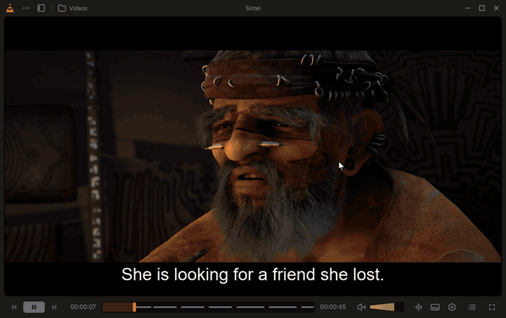</a><br><b>💬 Subtitles in every script.</b> Sharp, and right to left in the right order. They learn the languages you pick.</td>
<td valign="top"><a href="docs/media/demo/subtitle-size.mp4">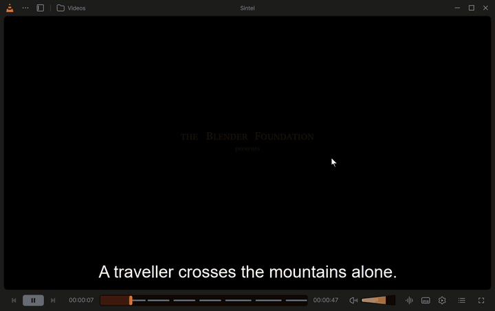</a><br><b>🔠 Move and resize subtitles, live.</b> Ctrl + mouse wheel over the video, or Shift+↑ / Shift+↓.</td>
</tr>
<tr>
<td valign="top"><a href="docs/media/demo/customize-player.mp4">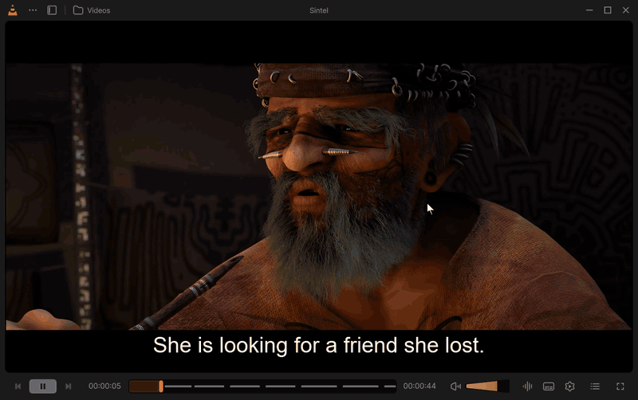</a><br><b>🎛️ Customize Player.</b> Drag buttons onto the bar and keep layouts as profiles.</td>
<td valign="top"><a href="docs/media/demo/theme-accent.mp4">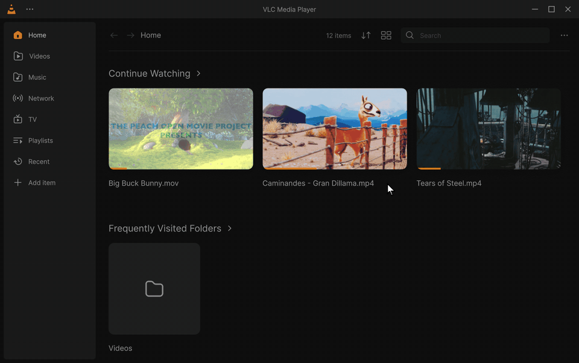</a><br><b>🎨 Themes and accents.</b> Dark, light or System, nine accent colours, applied at once.</td>
</tr>
<tr>
<td valign="top"><a href="docs/media/demo/cast.mp4">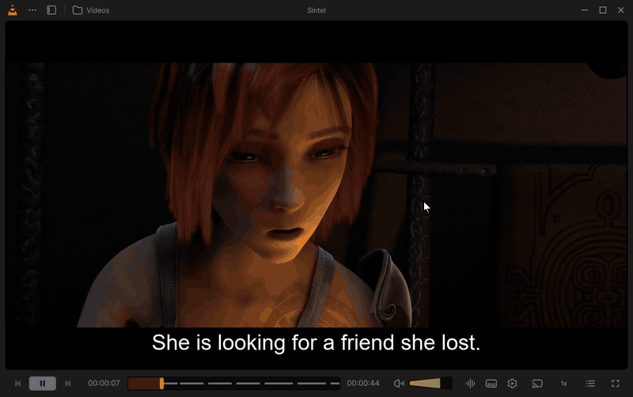</a><br><b>📡 Cast to your TV.</b> Chromecast and DLNA TVs, controlled from the bar. <a href="https://github.com/KuchiSofts/vlc-redesign/wiki/TV-Compatibility">Which TVs work</a>.</td>
<td valign="top"><a href="docs/media/demo/library.mp4">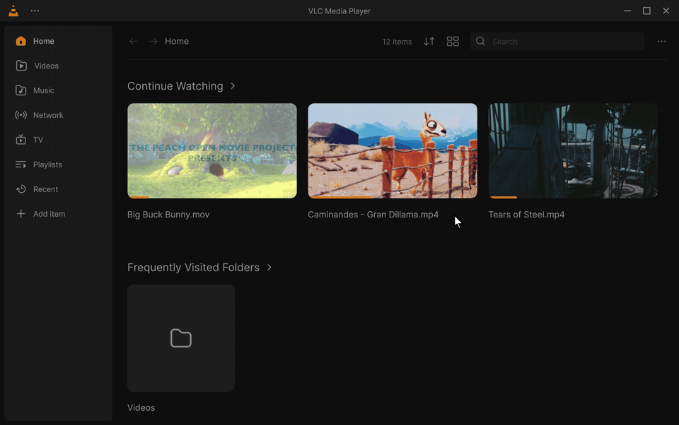</a><br><b>🏠 Home and a real library.</b> Continue Watching, then videos, music, albums and tracks.</td>
</tr>
<tr>
<td valign="top"><a href="docs/media/demo/rtl-hebrew.mp4">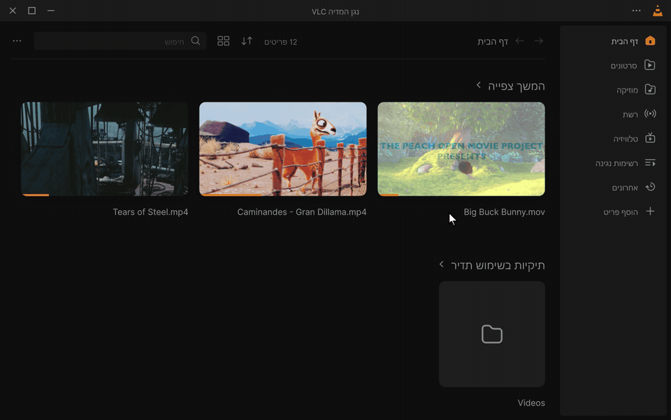</a><br><b>🌍 72 languages, switched live.</b> No restart; right-to-left languages lay the interface out right to left.</td>
<td valign="top"><a href="docs/media/demo/onboarding.mp4">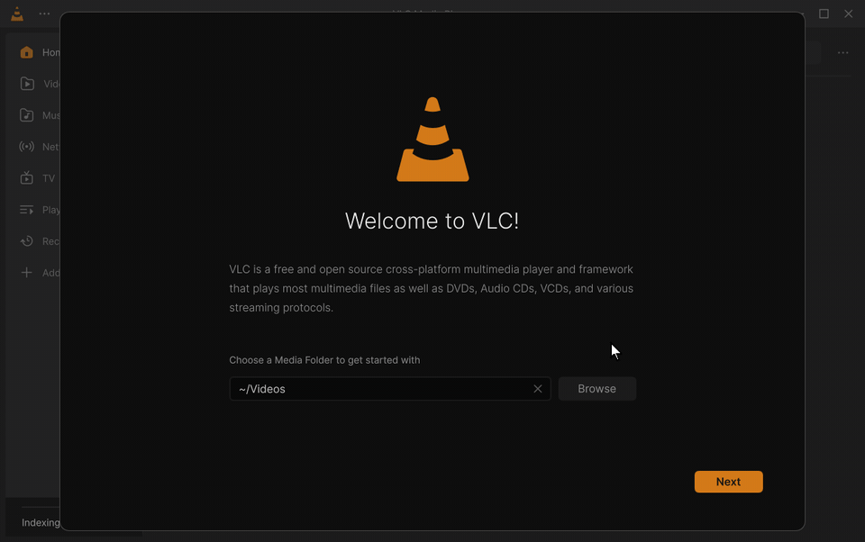</a><br><b>🔒 Private by default.</b> No telemetry, no ads, no account. What goes online is asked at the start.</td>
</tr>
</table>

**And more:** frame previews on the seek bar · music with a waveform seek bar · effects that apply live ·
small in-app updates signed by the project (Windows) · sleep timer · A-B loop · picture-in-picture · mini player ·
volume up to 200 % · bookmarks and chapters. Every option is explained in the
[wiki](https://github.com/KuchiSofts/vlc-redesign/wiki).

<details>
<summary><b>📸 More screenshots</b></summary>
<br>

<table>
<tr>
<td width="50%" valign="top"><br><b>Pick up where you left off.</b> Continue Watching and Listen Again.</td>
<td width="50%" valign="top"><br><b>Frame previews on the seek bar,</b> decoded ahead while you move.</td>
</tr>
<tr>
<td valign="top"><br><b>Subtitles that learn your languages.</b> Pick one about three times and it is chosen by itself.</td>
<td valign="top"><br><b>Subtitles moved and resized</b> while the film plays, kept for the next videos.</td>
</tr>
<tr>
<td valign="top"><br><b>Music, with a waveform seek bar,</b> readable on dark and bright covers.</td>
<td valign="top"><br><b>Everything one click away.</b> Panels open above their button; the video never pauses.</td>
</tr>
<tr>
<td valign="top"><br><b>The light theme,</b> every screen of the design in both themes.</td>
<td valign="top"><br><b>Settings,</b> with the interface language and layout direction.</td>
</tr>
<tr>
<td valign="top"><br><b>The welcome step</b> that tells exactly what goes online.</td>
<td valign="top"><br><b>Albums</b>, with artists, tracks, genres and playlists next to them.</td>
</tr>
</table>

</details>

## 🎬 See it in action

**One film per platform** (silent, every clip with a caption):
[Windows 0.4.0](docs/media/films/vlc-redesign-0.4.0-windows.mp4) (2 min 55 s) ·
[Linux and macOS 0.4.0](docs/media/films/vlc-redesign-0.4.0-linux-macos.mp4) (21 s) ·
[Android](docs/media/films/vlc-redesign-0.4.0-android.mp4) (2 min 2 s, in testing).

<table>
<tr>
<td width="40%" valign="top"><a href="docs/media/demo/linux.mp4">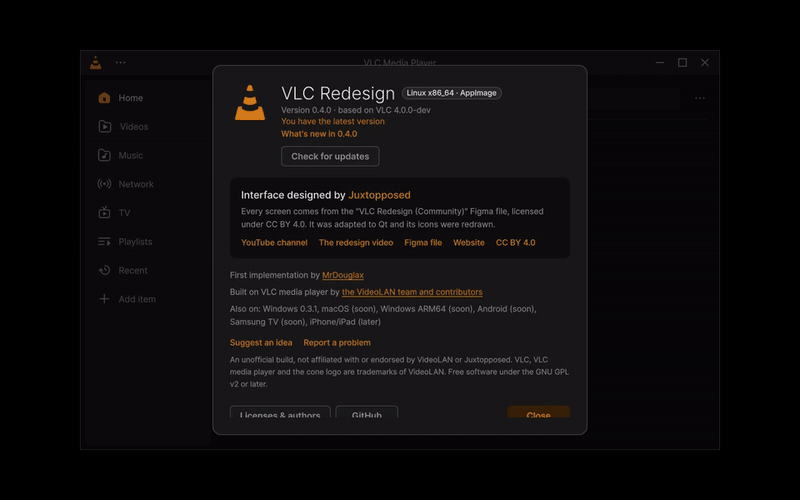</a><br><b>Linux.</b> The AppImage on Arch Linux: About, Settings, Home.</td>
<td width="40%" valign="top"><a href="docs/media/demo/macos.png">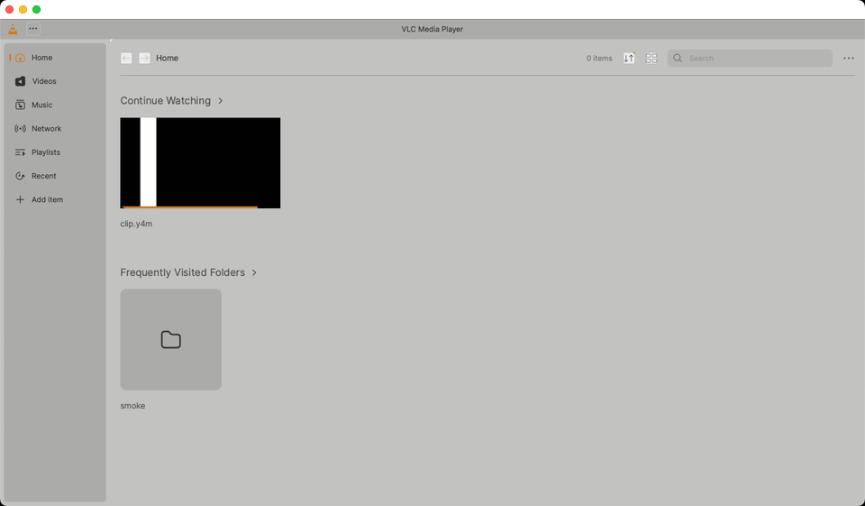</a><br><b>macOS.</b> The app on an Intel Mac, from the launch test of the build.</td>
<td width="20%" valign="top"><a href="docs/media/demo/android/home.mp4">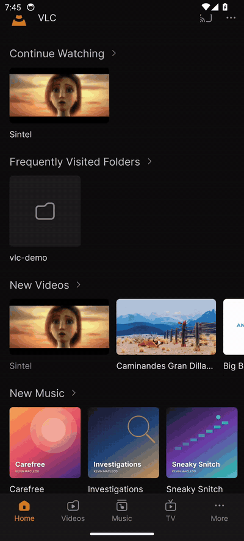</a><br><b>Android</b> (in testing). Home on a phone; <a href="docs/media/demo/android/tablet.mp4">the tablet</a>.</td>
</tr>
</table>

<sub>Click a clip for its MP4. Every clip: [the demo clips](docs/media/demo/README.md) and the
[Feature tour](https://github.com/KuchiSofts/vlc-redesign/wiki/Feature-Tour) of the wiki.</sub>

## 📦 Download & install

Every file is on **[Releases](https://github.com/KuchiSofts/vlc-redesign/releases/latest)**, with its SHA-256 in
`SHA256SUMS.txt`. Full guide: [Install and update](https://github.com/KuchiSofts/vlc-redesign/wiki/Install-and-Update).

| Platform | What to get |
|---|---|
| **Windows 10 / 11** (64-bit) | The **installer** (recommended: no administrator rights, keeps itself up to date) or the **portable zip** (unzip and run `vlc.exe`). Both keep their settings in their own `portable` folder, apart from an official VLC. |
| **Windows 11 on ARM64** (Snapdragon PCs) | The same two, built natively for ARM64. 0.4.1 is the first ARM64 release; small updates come with the next versions. [Details](https://github.com/KuchiSofts/vlc-redesign/wiki/Install-and-Update#windows-on-arm64) |
| **Linux** x86_64 / ARM64 (glibc 2.38: Ubuntu 24.04+, Debian 13, Fedora 39+) | A .deb, an .rpm, an AppImage or a tarball. Installs in `/opt/vlc-redesign` next to the distribution's `vlc`, as `vlc-redesign`. Live TV is an optional add-on package (.deb and .rpm). [Which file](https://github.com/KuchiSofts/vlc-redesign/wiki/Install-and-Update#linux) |
| **macOS 12+** (Apple Silicon / Intel) | Drag VLC Redesign to Applications. Signed ad hoc, not by Apple: open it once via *System Settings › Privacy & Security › Open Anyway*. [Details](https://github.com/KuchiSofts/vlc-redesign/wiki/Install-and-Update#macos) |

> [!NOTE]
> The Windows files are not code-signed yet (waiting for SignPath's approval), so SmartScreen may warn the first time:
> *More info → Run anyway*. The app installs only updates whose list is signed by the project.
> Policy: [CODE_SIGNING_POLICY.md](CODE_SIGNING_POLICY.md).

<details>
<summary><b>The Windows installer</b></summary>
<br>

<table>
<tr>
<td width="50%"></td>
<td width="50%"></td>
</tr>
</table>

Drawn like the app itself, in 29 languages (it offers Windows' own when it has it). On the way:

- **Languages**: the language of the interface (any of the 72, or English) and your default subtitle language.
- **Options**: open videos, music and playlists with VLC Redesign, *Play with VLC Redesign* in the right-click menu, a
  desktop shortcut, or install for everyone.
- **Privacy**: the update check and online subtitles, each with what it sends and to whom.

Silent installs take switches (`/VERYSILENT /UILANG=en /SUBLANG=en /NOUPDATECHECK` …), listed in the
[wiki](https://github.com/KuchiSofts/vlc-redesign/wiki/Install-and-Update#silent-install).

</details>

<details>
<summary><b>Updates</b></summary>
<br>

On Windows (x64; ARM64 from the next version), VLC Redesign checks this repository for a new release once a day
(Settings → General → *Check for updates automatically*, or ⋯ → About → *Check for updates*). When one is out, a card
offers **Update now**:

- **A small update** (installed or portable copy): only the files that changed, usually a few megabytes, checked file
  by file against the release's `SHA256SUMS.txt`, whose signature by the project's release key is checked first.
  **Restart now** puts it in place in about two seconds and reopens what was playing; **Later** does it when you
  close VLC Redesign. If anything goes wrong, every file goes back as it was.
- **The installer**, when no small update fits (more than three releases behind, or installed for everyone):
  downloaded, checked, and run without questions.

On Linux and macOS there is no update in the app yet: install the new package or disk image.

</details>

<details>
<summary><b>Known limitations</b></summary>
<br>

- **Based on VLC 4.0-dev**, not on the stable VLC 3. Expect the occasional rough edge.
- Small updates in the app are for Windows only (on ARM64 from the next version). Windows on ARM64 has not been run
  by hand on an ARM64 PC yet, and the macOS app is not signed by Apple yet.
- 72 languages cover the whole interface; in VLC's other catalogs (listed as partial) only VLC's own texts are
  translated.
- Media Information, Bookmarks, Convert/Stream, Open Media (disc, capture), Messages and the other classic VLC windows
  keep their classic layout, in the redesign's colours and, on Windows, with its title bar and icons. *Go to Time*,
  *Plugins and extensions*, *Media Statistics* and *Folder information* are redrawn as dialogs of the redesign.
- The waveform seek bar works on local files up to 1 GB and 8 minutes; other media get the regular seek bar.
- HDR output offers Auto / Off / HDR10 / HLG and needs the libplacebo renderer.

</details>

## 💻 Platforms

<!-- platforms:start -->
<!-- Written by extras/juxtopposed/platforms/render.py from platforms.yml: edit that file. -->
<p align="center"><sub>

**[Windows 0.4.1](https://github.com/KuchiSofts/vlc-redesign/releases/latest)** · **[Linux 0.4.1](https://github.com/KuchiSofts/vlc-redesign/wiki/Install-and-Update)** · **[macOS 0.4.1](https://github.com/KuchiSofts/vlc-redesign/wiki/Install-and-Update)** · **[Windows ARM64 0.4.1](https://github.com/KuchiSofts/vlc-redesign/wiki/Install-and-Update)** · Android soon · Samsung TV soon · iPhone/iPad later

</sub></p>

<details>
<summary>Every platform and its status</summary>

| Platform | Status | Latest | Get it |
|---|---|---|---|
| Windows | 🟢 released | 0.4.1 · 2026-10-30 | [installer](https://github.com/KuchiSofts/vlc-redesign/releases/download/v0.4.1/vlc-redesign-0.4.1-win64-setup.exe) · [portable](https://github.com/KuchiSofts/vlc-redesign/releases/download/v0.4.1/vlc-redesign-0.4.1-win64.zip) |
| Linux | 🟢 released | 0.4.1 · 2026-10-30 | [appimage](https://github.com/KuchiSofts/vlc-redesign/releases/download/v0.4.1/vlc-redesign-0.4.1-x86_64.AppImage) · [deb](https://github.com/KuchiSofts/vlc-redesign/releases/download/v0.4.1/vlc-redesign_0.4.1_amd64.deb) · [rpm](https://github.com/KuchiSofts/vlc-redesign/releases/download/v0.4.1/vlc-redesign-0.4.1-1.x86_64.rpm) · [tar.xz](https://github.com/KuchiSofts/vlc-redesign/releases/download/v0.4.1/vlc-redesign-0.4.1-linux-x86_64.tar.xz) · [appimage arm64](https://github.com/KuchiSofts/vlc-redesign/releases/download/v0.4.1/vlc-redesign-0.4.1-aarch64.AppImage) · [deb arm64](https://github.com/KuchiSofts/vlc-redesign/releases/download/v0.4.1/vlc-redesign_0.4.1_arm64.deb) · [rpm arm64](https://github.com/KuchiSofts/vlc-redesign/releases/download/v0.4.1/vlc-redesign-0.4.1-1.aarch64.rpm) |
| macOS | 🟢 released | 0.4.1 · 2026-10-30 | [apple silicon](https://github.com/KuchiSofts/vlc-redesign/releases/download/v0.4.1/vlc-redesign-0.4.1-macos-arm64.dmg) · [intel](https://github.com/KuchiSofts/vlc-redesign/releases/download/v0.4.1/vlc-redesign-0.4.1-macos-x86_64.dmg) |
| Windows ARM64 | 🟢 released | 0.4.1 · 2026-10-30 | [installer](https://github.com/KuchiSofts/vlc-redesign/releases/download/v0.4.1/vlc-redesign-0.4.1-winarm64-setup.exe) · [portable](https://github.com/KuchiSofts/vlc-redesign/releases/download/v0.4.1/vlc-redesign-0.4.1-winarm64.zip) |
| Android | ⚪ research | — | coming soon |
| Samsung TV | ⚪ research | — | coming soon |
| iPhone/iPad | ⚪ later | — | coming soon |

<sub>From [`platforms.yml`](platforms.yml) · [every platform on the website](https://kuchisofts.github.io/vlc-redesign/).</sub>

</details>
<!-- platforms:end -->

- **Windows on ARM64** since 0.4.1: tested on GitHub's ARM64 Windows runner, not yet by hand on an ARM64 PC.
- **Linux** since 0.4.0: tested in containers on 7 distributions and on GitHub's x86_64 and ARM64 runners. A Flatpak comes next.
- **macOS** since 0.4.0: built and tested by GitHub's Macs, signed ad hoc (not yet by Apple).
- **Android** (phones, tablets, TV): a separate app, a fork of VLC for Android with the design, in testing; no
  download yet.
- Windows 7, 8, XP and 32-bit Windows are not planned (VLC 4's interface needs Qt 6, which needs 64-bit Windows 10
  or later): use the official VLC 3 there.

Each platform in detail: the [Platforms](https://github.com/KuchiSofts/vlc-redesign/wiki/Platforms) page of the wiki,
and the [platform study](docs/PLATFORMS.md).

## 🧭 Roadmap

**Next: the Android app, then 0.5.0** (Windows on ARM64 small updates in the app, the Linux Flatpak, and what the
issues and the Android work bring back to the desktop). Progress of each program:
[Roadmap on the wiki](https://github.com/KuchiSofts/vlc-redesign/wiki/Roadmap) · [ROADMAP.md](ROADMAP.md) ·
[CHANGELOG.md](CHANGELOG.md).

## 📚 Documentation

The [wiki](https://github.com/KuchiSofts/vlc-redesign/wiki) explains every screen and option.

| Get started | Watch and listen | Make it yours | Help |
|---|---|---|---|
| [Install and Update](https://github.com/KuchiSofts/vlc-redesign/wiki/Install-and-Update) | [The Player](https://github.com/KuchiSofts/vlc-redesign/wiki/The-Player) | [Customize the Player](https://github.com/KuchiSofts/vlc-redesign/wiki/Customize-the-Player) | [Troubleshooting and FAQ](https://github.com/KuchiSofts/vlc-redesign/wiki/Troubleshooting-and-FAQ) |
| [Feature Tour](https://github.com/KuchiSofts/vlc-redesign/wiki/Feature-Tour) | [Subtitles](https://github.com/KuchiSofts/vlc-redesign/wiki/Subtitles) | [Colours and Themes](https://github.com/KuchiSofts/vlc-redesign/wiki/Colours-and-Themes) | [Keyboard Shortcuts](https://github.com/KuchiSofts/vlc-redesign/wiki/Keyboard-Shortcuts) |
| [Platforms](https://github.com/KuchiSofts/vlc-redesign/wiki/Platforms) | [Live TV](https://github.com/KuchiSofts/vlc-redesign/wiki/Live-TV) | [Effects](https://github.com/KuchiSofts/vlc-redesign/wiki/Effects) | [Casting Troubleshooting](https://github.com/KuchiSofts/vlc-redesign/wiki/Casting-Troubleshooting) |
| [Library](https://github.com/KuchiSofts/vlc-redesign/wiki/Library) | [Casting](https://github.com/KuchiSofts/vlc-redesign/wiki/Casting) | [Languages](https://github.com/KuchiSofts/vlc-redesign/wiki/Languages) | [TV Compatibility](https://github.com/KuchiSofts/vlc-redesign/wiki/TV-Compatibility) |
| | | [Settings](https://github.com/KuchiSofts/vlc-redesign/wiki/Settings) | [Credits and License](https://github.com/KuchiSofts/vlc-redesign/wiki/Credits-and-License) |

## 🤝 Contributing & translating

- **Bugs, TV reports, design mismatches:** the [issue forms](https://github.com/KuchiSofts/vlc-redesign/issues/new/choose) ask for what is needed.
- **Translations:** on [Weblate](https://hosted.weblate.org/engage/vlc-redesign/), in the browser (no files or Git
  needed), or see [TRANSLATING.md](docs/TRANSLATING.md).
- **Pull requests:** read [CONTRIBUTING.md](CONTRIBUTING.md) first.
- **Security problems:** [SECURITY.md](SECURITY.md). Everyone here follows the [code of conduct](CODE_OF_CONDUCT.md).

<a href="https://hosted.weblate.org/engage/vlc-redesign/"></a>

## 🔧 Build from source

The Windows build is a cross-compile in Docker, with VideoLAN's official build image and prebuilt libraries. You need
[Docker Desktop](https://www.docker.com/products/docker-desktop/) and Git.

```powershell
git clone https://github.com/KuchiSofts/vlc-redesign.git
cd vlc-redesign
.\extras\juxtopposed\win64-docker.ps1     # development build (debug, asserts on)
.\extras\juxtopposed\make-release.ps1     # release: portable zip, installer, SHA256SUMS.txt (needs Inno Setup 6.7+)
```

The first build takes a while; later ones only rebuild what changed (`-Quick` skips configure). Every parameter, and
the other platforms: [Building from Source](https://github.com/KuchiSofts/vlc-redesign/wiki/Building-from-Source).
The interface lives in [`modules/gui/qt`](modules/gui/qt).

## 🧡 Built on VLC

VLC Redesign is the interface; everything underneath is **[VLC](https://www.videolan.org/)**, the free, open-source
media player and engine made by the VideoLAN team and a community of volunteers. Thank you to them.

- VLC's own project and README: [code.videolan.org/videolan/vlc](https://code.videolan.org/videolan/vlc)
- This repository is a fork of VLC's 4.0 development branch (forked on 2026-10-12). Fixes from VLC are merged in
  regularly: a weekly GitHub Action tries the merge and opens a pull request, or an issue listing the conflicts.
- The documents of this repository (platforms, translating, the plan): [docs/](docs/)

## 🙏 Credits

- **Design:** [Juxtopposed](https://www.youtube.com/@juxtopposed). [Video](https://www.youtube.com/watch?v=ERFeOgqk324) · [Figma file](https://www.figma.com/community/file/1691465999134370980) (CC BY 4.0)
- **First implementation:** [MrDouglax](https://github.com/SrDouglax/JuxtopposedVLC), whose Linux fork this builds on
- **VLC:** the [VideoLAN](https://www.videolan.org/) team and the VLC contributors ([AUTHORS](AUTHORS))
- **Translators:** see [CREDITS.md](CREDITS.md); Brazilian Portuguese by [Kinglucas962](https://github.com/Kinglucas962)
- **Fonts:** [Inter](https://github.com/rsms/inter) and [DM Mono](https://github.com/googlefonts/dm-mono), SIL Open Font License 1.1
- **Media in the pictures and the tour:** *Caminandes: Gran Dillama* (CC BY), *Sintel*, *Tears of Steel* and *Big Buck
  Bunny* (CC BY 3.0) and *Elephants Dream* (CC BY 2.5), © Blender Foundation, pictures only; music by
  [Kevin MacLeod](https://incompetech.com/) (CC BY 4.0), with covers made for this demo.

Compiled by KuchiSofts. Details in [CREDITS.md](CREDITS.md).

## 📄 License

Like VLC, this is free software under the **GNU GPL version 2 or later** ([COPYING](COPYING)); libVLC is under the
LGPL 2.1 or later ([COPYING.LIB](COPYING.LIB)). The design is **CC BY 4.0** (Juxtopposed), and the fonts (Inter,
DM Mono) are **SIL OFL 1.1**. Every release links to the exact source it was built from.
