# Icons

The icon set of the VLC Redesign, `design-1.0`. Generated by `design/tools/sync_assets.py` from
`modules/gui/qt/pixmaps/redesign`; do not edit by hand. `index.json` lists every file with its
name, state, scale, size and checksum.

Derived from *VLC Redesign (Community)* by Juxtopposed, CC BY 4.0 (see `design/README.md`).

**SVG sources.** The glyphs of the Figma *Icon* set (42:356) are the PNG files exported from Figma
(`png/`, with `@2x` where the app needs it) and their SVG sources (`svg/glyphs/`), cut from Figma's
SVG export of the set by `design/tools/icon_svgs.py`; `design/tools/icon_svgs_report.md` compares
each with its PNG. Every other raster piece (`images/`, `player/`) has its SVG too (`svg/`,
`player/svg/`; `design/tools/raster_svgs.json` names its Figma node). The app draws the SVGs, at
the size shown times the screen's scale and the interface zoom; the PNGs are kept here only. The
two-tone menu icons (`svg/duo/`) and the widget chevrons (`svg/widgets/`) are SVG only.

**States.** `default`: idle, #8F8F8F (Dark/FG/A2); `active`: active or hovered, #D37918 (the default accent; the app tints it with the chosen one); `selected`: selected (outline variant); `dim`: dimmed, #6B6B6B or #404040; `disabled`: disabled, #343434; `default-grey`: idle, grey variant; `default-accent`: idle, drawn in the accent; `active-grey`: active, grey variant; `active-accent`: active, drawn in the accent; `outline-active`: active, outline only; `large`: large variant; `half`: half (volume, rating).

## glyphs (`png/`, 116 icons, 261 files)

The icons of the Figma "Icon" component set (42:356), exported as PNG, one folder per icon, one file per state. 24 x 24 unless noted; @2x files are the same state at twice the size.

| Icon | States | Size |
|---|---|---|
| `0` |  `default` | 24 x 24 |
| `accessibility` |  `default` | 24 x 24 |
| `add` |  `default`  `default@2x`  `half` | 24 x 24, 48 x 48 |
| `album` |  `default` | 24 x 24 |
| `arrow-left` |  `default`  `default@2x`  `disabled`  `disabled@2x` | 24 x 24, 48 x 48 |
| `arrow-right` |  `default`  `default@2x`  `disabled`  `disabled@2x` | 24 x 24, 48 x 48 |
| `artist` |  `active` 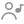 `default`  `default@2x` | 24 x 24, 48 x 48 |
| `audio` |  `active`  `default`  `default@2x` | 24 x 24, 48 x 48 |
| `backward-10-sec` |  `default` | 24 x 24 |
| `backward-15-sec` |  `default` | 24 x 24 |
| `bookmark` |  `default` | 24 x 24 |
| `bookmarks` |  `default` | 24 x 24 |
| `capture-device` |  `default` | 24 x 24 |
| `cast` |  `default`  `large` | 24 x 24, 96 x 96 |
| `chapters` |  `default` | 24 x 24 |
| `check` |  `active`  `default`  `selected` | 24 x 24 |
| `chevron-down` |  `default` | 24 x 24 |
| `chevron-right` |  `default` | 24 x 24 |
| `close` |  `default`  `default@2x` | 24 x 24, 48 x 48 |
| `collapse-sidebar` |  `default` | 24 x 24 |
| `disc` |  `default`  `default@2x` | 24 x 24, 48 x 48 |
| `divider` |  `default` | 24 x 24 |
| `edit` |  `default`  `dim` | 24 x 24 |
| `EQ` |  `default` | 24 x 24 |
| `eq-classical` |  `default-accent`  `default-grey`  `default` | 24 x 24 |
| `eq-club` |  `default-accent`  `default-grey`  `default` | 24 x 24 |
| `eq-dance` |  `default-accent`  `default-grey`  `default` | 24 x 24 |
| `eq-flat` |  `default-accent`  `default-grey`  `default` | 24 x 24 |
| `eq-fullbass` |  `default-accent`  `default-grey`  `default` | 24 x 24 |
| `eq-fullbasstreble` |  `default-accent`  `default-grey`  `default` | 24 x 24 |
| `eq-fulltreble` |  `default-accent`  `default-grey`  `default` | 24 x 24 |
| `eq-headphones` |  `default-accent`  `default-grey`  `default` | 24 x 24 |
| `eq-largehall` |  `default-accent`  `default-grey`  `default` | 24 x 24 |
| `eq-live` | 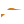 `default-accent`  `default-grey`  `default` | 24 x 24 |
| `eq-party` | 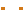 `default-accent`  `default-grey`  `default` | 24 x 24 |
| `eq-pop` |  `default-accent`  `default-grey`  `default` | 24 x 24 |
| `eq-reggae` |  `default-accent`  `default-grey` 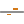 `default` | 24 x 24 |
| `eq-rock` |  `default-accent`  `default-grey`  `default` | 24 x 24 |
| `eq-ska` |  `default-accent`  `default-grey`  `default` | 24 x 24 |
| `eq-soft` |  `default-accent`  `default-grey`  `default` | 24 x 24 |
| `eq-softrock` |  `default-accent`  `default-grey`  `default` | 24 x 24 |
| `eq-techno` |  `default-accent`  `default-grey`  `default` | 24 x 24 |
| `expand-sidebar` |  `default` | 24 x 24 |
| `favorite` |  `active`  `default`  `default@2x` | 24 x 24, 48 x 48 |
| `file` |  `default` | 24 x 24 |
| `folder` |  `active`  `default`  `large`  `selected` | 24 x 24, 48 x 48 |
| `forward-10-sec` | 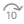 `default` | 24 x 24 |
| `forward-15-sec` |  `default` | 24 x 24 |
| `fullscreen` |  `active`  `default`  `default@2x` | 24 x 24, 48 x 48 |
| `genre` |  `default` | 24 x 24 |
| `grid` |  `default`  `dim` | 24 x 24 |
| `HDR` |  `default` | 24 x 24 |
| `home` |  `active`  `default`  `default@2x`  `selected` | 24 x 24, 48 x 48 |
| `hotkeys` |  `active`  `default`  `default@2x` | 24 x 24, 48 x 48 |
| `info` |  `default`  `default@2x` | 24 x 24, 48 x 48 |
| `interface` |  `active`  `default` | 24 x 24 |
| `link` |  `active`  `default` | 24 x 24 |
| `list` |  `default`  `dim` | 24 x 24 |
| `lists` |  `active`  `default`  `default@2x` | 24 x 24, 48 x 48 |
| `maximize` |  `default`  `default@2x` | 24 x 24, 48 x 48 |
| `minimize` |  `default`  `default@2x` | 24 x 24, 48 x 48 |
| `more` |  `default`  `dim` | 24 x 24 |
| `move` |  `default` | 24 x 24 |
| `music` |  `default` | 24 x 24 |
| `new-folder` |  `default` | 24 x 24 |
| `next` |  `default`  `default@2x` | 24 x 24, 48 x 48 |
| `open` |  `default`  `dim` | 24 x 24 |
| `paint` |  `active`  `default` | 24 x 24 |
| `pause` |  `default` | 24 x 24 |
| `PiP` |  `default` | 24 x 24 |
| `play` |  `default`  `default@2x`  `outline-active` | 24 x 24, 48 x 48 |
| `playback` |  `active`  `default` | 24 x 24 |
| `playback-settings` |  `active`  `default`  `default@2x` | 24 x 24, 48 x 48 |
| `playlist` |  `active`  `default`  `default@2x` | 24 x 24, 48 x 48 |
| `plugins` |  `active`  `default` | 24 x 24 |
| `preferences` | 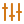 `active` 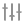 `default` | 24 x 24 |
| `previous` |  `default`  `default@2x` | 24 x 24, 48 x 48 |
| `privacy` |  `active`  `default` | 24 x 24 |
| `profile` |  `default`  `default@2x` | 24 x 24, 48 x 48 |
| `queue` |  `default`  `default@2x` | 24 x 24, 48 x 48 |
| `quit` |  `default`  `default@2x` | 24 x 24, 48 x 48 |
| `recent` |  `active-accent`  `active-accent@2x`  `active-grey`  `active-grey@2x`  `active`  `active@2x`  `default`  `default@2x` | 24 x 24, 48 x 48 |
| `record` |  `active`  `default` | 24 x 24 |
| `refresh` |  `default` | 24 x 24 |
| `remove` |  `default`  `default@2x` | 24 x 24, 48 x 48 |
| `repeat` |  `active`  `default` | 24 x 24 |
| `replay` |  `default` | 24 x 24 |
| `right-sidebar` |  `default` | 24 x 24 |
| `save` |  `default` | 24 x 24 |
| `scope` |  `default-accent` 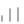 `default-grey`  `default` | 24 x 24 |
| `search` |  `default`  `default@2x`  `dim`  `dim@2x` | 24 x 24, 48 x 48 |
| `settings` |  `active`  `default`  `default@2x` | 24 x 24, 48 x 48 |
| `shuffle` |  `active`  `default` | 24 x 24 |
| `sidebar` |  `active`  `default` | 24 x 24 |
| `snapshot` |  `default` | 24 x 24 |
| `songs` |  `active`  `default`  `selected` | 24 x 24 |
| `sort` |  `active-accent`  `active-grey`  `active`  `default`  `dim` | 24 x 24, 26 x 25 |
| `spectrometer` |  `default-accent`  `default-grey`  `default` | 24 x 24 |
| `spectrum` |  `default-accent`  `default-grey` 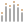 `default`  `dim` | 24 x 24 |
| `speed` |  `active`  `default` | 24 x 24 |
| `stop` |  `default` | 24 x 24 |
| `streaming` |  `active`  `default`  `selected` | 24 x 24 |
| `subtitle` |  `default`  `dim` | 24 x 24 |
| `subtitles` |  `active`  `default`  `default@2x` | 24 x 24, 48 x 48 |
| `swap` |  `default` | 24 x 24 |
| `thumbnail` |  `default` | 24 x 24 |
| `tv` |  `active`  `default`  `selected` | 24 x 24 |
| `ui` |  `default-accent`  `default-accent@2x`  `default-grey`  `default-grey@2x`  `default`  `default@2x` | 24 x 24, 48 x 48 |
| `video` |  `active`  `default`  `dim` | 24 x 24 |
| `videos` |  `active`  `default`  `selected` | 24 x 24 |
| `view` |  `active`  `default` | 24 x 24, 26 x 25 |
| `vumeter` | 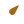 `default-accent`  `default-grey`  `default` | 24 x 24 |
| `waveform` |  `default-accent`  `default-grey` 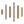 `default` | 24 x 24 |
| `window` |  `default` | 24 x 24 |
| `wrench` |  `default` | 24 x 24 |
| `zoom` |  `default` | 24 x 24 |

## glyphs-svg (`svg/glyphs/`, 116 icons, 224 files)

SVG sources of the glyphs, from the same Figma symbols (42:356), one per PNG state (design/tools/icon_svgs.py; its report icon_svgs_report.md compares them with the PNGs). 24 x 24 unless noted, Figma's colours of each state. The app draws these, at the size shown; it ships no PNG of them.

| Icon | States | Size |
|---|---|---|
| `0` |  `default` | 24 x 24 |
| `accessibility` |  `default` | 24 x 24 |
| `add` |  `default`  `half` | 24 x 24 |
| `album` |  `default` | 24 x 24 |
| `arrow-left` |  `default`  `disabled` | 24 x 24 |
| `arrow-right` |  `default`  `disabled` | 24 x 24 |
| `artist` |  `active` 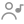 `default` | 24 x 24 |
| `audio` |  `active`  `default` | 24 x 24 |
| `backward-10-sec` |  `default` | 24 x 24 |
| `backward-15-sec` |  `default` | 24 x 24 |
| `bookmark` |  `default` | 24 x 24 |
| `bookmarks` |  `default` | 24 x 24 |
| `capture-device` |  `default` | 24 x 24 |
| `cast` |  `default`  `large` | 24 x 24, 96 x 96 |
| `chapters` |  `default` | 24 x 24 |
| `check` |  `active`  `default`  `selected` | 24 x 24 |
| `chevron-down` |  `default` | 24 x 24 |
| `chevron-right` |  `default` | 24 x 24 |
| `close` |  `default` | 24 x 24 |
| `collapse-sidebar` |  `default` | 24 x 24 |
| `disc` |  `default` | 24 x 24 |
| `divider` |  `default` | 24 x 24 |
| `edit` |  `default`  `dim` | 24 x 24 |
| `EQ` |  `default` | 24 x 24 |
| `eq-classical` |  `default-accent`  `default-grey`  `default` | 24 x 24 |
| `eq-club` |  `default-accent`  `default-grey`  `default` | 24 x 24 |
| `eq-dance` |  `default-accent`  `default-grey`  `default` | 24 x 24 |
| `eq-flat` |  `default-accent`  `default-grey`  `default` | 24 x 24 |
| `eq-fullbass` |  `default-accent`  `default-grey`  `default` | 24 x 24 |
| `eq-fullbasstreble` |  `default-accent`  `default-grey`  `default` | 24 x 24 |
| `eq-fulltreble` |  `default-accent`  `default-grey`  `default` | 24 x 24 |
| `eq-headphones` |  `default-accent`  `default-grey`  `default` | 24 x 24 |
| `eq-largehall` |  `default-accent`  `default-grey`  `default` | 24 x 24 |
| `eq-live` | 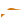 `default-accent`  `default-grey`  `default` | 24 x 24 |
| `eq-party` |  `default-accent`  `default-grey` 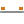 `default` | 24 x 24 |
| `eq-pop` |  `default-accent`  `default-grey`  `default` | 24 x 24 |
| `eq-reggae` |  `default-accent`  `default-grey`  `default` | 24 x 24 |
| `eq-rock` |  `default-accent`  `default-grey`  `default` | 24 x 24 |
| `eq-ska` |  `default-accent`  `default-grey`  `default` | 24 x 24 |
| `eq-soft` |  `default-accent`  `default-grey`  `default` | 24 x 24 |
| `eq-softrock` |  `default-accent`  `default-grey`  `default` | 24 x 24 |
| `eq-techno` |  `default-accent`  `default-grey`  `default` | 24 x 24 |
| `expand-sidebar` |  `default` | 24 x 24 |
| `favorite` |  `active`  `default` | 24 x 24 |
| `file` |  `default` | 24 x 24 |
| `folder` |  `active`  `default`  `large`  `selected` | 24 x 24, 48 x 48 |
| `forward-10-sec` |  `default` | 24 x 24 |
| `forward-15-sec` |  `default` | 24 x 24 |
| `fullscreen` |  `active`  `default` | 24 x 24 |
| `genre` |  `default` | 24 x 24 |
| `grid` |  `default`  `dim` | 24 x 24 |
| `HDR` |  `default` | 24 x 24 |
| `home` |  `active`  `default`  `selected` | 24 x 24 |
| `hotkeys` |  `active`  `default` | 24 x 24 |
| `info` |  `default` | 24 x 24 |
| `interface` |  `active`  `default` | 24 x 24 |
| `link` |  `active`  `default` | 24 x 24 |
| `list` |  `default` 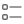 `dim` | 24 x 24 |
| `lists` |  `active`  `default` | 24 x 24 |
| `maximize` |  `default` | 24 x 24 |
| `minimize` |  `default` | 24 x 24 |
| `more` |  `default`  `dim` | 24 x 24 |
| `move` |  `default` | 24 x 24 |
| `music` |  `default` | 24 x 24 |
| `new-folder` |  `default` | 24 x 24 |
| `next` |  `default` | 24 x 24 |
| `open` |  `default`  `dim` | 24 x 24 |
| `paint` |  `active`  `default` | 24 x 24 |
| `pause` |  `default` | 24 x 24 |
| `PiP` |  `default` | 24 x 24 |
| `play` |  `default`  `outline-active` | 24 x 24 |
| `playback` |  `active`  `default` | 24 x 24 |
| `playback-settings` |  `active`  `default` | 24 x 24 |
| `playlist` |  `active`  `default` | 24 x 24 |
| `plugins` |  `active`  `default` | 24 x 24 |
| `preferences` | 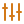 `active` 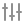 `default` | 24 x 24 |
| `previous` |  `default` | 24 x 24 |
| `privacy` |  `active`  `default` | 24 x 24 |
| `profile` |  `default` | 24 x 24 |
| `queue` |  `default` | 24 x 24 |
| `quit` |  `default` | 24 x 24 |
| `recent` |  `active-accent`  `active-grey`  `active`  `default` | 24 x 24 |
| `record` |  `active`  `default` | 24 x 24 |
| `refresh` |  `default` | 24 x 24 |
| `remove` |  `default` | 24 x 24 |
| `repeat` |  `active`  `default` | 24 x 24 |
| `replay` |  `default` | 24 x 24 |
| `right-sidebar` |  `default` | 24 x 24 |
| `save` |  `default` | 24 x 24 |
| `scope` |  `default-accent`  `default-grey` 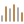 `default` | 24 x 24 |
| `search` |  `default`  `dim` | 24 x 24 |
| `settings` |  `active`  `default` | 24 x 24 |
| `shuffle` |  `active`  `default` | 24 x 24 |
| `sidebar` |  `active`  `default` | 24 x 24 |
| `snapshot` |  `default` | 24 x 24 |
| `songs` |  `active`  `default`  `selected` | 24 x 24 |
| `sort` |  `active-accent`  `active-grey`  `active`  `default`  `dim` | 24 x 24, 26 x 25 |
| `spectrometer` |  `default-accent`  `default-grey`  `default` | 24 x 24 |
| `spectrum` | 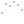 `default-accent` 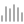 `default-grey`  `default` 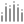 `dim` | 24 x 24 |
| `speed` |  `active`  `default` | 24 x 24 |
| `stop` |  `default` | 24 x 24 |
| `streaming` |  `active`  `default`  `selected` | 24 x 24 |
| `subtitle` |  `default`  `dim` | 24 x 24 |
| `subtitles` |  `active`  `default` | 24 x 24 |
| `swap` |  `default` | 24 x 24 |
| `thumbnail` |  `default` | 24 x 24 |
| `tv` |  `active`  `default`  `selected` | 24 x 24 |
| `ui` | 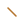 `default-accent`  `default-grey`  `default` | 24 x 24 |
| `video` |  `active`  `default`  `dim` | 24 x 24 |
| `videos` |  `active`  `default`  `selected` | 24 x 24 |
| `view` |  `active`  `default` | 24 x 24, 26 x 25 |
| `vumeter` | 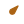 `default-accent`  `default-grey`  `default` | 24 x 24 |
| `waveform` |  `default-accent`  `default-grey` 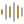 `default` | 24 x 24 |
| `window` |  `default` | 24 x 24 |
| `wrench` |  `default` | 24 x 24 |
| `zoom` |  `default` | 24 x 24 |

## svg (`svg/`, 57 icons, 57 files)

SVG icons of the top bar, the sidebar and the player, and the SVG of each raster piece of images/ (same name; design/tools/raster_svgs.json says which Figma node each comes from).

| Icon | States | Size |
|---|---|---|
| `add` |  `default` | 24 x 24 |
| `arrow-left` |  `default` | 24 x 24 |
| `arrow-right` |  `default` | 24 x 24 |
| `artist` |  `default` | 24 x 24 |
| `close` |  `default` | 24 x 24 |
| `equalizer` |  `default` | 24 x 24 |
| `folder` |  `default` | 24 x 24 |
| `fullscreen` |  `default` | 24 x 24 |
| `grid` |  `default` | 24 x 24 |
| `home` |  `default` | 24 x 24 |
| `line-vertical` |  `default` | 24 x 24 |
| `list` | 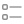 `default` | 24 x 24 |
| `logo` |  `default` | 24 x 24 |
| `maximize` |  `default` | 24 x 24 |
| `menu` |  `default` | 18 x 18 |
| `mini-queue` |  `default` | 24 x 24 |
| `minimize` |  `default` | 24 x 24 |
| `music` |  `default` | 24 x 24 |
| `network` |  `default` | 24 x 24 |
| `next` |  `default` | 24 x 24 |
| `play` |  `default` | 24 x 24 |
| `player-settings` |  `default` | 24 x 24 |
| `playlists` |  `default` | 24 x 24 |
| `previous` |  `default` | 24 x 24 |
| `queue` |  `default` | 24 x 24 |
| `recent` |  `default` | 24 x 24 |
| `search` |  `default` | 24 x 24 |
| `settings` |  `default` | 24 x 24 |
| `sidebar` |  `default` | 18 x 18 |
| `sort` |  `default` | 26 x 25 |
| `subtitle-file` |  `default` | 24 x 24 |
| `subtitles` |  `default` | 24 x 24 |
| `theme-bar-knob` |  `default` | 12 x 20 |
| `theme-bar-mask` |  `default` | 1056 x 30 |
| `theme-bar-pill` |  `default` | 40 x 24 |
| `theme-bar-play` |  `default` | 14 x 14 |
| `theme-strip-buttons` |  `default` | 1056 x 22 |
| `theme-strip-cone` |  `default` | 1056 x 22 |
| `theme-system` |  `default` | 100 x 100 |
| `track-audio` |  `default` | 24 x 24 |
| `track-audio-active` |  `default` | 24 x 24 |
| `track-check-active` |  `default` | 24 x 24 |
| `track-subtitles` |  `default` | 24 x 24 |
| `track-subtitles-active` |  `default` | 24 x 24 |
| `track-video` |  `default` | 24 x 24 |
| `track-video-active` |  `default` | 24 x 24 |
| `tv` |  `default` | 24 x 24 |
| `video` |  `default` | 24 x 24 |
| `volume` |  `default` | 24 x 24 |
| `volume-background` |  `default` | 89 x 27.3633 |
| `volume-fill` |  `default` | 86 x 24.56 |
| `volume-high` |  `default` | 24 x 24 |
| `volume-low` |  `default` | 24 x 24 |
| `volume-mask` |  `default` | 33 x 30 |
| `volume-medium` |  `default` | 24 x 24 |
| `volume-muted` |  `default` | 24 x 24 |
| `welcome` |  `default` | 141 x 141 |

## player-svg (`player/svg/`, 21 icons, 21 files)

SVG of each player and window-frame piece of player/ (same name, from Figma; raster_svgs.json).

| Icon | States | Size |
|---|---|---|
| `close` |  `default` | 24 x 24 |
| `corner-bl-dark` |  `default` | 9 x 9 |
| `corner-bl-light` |  `default` | 9 x 9 |
| `corner-br-dark` |  `default` | 9 x 9 |
| `corner-br-light` |  `default` | 9 x 9 |
| `corner-tl-dark` |  `default` | 9 x 9 |
| `corner-tl-light` |  `default` | 9 x 9 |
| `corner-tr-dark` |  `default` | 9 x 9 |
| `corner-tr-light` |  `default` | 9 x 9 |
| `equalizer` |  `default` | 24 x 24 |
| `fullscreen` |  `default` | 24 x 24 |
| `library-add` |  `default` | 32 x 32 |
| `library-playlist` |  `default` | 32 x 32 |
| `maximize` |  `default` | 24 x 24 |
| `minimize` |  `default` | 24 x 24 |
| `next` |  `default` | 24 x 24 |
| `pause` |  `default` | 24 x 24 |
| `previous` |  `default` | 24 x 24 |
| `queue` |  `default` | 24 x 24 |
| `settings` |  `default` | 24 x 24 |
| `subtitles` |  `default` | 24 x 24 |

## duo (`svg/duo/`, 56 icons, 56 files)

Two-tone menu icons. Placeholder colours (ColorizedSvgIcon): #FF00FF = outline (Dark/FG/A2 #8F8F8F, light #2E2E2E), #FF8800 = details (Accent Dim), #00FFFF = the full accent.

| Icon | States | Size |
|---|---|---|
| `add` |  `default` | 24 x 24 |
| `album` |  `default` | 24 x 24 |
| `audio` |  `default` | 24 x 24 |
| `backward-10` | 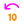 `default` | 24 x 24 |
| `capture-device` |  `default` | 24 x 24 |
| `close` |  `default` | 24 x 24 |
| `disc` | 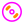 `default` | 24 x 24 |
| `edit` |  `default` | 24 x 24 |
| `export` |  `default` | 24 x 24 |
| `faster` | 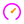 `default` | 24 x 24 |
| `favorite` |  `default` | 24 x 24 |
| `file` | 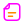 `default` | 24 x 24 |
| `folder` |  `default` | 24 x 24 |
| `folder-add` |  `default` | 24 x 24 |
| `folder-open` |  `default` | 24 x 24 |
| `forward-10` | 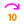 `default` | 24 x 24 |
| `go-to` |  `default` | 24 x 24 |
| `help` |  `default` | 24 x 24 |
| `hotkeys` | 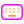 `default` | 24 x 24 |
| `info` |  `default` | 24 x 24 |
| `info-small` |  `default` | 18 x 18 |
| `lists` |  `default` | 24 x 24 |
| `mark-watched` |  `default` | 24 x 24 |
| `next` |  `default` | 24 x 24 |
| `open` | 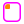 `default` | 24 x 24 |
| `paint` | 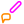 `default` | 24 x 24 |
| `pause` |  `default` | 24 x 24 |
| `play` |  `default` | 24 x 24 |
| `playback` | 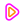 `default` | 24 x 24 |
| `playback-settings` | 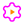 `default` | 24 x 24 |
| `playlist` |  `default` | 24 x 24 |
| `plugins` |  `default` | 24 x 24 |
| `previous` |  `default` | 24 x 24 |
| `profile` | 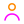 `default` | 24 x 24 |
| `queue` |  `default` | 24 x 24 |
| `quit` |  `default` | 24 x 24 |
| `recent` | 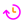 `default` | 24 x 24 |
| `record` |  `default` | 24 x 24 |
| `remove` |  `default` | 24 x 24 |
| `settings` | 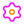 `default` | 24 x 24 |
| `shuffle` | 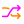 `default` | 24 x 24 |
| `slower` | 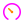 `default` | 24 x 24 |
| `spectrum` |  `default` | 24 x 24 |
| `stop` |  `default` | 24 x 24 |
| `streaming` | 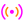 `default` | 24 x 24 |
| `subtitle` |  `default` | 24 x 24 |
| `subtitles` |  `default` | 24 x 24 |
| `swap` |  `default` | 24 x 24 |
| `sync` |  `default` | 24 x 24 |
| `tv` |  `default` | 24 x 24 |
| `ui` |  `default` | 24 x 24 |
| `video` |  `default` | 24 x 24 |
| `view` |  `default` | 24 x 24 |
| `volume-high` |  `default` | 24 x 24 |
| `volume-low` |  `default` | 24 x 24 |
| `volume-muted` |  `default` | 24 x 24 |

## widgets (`svg/widgets/`, 11 icons, 11 files)

Chevrons and checks of the classic (widget) dialogs, one file per theme and state.

| Icon | States | Size |
|---|---|---|
| `check` |  `default` | 16 x 16 |
| `chevron-down-dark` |  `default` | 24 x 24 |
| `chevron-down-disabled-dark` |  `default` | 24 x 24 |
| `chevron-down-disabled-light` |  `default` | 24 x 24 |
| `chevron-down-light` |  `default` | 24 x 24 |
| `chevron-right-dark` |  `default` | 24 x 24 |
| `chevron-right-light` |  `default` | 24 x 24 |
| `chevron-up-dark` |  `default` | 24 x 24 |
| `chevron-up-disabled-dark` |  `default` | 24 x 24 |
| `chevron-up-disabled-light` |  `default` | 24 x 24 |
| `chevron-up-light` |  `default` | 24 x 24 |

## player (`player/`, 21 icons, 21 files)

Raster player and window-frame pieces (corners per theme).

| Icon | States | Size |
|---|---|---|
| `close` |  `default` | 24 x 24 |
| `corner-bl-dark` |  `default` | 9 x 9 |
| `corner-bl-light` |  `default` | 9 x 9 |
| `corner-br-dark` |  `default` | 9 x 9 |
| `corner-br-light` |  `default` | 9 x 9 |
| `corner-tl-dark` |  `default` | 9 x 9 |
| `corner-tl-light` |  `default` | 9 x 9 |
| `corner-tr-dark` |  `default` | 9 x 9 |
| `corner-tr-light` |  `default` | 9 x 9 |
| `equalizer` |  `default` | 24 x 24 |
| `fullscreen` |  `default` | 24 x 24 |
| `library-add` |  `default` | 32 x 32 |
| `library-playlist` |  `default` | 32 x 32 |
| `maximize` |  `default` | 24 x 24 |
| `minimize` |  `default` | 24 x 24 |
| `next` |  `default` | 24 x 24 |
| `pause` |  `default` | 24 x 24 |
| `previous` |  `default` | 24 x 24 |
| `queue` |  `default` | 24 x 24 |
| `settings` |  `default` | 24 x 24 |
| `subtitles` |  `default` | 24 x 24 |

## images (`images/`, 21 icons, 21 files)

Other raster pieces: onboarding theme previews, track icons, volume states, list/grid toggles.

| Icon | States | Size |
|---|---|---|
| `grid` |  `default` | 24 x 24 |
| `list` | 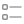 `default` | 24 x 24 |
| `subtitle-file` |  `default` | 24 x 24 |
| `theme-bar-knob` |  `default` | 12 x 20 |
| `theme-bar-mask` |  `default` | 1056 x 30 |
| `theme-bar-pill` |  `default` | 40 x 24 |
| `theme-bar-play` |  `default` | 14 x 14 |
| `theme-strip-buttons` |  `default` | 1056 x 22 |
| `theme-strip-cone` |  `default` | 1056 x 22 |
| `theme-system` |  `default` | 100 x 100 |
| `track-audio` |  `default` | 24 x 24 |
| `track-audio-active` |  `default` | 24 x 24 |
| `track-check-active` |  `default` | 24 x 24 |
| `track-subtitles` |  `default` | 24 x 24 |
| `track-subtitles-active` |  `default` | 24 x 24 |
| `track-video` |  `default` | 24 x 24 |
| `track-video-active` |  `default` | 24 x 24 |
| `volume-high` |  `default` | 24 x 24 |
| `volume-low` |  `default` | 24 x 24 |
| `volume-medium` |  `default` | 24 x 24 |
| `volume-muted` |  `default` | 24 x 24 |

