# VLC Redesign 0.3.0

## 🎨 Design by [Juxtopposed](https://www.youtube.com/@juxtopposed)

Every screen of this interface was designed by **Juxtopposed**. ▶ **[Watch the video: *I Redesigned VLC After 25 Years*](https://www.youtube.com/watch?v=ERFeOgqk324)** · the ["VLC Redesign (Community)"](https://www.figma.com/community/file/1691465999134370980) Figma file, [CC BY 4.0](https://creativecommons.org/licenses/by/4.0/) · Juxtopposed does not endorse this project.

---

Casting to a TV, the library next to the video, effect presets, new settings, surround sound that stays in place,
and memory that stays flat over long sessions. Every change, with its technical details, is in the
[changelog](https://github.com/KuchiSofts/vlc-redesign/blob/main/CHANGELOG.md).

## Highlights

### Casting to a TV

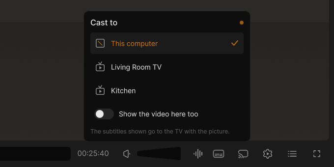

- **To the last picture**: a film cast to a TV now plays there to its end, also with a subtitle file beside it and
  for the next film of a playlist. The last seconds of a film were dropped before.
- **Starts once**: the TV starts with the picture and the sound together. It no longer loads a film twice and misses
  its first second, and a cast from the middle of a film no longer sends the sound alone first.
- **4K four times faster**: a 4K film converted for the TV is made smaller by the graphics card instead of the
  processor, so slower PCs keep up too. Each picture goes out as soon as it is made, and the conversion takes half the
  memory (280 MB instead of 570 for a 1080p film with subtitles).
- **Listed before you open the panel**: once you have cast, VLC looks for your TVs quietly while a video plays, so they
  are listed as soon as you click the cast button, with the one you used last at the top.
- **50 and 60 fps films** go to the TV at 25 and 30 frames per second when they are converted (they were brought to
  24 and juddered).
- **Samsung TVs**: a paused cast stays paused (the TV left the film with an error about 10 seconds into a pause), and
  a film the TV can play as it is goes as MPEG-TS (it played one second). A TV that stops such a film gets it converted
  instead of an error.

How to cast, and what to do when a TV does not play a file: [Casting](https://github.com/KuchiSofts/vlc-redesign/wiki/Casting)
in the wiki.

### The library next to the video goes everywhere the library does

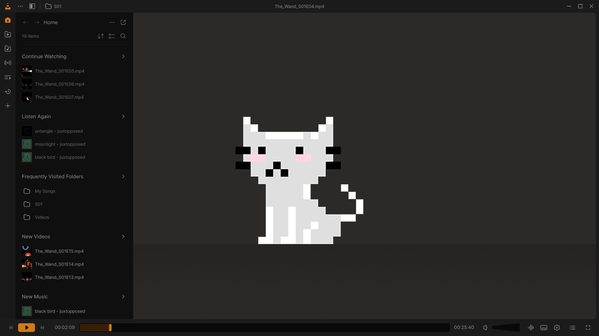

Home with the sections of the library's Home (a section's arrow lists all of it), *Videos* and its folders, *Music*
with Songs, Albums, Artists and Genres, and *Network* with *Add Network Stream* and the Internet services, each with its
⋯ menu (*Rescan library*, *Add folder to library*, *Add network stream*). Home is listed in Home's order, and *Videos*
lists the folders that hold videos.

### The menus of the design in the library

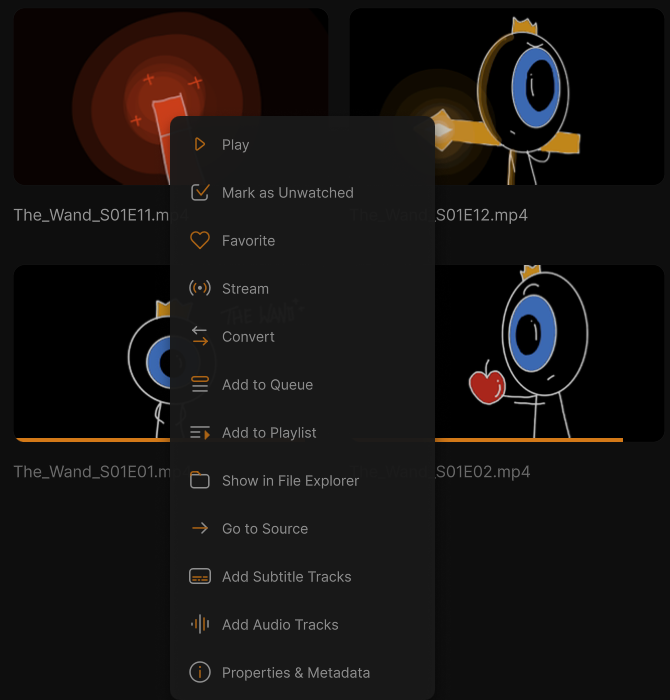

A right-click on a video, a song, a folder, a file or a playlist opens the menu card of the design, with
*Mark as Watched* / *Unwatched* and *Show in File Explorer*.

### Effect presets

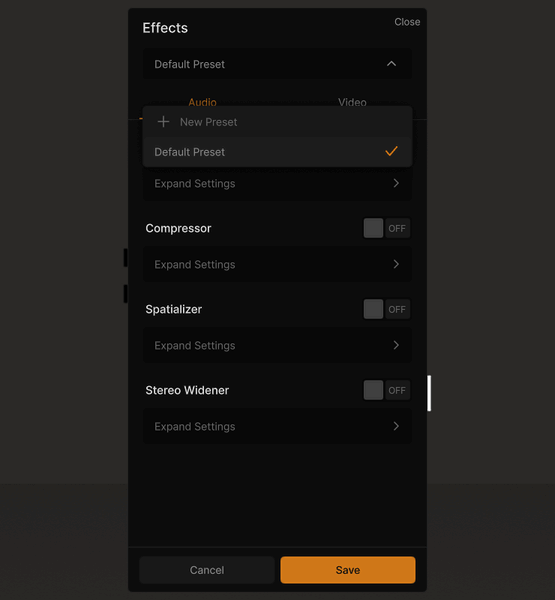

The Effects window keeps sets of audio and video effects under a name. *New Preset* saves the effects playing, a
preset applies them (*Save* keeps them, *Cancel* drops them), its ⋯ renames, updates or deletes it, and
*Default Preset* turns every effect off.

### More video effects

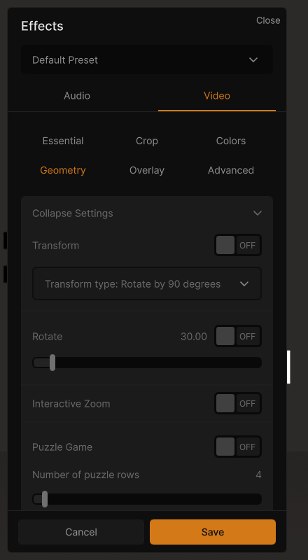

The *Geometry* (transform, rotate, interactive zoom, puzzle), *Overlay* (logo, text, logo erase) and *Advanced*
(anaglyph 3D, mirror, psychedelic, waves, water, motion detect, blur, motion blur, anti-flickering, denoiser) effects of
the classic dialog are in the effects of the redesign. *Edge detection* no longer crashes VLC and shows the edges, and
*Anaglyph*, *Anti-flicker*, *Motion detection*, *Ripple* and *Waves* no longer crash after *Puzzle* or *Waves* (the same
in VLC 4 itself). 40 effects were checked alone and in chains.

### Type a time to go to

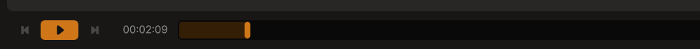

A click on the time of the bar makes it a field: type 1:02:10, 62:10 or 130 and press Enter, as the design draws it.

### Always show the player bar

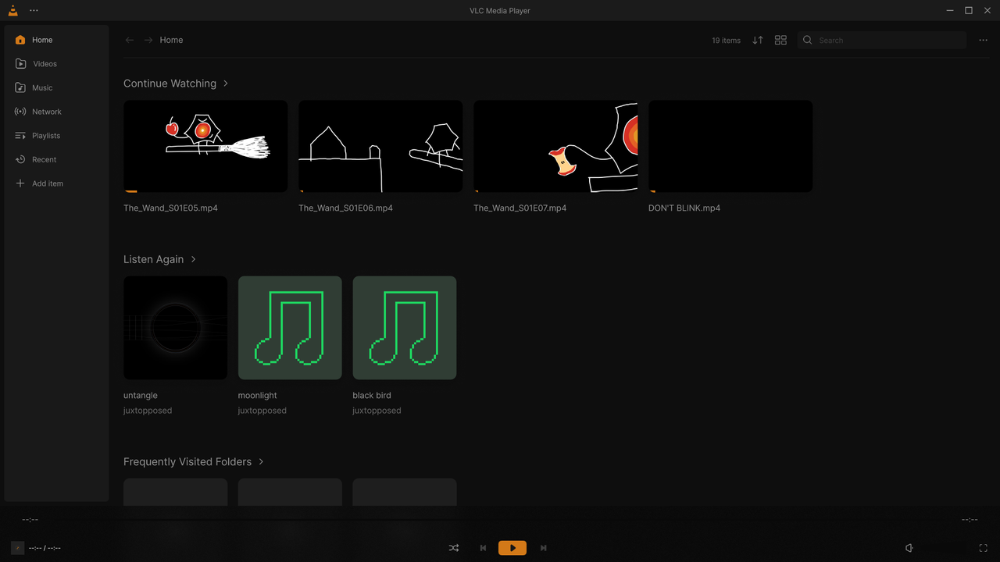

*Settings › Interface › Player Bar*: the bar stays at the bottom of Home and the library while nothing plays. Its Play
starts the play queue, or opens files when the queue is empty.

### Figma's pixel cat in the empty player

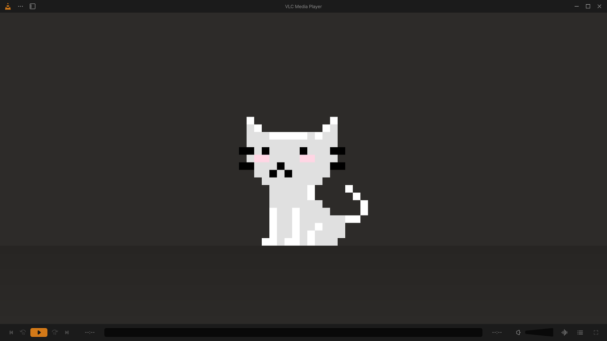

The player with nothing to play shows the picture of the design, the white cat on the floor of a dark room, drawn
sharp at any size (it uses no picture file or memory).

### New settings

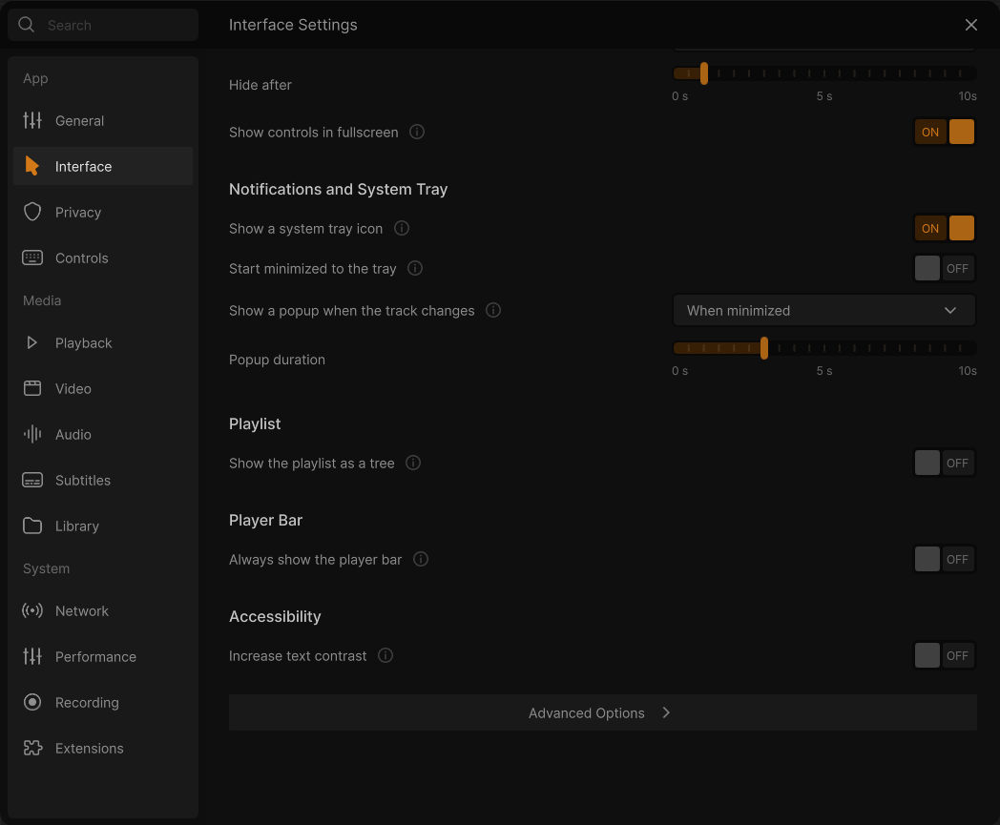

- *Show the playlist as a tree* (*Interface › Playlist*, the last row of the design): the queue shows its media under
  the folder (or the website) they come from.
- *Always show the player bar* and *Increase text contrast* (below).
- *Show confirmation and error dialogs*, *Show controls in fullscreen*, *Show cover art in the window when playing
  audio* and *Additional command line options*.
- The pages start as the design draws them: on the Subtitles page, *Preferred language* picks the language of the
  subtitles, and the second language, the online search and the subtitle services come after the sections of the
  design.
- Settings changed just before quitting VLC are kept (they were lost when VLC quit with the window still open).

Every new row, page by page: [Settings](https://github.com/KuchiSofts/vlc-redesign/wiki/Settings) in the wiki.

### Increase text contrast

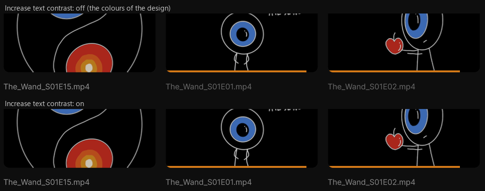

*Settings › Interface › Accessibility*: the dim texts of the design (hints, descriptions, watched videos, the (i) icons)
are drawn brighter, to the contrast the WCAG accessibility guidelines ask for (AA, 4.5:1). It is off by default: the
colours of the design stay as they are.

### The light theme and your accent colour everywhere

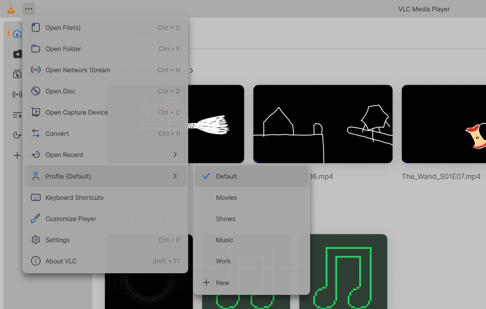

The windows the light theme left dark or hard to read follow it now: the tracks and subtitles window, the profiles
list, the welcome screens, the shortcut windows, the cast and visualizer windows, the mini queue, selected text, the
player customization and the effect sliders. Check marks, the icon of the current page and of the current settings
section take the accent colour chosen (green, blue…), not always orange.

### The older windows look like the rest

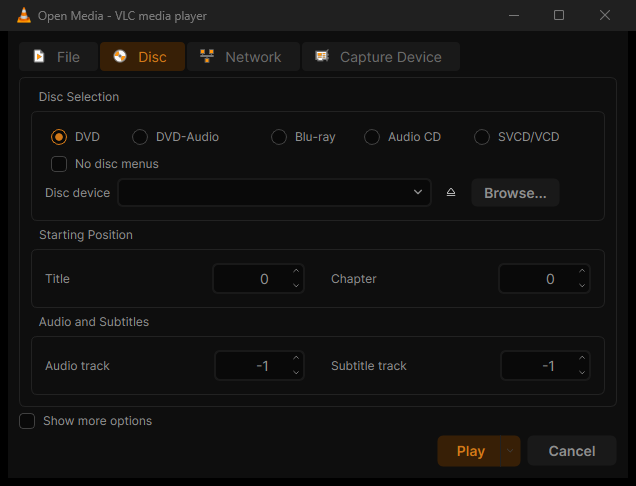

*Open Media*, *Convert*, *Media Information* and the other classic windows are drawn in the dark or light colours of
the redesign. A stray line under *No disc menus* in the Disc tab is gone.

### The visualizations of the design

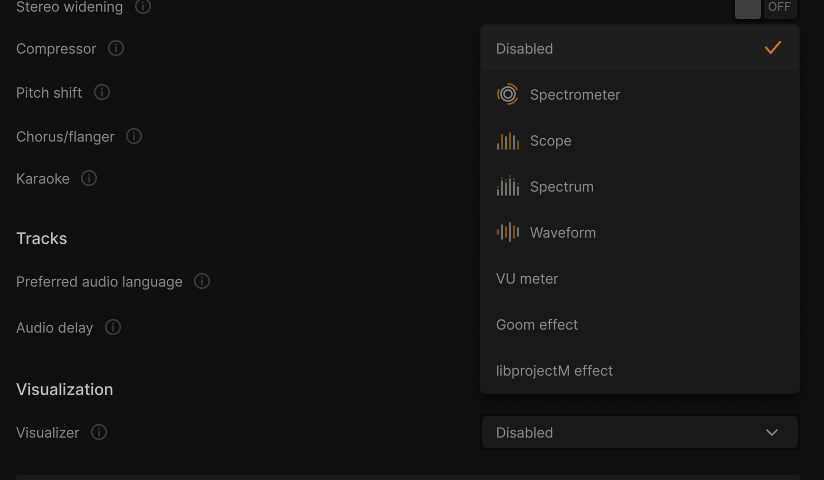

*Settings › Audio › Visualizer* offers Spectrometer, Scope, Spectrum, Waveform and VU meter, then VLC's other
visualizations (before: only "Visualizer filter"). HDR, the visualizer and the equalizer presets choose as the
design's dropdowns: the equalizer presets start with *None* and draw the curve of each preset.

## Also fixed

**Sound**
- 5.1 and 7.1 sound no longer jumps between speakers (voices moved between the centre and the side or rear speakers
  many times a second); 6.1 sound on a 7.1 device keeps its rear centre.
- Surround films on stereo headphones or speakers: every layout is mixed the same way now, as 5.1 already was.

**Opening, starting and quitting**
- A file opened from Explorer while VLC plays starts at once (in 0.1 s) and brings the window back, even minimized.
  Several files selected together: the first plays, the others follow.
- The first film after installing no longer plays under two questions: VLC opens no network ports at start (no
  Windows Firewall question), and the welcome waits for the next time VLC opens without a file.
- Opening a file never hangs, even when a VLC stopped answering, and the first file after installing opens quickly.
- Quitting after a film no longer takes up to 10 seconds after installing or updating.
- Starting a video decoded by the processor (older formats, or PCs without hardware decoding) is quicker.

**Stability**
- Memory no longer grows with every media change (about 70 KB each time): it stays flat over 400 changes.
- *Media › Convert/Save* of a video with its sound no longer crashes VLC (the same in VLC 4 itself): every format
  converts to the last picture.
- A damaged file no longer stops the playlist: 148 cut and damaged copies of 35 formats play without a crash or a hang.
- Raw video files (.yuv, .cif, .qcif… and .y4m) open.
- Changing some video effects (the strength of the spatial blur) no longer turns every effect off.
- Thumbnails come at once when VLC is set to start paused.

**Player**
- The file name in the player bar is the media playing, not the one before; a song's title, artist and album no longer
  stay on the next media.
- The subtitles window, and the menus of the ⋯ button and of the library's Sort, View and More buttons, close when
  their button is clicked again. A click outside a window or a list only closes it: a click on the video no longer
  pauses the film.
- A file opened paused shows 00:00:00 and its length, not "--:--".
- The seek bar of paused music follows a jump.
- HDR10+ and Dolby Vision show why they cannot be chosen (Windows offers no way for a player to send them).
- Keyboard shortcuts with several keys show each key whole (*Next track*: N, Shift+>, >).
- The rows of the player's menu are in line.

**Library**
- The library lists start A-Z (artists, albums, tracks, genres, playlists, videos, network folders); Home's lists keep
  the newest first, and an order you picked stays.
- *Listen Again* lists the last played first, as *Continue Watching*.
- A folder opened from *Videos* shows its name, not its path without separators.
- In a small window, the library panel and its section icons fit, the main menu shows that it scrolls, and a narrow
  player's bar keeps the same buttons at every start.

## Also changed

- **Windows 10 version 1809 or later**, the portable zip too (the interface, Qt 6.8, needs it). An older Windows 10
  says so when the portable copy starts.
- **The resume card** reads as in the design: "You've watched till 00:45:08 already." and one *Continue Watching* button.
- **Videos stopped partway stay bright** in the library: only the ones watched to the end are dimmed.
- **Home, the music player and Customize Player** as the design draws them; **the effects panels** too (*Reset* and
  *Two-pass* read in full).
- **The volume shows its value** ("100 %") in a box over the slider while it changes.
- **The frame preview of the seek bar** is the design's thumbnail: a larger frame (252 px) with the time under it.
- **No light squares in the dark theme**: music and videos without a picture get a dark placeholder.
- **Playlists**: *New playlist* takes a thumbnail of your own, a playlist can be saved with only its title, and
  *Properties & Metadata* shows its name, media, length and file.
- **The queue of the mini player** is part of its card: drag a row by its handle to move it.

## Updating

- **An update keeps your settings, the portable zip too**: a new version unpacked into another folder starts once with
  the settings, theme and accent, library, playlists, history and downloaded subtitles of the copy you used last
  (0.2.4 and later), when its own are still empty. The copy it came from stays as it was, and VLC's own settings are
  never taken. A copy with an empty file named `standalone` in its `portable` folder keeps to itself.
- Already on **0.2.4**, **0.2.5** or **0.2.6**? This update downloads only what changed (⋯ → About → *Check for
  updates*). From 0.2.3 or earlier, use the installer.

| | |
|---|---|
| **`vlc-redesign-0.3.0-win64-setup.exe`** | Recommended: per-user install, automatic updates |
| **`vlc-redesign-0.3.0-win64.zip`** | Portable |

[CHANGELOG](https://github.com/KuchiSofts/vlc-redesign/blob/main/CHANGELOG.md) · [ROADMAP](https://github.com/KuchiSofts/vlc-redesign/blob/main/ROADMAP.md) · [Wiki](https://github.com/KuchiSofts/vlc-redesign/wiki) · SHA-256 in `SHA256SUMS.txt`

---

**Unofficial build**, not affiliated with or endorsed by [VideoLAN](https://www.videolan.org/). *VLC* and the cone are VideoLAN trademarks. GPL v2 or later; source: the `v0.3.0` tag.
