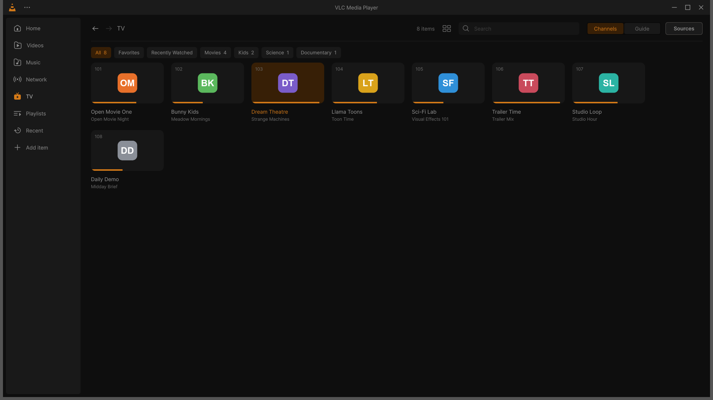
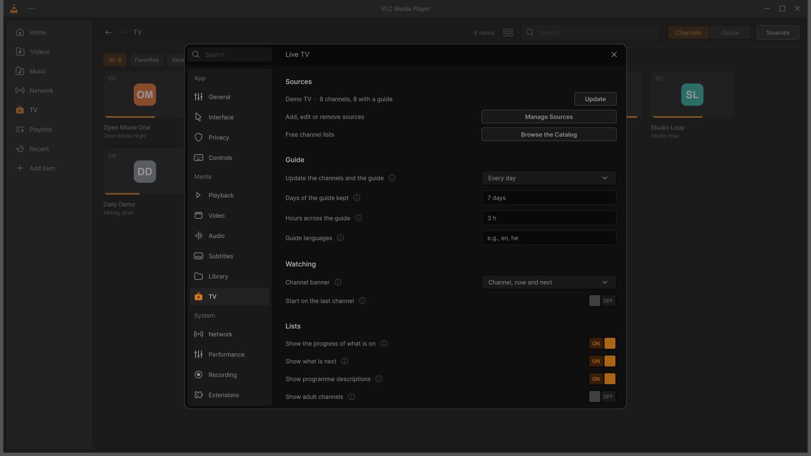
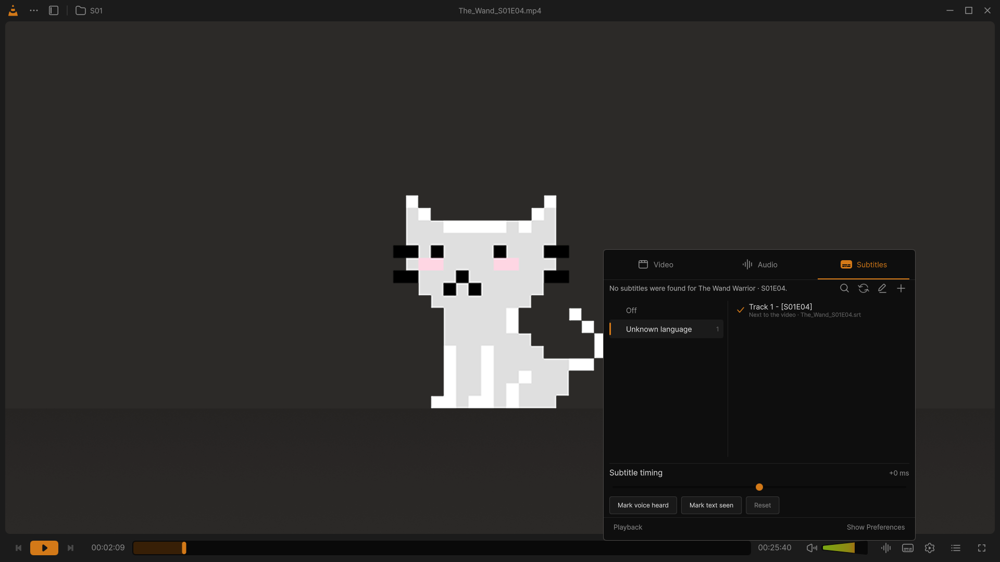
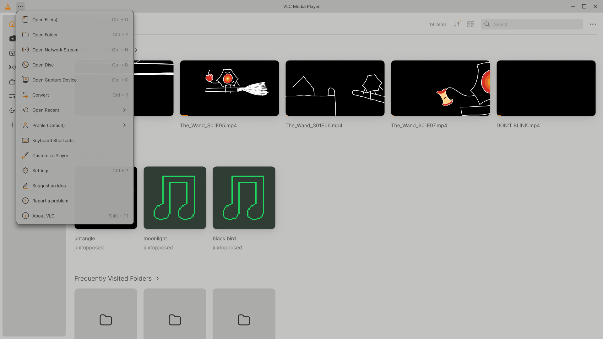
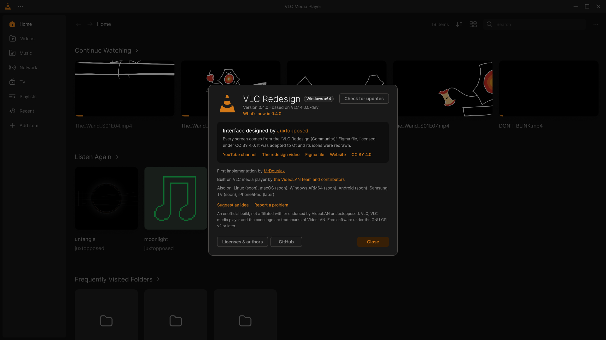

# VLC Redesign 0.4.0

<!-- DRAFT: not dated, not published. Before the upload: the date, the file table (release-notes.py writes it
     with the checksums), the Android row confirmed by the owner. The five screenshots are of the
     0.4.0 build with the demo library of the Figma frames and a made-up TV provider (nothing personal,
     no broadcaster's content). -->

## 🎨 Design by [Juxtopposed](https://www.youtube.com/@juxtopposed)

Every screen of this interface was designed by **Juxtopposed**. ▶ **[Watch the video: *I Redesigned VLC After 25 Years*](https://www.youtube.com/watch?v=ERFeOgqk324)** · the ["VLC Redesign (Community)"](https://www.figma.com/community/file/1691465999134370980) Figma file, [CC BY 4.0](https://creativecommons.org/licenses/by/4.0/) · Juxtopposed does not endorse this project.

---

Live TV, your own order of the sidebar, subtitles that read right in every language, sharp icons at every size,
a frame around every window, and the first release for Linux and macOS, next to Windows. Every change, with its
technical details, is in the [changelog](https://github.com/KuchiSofts/vlc-redesign/blob/main/CHANGELOG.md).

## Highlights

### Live TV

Watch the channels of your own IPTV provider like on a TV box. **TV** in the sidebar lists them with their logos,
numbers and groups, what is on now (with its progress) and what is next, your favourites and the ones watched last;
**Guide** shows the programmes of every channel across the hours, with the line of now.

- **Your sources**: a playlist link or file (M3U, its guide found in it), an Xtream Codes login (with its films and
  series), a guide of your own (XMLTV, several merged), or one of the free, legal channel lists of the **catalog**
  in a click. *Suggest a Service* proposes a new one.
- **Like a TV box**: Page Up and Page Down change channel, type a number, Backspace goes back to the last channel,
  Enter shows the channel list over the video, and a banner shows what is on at every switch.
- **Catch-up**: past programmes play from the archive when the channel keeps one, *Watch from the Start* restarts
  the one on now, and a reminder tells when a programme starts.
- **Fast and private**: the guide is ready about half a second after VLC starts, even a guide of 200 MB; links and
  passwords stay in VLC's keystore, and a channel zapped leaves nothing in the library or the history.
- **An add-on**, on by default: *Live TV (IPTV) add-on* in Settings › General turns it off, and the installer can
  leave it out. Without it nothing of it shows.

How to add a source, the catalog and the keys: [Live TV](https://github.com/KuchiSofts/vlc-redesign/wiki/Live-TV)
in the wiki.

### The sidebar in your order

Drag the pages of the sidebar into your order (or use the arrows), hide the ones you do not use, or reset them:
right-click the sidebar, or *Settings › Interface › Sidebar*.

### Subtitles that read right

- **Every language, whatever its encoding**: Hebrew, Arabic, Russian, Greek, Japanese, Chinese, Korean, Thai and
  the rest are read right from old encodings too (Windows-1255, Shift-JIS…): 212 test files out of 212.
- **Right-to-left lines** in the right order, with their punctuation where it belongs (SRT and ASS).
- **Picture subtitles** (DVD, Blu-ray, DVB) stay smooth when the video is scaled.
- **Subtitle lines on the seek bar**: thin marks show where the lines of the subtitle file are; hovering the bar
  shows the line at that time.
- **Online subtitles only for the right film**: a subtitle found online is loaded by itself only when it was made
  for that very file or the title is sure; a guess from the file name alone waits in the list.
- **Subtitles only for films**: a live channel or music shows no subtitle search or sync.

### Sharp icons and a frame around every window

Every icon is drawn from the design's SVG at the size it is shown, at the screen's density: sharp at 100 to 200 %
 Windows scaling and when the interface is zoomed (at 100 % its 1.5 px lines match the design to the pixel).
Before, an icon was drawn for 100 % and stretched at 125 % and more.
Every dialog, menu, panel, list and tooltip has the thin frame of the main window, and text
buttons are framed so they never melt into their dialog.

### About, What's new, Suggest an idea, Report a problem

- **About** shows the system it runs on, *What's new in 0.4.0* and the credit of the design.
- **What's new** after an update: the highlights, once, the first time VLC opens.
- **Suggest an idea** and **Report a problem** at the end of the ⋯ menu: the GitHub form opens filled with what helps
  (versions, Windows, graphics card, screens), never anything personal, and nothing is sent by VLC.

### And more

- **Follow the Windows accent color** (*Settings › Appearance*): the interface takes the accent of Windows, and
  follows it when it changes.
- **Every message and question in the redesign's look**, and the classic windows with the redesign's title bar;
  *Go to Time*, *Plugins and extensions*, *Media Statistics* and *Folder information* redrawn.
- **Live TV on a DLNA TV**: a channel cast to a TV goes as one stream with its picture and its sound, also when it
  was already playing and when it restarts its picture after an advert; the TV no longer loads each channel twice.
- **The mouse wheel changes the volume** over the video and over the slider, and the volume never reads "-100 %".
- **Accessibility**: every button and field has a name for screen readers, the dialogs are named by their title,
  and Tab moves through every field.

## Platforms

| Platform | In 0.4.0 |
|---|---|
| **Windows 10 and 11, x64** | Installer and portable zip, small updates from the last three versions |
| **Linux** (x86_64, ARM64) | `.deb`, `.rpm`, AppImage and `.tar.xz`, with the optional Live TV packages; glibc 2.38 or later (Ubuntu 24.04, Debian 13, Fedora 39 or later). First release |
| **macOS** (Apple Silicon, Intel) | A `.dmg` for each, macOS 12 or later; signed ad hoc, not by Apple (macOS asks once to open it). First release |
| **Windows on ARM64** | Not in 0.4.0: in its tests on a real ARM64 Windows runner it stopped a few seconds after opening its window (a crash in the Qt interface after the media library started), and one of the installer's 400 binaries was not ARM64. It comes in a later version; the x64 build runs on Windows 11 ARM64 under emulation |
| **Android** | <!-- owner: confirm --> The phone app with the redesign is in progress (about 95 % of the phone screens); not part of this release's downloads |

### Linux

Needs glibc 2.38 or later (Ubuntu 24.04 and later, Debian 13, Fedora 39 and later). The .deb and .rpm install next to
the distribution's own `vlc`, in `/opt/vlc-redesign`, with the command `vlc-redesign`:

- **Ubuntu, Debian:** `sudo apt install ./vlc-redesign_0.4.0_amd64.deb ./vlc-redesign-livetv_0.4.0_amd64.deb`
- **Fedora:** `sudo dnf install ./vlc-redesign-0.4.0-1.x86_64.rpm ./vlc-redesign-livetv-0.4.0-1.x86_64.rpm`
- **Any other distribution:** `chmod +x vlc-redesign-0.4.0-x86_64.AppImage` and run it; or unpack
  `vlc-redesign-0.4.0-linux-x86_64.tar.xz` and run `vlc-redesign/vlc`.

ARM64: the same with `_arm64.deb`, `-1.aarch64.rpm`, `-aarch64.AppImage` and `-linux-aarch64.tar.xz`. The
`vlc-redesign-livetv` package is the Live TV add-on and can be left out. Check a download with
`sha256sum --check --ignore-missing SHA256SUMS-linux-x86_64.txt` (or `-aarch64.txt`). No Flatpak in this release (it
comes next), and no update in the app: install the new package to update. Every step:
[Install and update: Linux](https://github.com/KuchiSofts/vlc-redesign/wiki/Install-and-Update#linux).

### macOS

`vlc-redesign-0.4.0-macos-arm64.dmg` for Apple Silicon, `vlc-redesign-0.4.0-macos-x86_64.dmg` for Intel, macOS 12
Monterey or later: open it and drag VLC Redesign to Applications. The app is signed ad hoc, not by Apple (no developer
account yet), so **macOS refuses to open it the first time**: open it once, then *System Settings › Privacy &
Security › Open Anyway* and confirm with your password (on macOS 12 to 14, right-click the app › *Open* works too).
No update in the app: download the new disk image to update. Every step:
[Install and update: macOS](https://github.com/KuchiSofts/vlc-redesign/wiki/Install-and-Update#macos).

## Updating

- On **Windows**, from **0.2.4** or later: ⋯ → About → *Check for updates* downloads only what changed. From 0.2.3 or earlier, use
  the installer.
- **Signed checksums**: from 0.4.0 on, `SHA256SUMS.txt` is signed with the project's key
  (`SHA256SUMS.txt.sig`), and the app checks it before it installs an update.

<!-- release-notes.py adds the table of files with their SHA-256 here -->

## Source code

VLC Redesign is free software, GPL v2 or later. The source of these files is `vlc-redesign-0.4.0-source.tar.gz` on
this page and the tag [`v0.4.0`](https://github.com/KuchiSofts/vlc-redesign/tree/v0.4.0); the libraries VLC uses and
the written offer for their source: [SOURCE.md](https://github.com/KuchiSofts/vlc-redesign/blob/main/docs/SOURCE.md).

[CHANGELOG](https://github.com/KuchiSofts/vlc-redesign/blob/main/CHANGELOG.md) · [ROADMAP](https://github.com/KuchiSofts/vlc-redesign/blob/main/ROADMAP.md) · [Wiki](https://github.com/KuchiSofts/vlc-redesign/wiki)

---

**Unofficial build**, not affiliated with or endorsed by [VideoLAN](https://www.videolan.org/). *VLC* and the cone are VideoLAN trademarks. GPL v2 or later; source: the `v0.4.0` tag.
