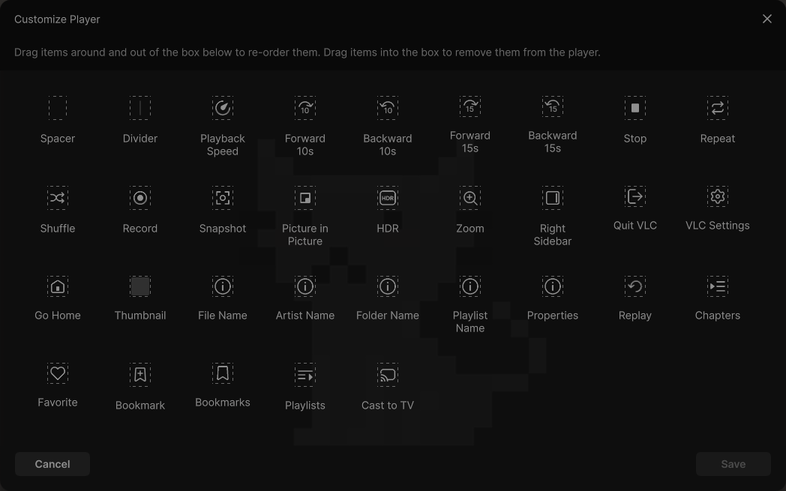
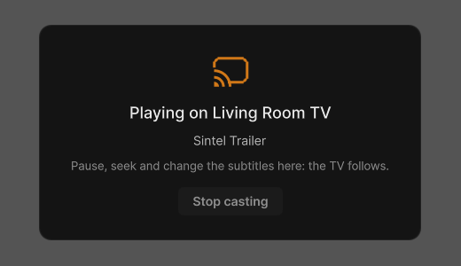
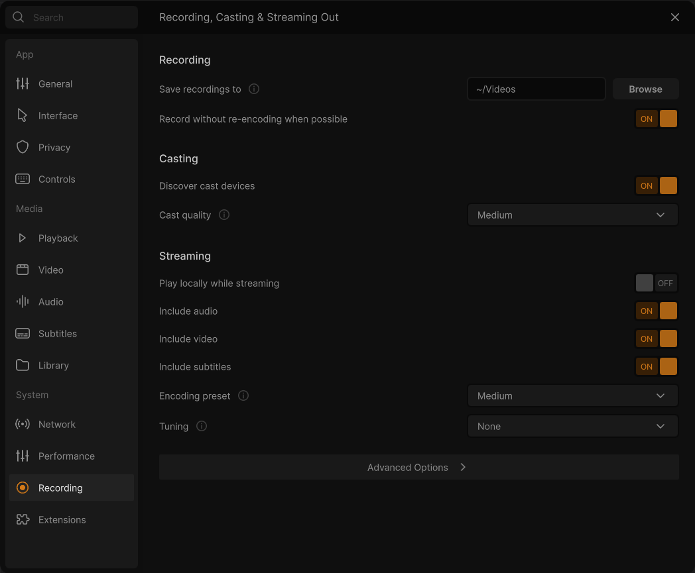

# Casting to a TV

VLC Redesign plays what is playing on a **Chromecast** or on a **DLNA / UPnP TV** of your network. The film goes on
there from where it was, and the bar of the player goes on controlling it: pause, seek and change the subtitles here,
the TV follows.

> When a TV does not appear, does not play a file, or Windows asks about its firewall, see
> [Casting: when a TV does not play](Casting-Troubleshooting). What is known of each TV model is in
> [TV compatibility](TV-Compatibility).

## Before you start

- The TV (or the Chromecast) is **on**, and on the **same network** as this computer.
- The TV or the Chromecast reads the film from a small server VLC Redesign runs on this computer. Windows Firewall has
  to let it in: VLC Redesign asks Windows for that the first time it is needed (see
  [the firewall question](Casting-Troubleshooting#the-firewall-question)).
- Nothing else to install: the Chromecast and DLNA parts are in VLC Redesign.

## Put the Cast button in the bar

The default bars have no Cast button. Add it once:

1. **⋯ → Customize Player** (or the gear of the player's bar → *Customize player*).
2. Drag **Cast to TV**, the last item of the palette, onto the player's bar.
3. **Save**.

The button belongs to the profile you edited (*⋯ → Profile*); see [Customize the player](Customize-the-Player).

Without the button, a right click on the video (while a media plays) → **Playback → Renderer** lists the same devices
in a classic menu: *&lt;Local&gt;* is this computer.

## Cast

1. Play a video (or a song).
2. Click the **Cast** button. The panel **Cast to** opens; a dot in the accent colour pulses while VLC looks for
   devices (about 20 seconds).
3. Click the TV or the Chromecast. The panel closes and the player shows **Connecting to *TV*…**, then
   **Playing on *TV***.

The panel lists:

- **This computer**, with a check mark while the media plays here.
- The devices found: a TV icon for a screen, a note icon and *Sound only* for a speaker. The one you cast to last
  comes first. Five are in view; the list scrolls for more.
- **Show the video here too**: the picture stays on this computer as well while the TV plays (DLNA TVs only;
  *"With a Chromecast, the video plays only there."*).
- *The subtitles shown go to the TV with the picture*: the subtitle you see is drawn into the picture sent to the TV.

When nothing is found yet: *Looking for TVs and Chromecasts on your network…*, then *No device found. Turn your TV or
Chromecast on, on the same network as this computer.*

After the first search (the first time the panel opened), VLC Redesign looks for your devices quietly, once per
session, 3 seconds into a playing video, so they are already in the list when you open the panel.

## While it plays on the TV

- The player shows the card **Playing on *TV***, with the title of the media and *Pause, seek and change the subtitles
  here: the TV follows.*
- The Cast button is lit, and its tooltip reads *Casting to TV*.
- Pause, seek, the next or previous media of the playlist, and the subtitles (choose another one, or none) are done
  here; the TV follows. A playlist goes on to its next film on the TV, and a subtitle file beside a film goes with it.
- **Stop casting** on the card, or **This computer** in the panel, brings the media back here: it goes on where the
  TV was.

## Chromecast

- Found on the network (mDNS), listed with its name.
- The video plays only on the Chromecast (no picture here).
- A format the Chromecast cannot play, or a subtitle shown, is converted on this computer while it plays. **Cast
  quality** in [Settings › Recording](Settings-Recording) trades the quality of that conversion against the processor
  time it takes (High / Medium / Low / Low CPU; Medium by default).
- The server the Chromecast reads from uses port **8010** (*Cast HTTP port*, under Advanced Options of
  Settings › Recording). *Send Dolby audio as is* passes (E)AC-3 sound unconverted; leave it off unless your
  receiver plays Dolby.

## DLNA / UPnP TV

- Found by UPnP: TVs that act as a DLNA media renderer, as many smart TVs do (Samsung, LG, Sony…). Only a Samsung
  has been checked so far: see [TV compatibility](TV-Compatibility).
- The TV reads the film from VLC Redesign's server on this computer, port **7070**, at the pace of the film (one second
  ahead of it).
- A film the TV can play as it is goes as it is, in MPEG-TS when the TV takes it. A film it cannot play, a subtitle
  shown, or a film the TV stops within its first 15 seconds is converted (H.264 in MPEG-TS). A 4K film is made smaller
  for the TV by the graphics card; films of 50 and 60 frames per second go at 25 and 30.
- **Show the video here too** works with a DLNA TV.

## Settings for casting

**⋯ → Settings → Recording**, section *Casting* (see [Settings: Recording](Settings-Recording)):

- **Discover cast devices** (on): VLC looks for devices when the *Renderer* menu opens. Off, that menu shows
  *Search for cast devices* instead, and VLC only looks when you choose it. (The cast panel always looks when it
  opens.)
- **Cast quality**: see Chromecast above.
- *Advanced Options*: **Send Dolby audio as is**, **Cast HTTP port**.

---

[Casting: when a TV does not play](Casting-Troubleshooting) · [TV compatibility](TV-Compatibility) · [Home](Home)
