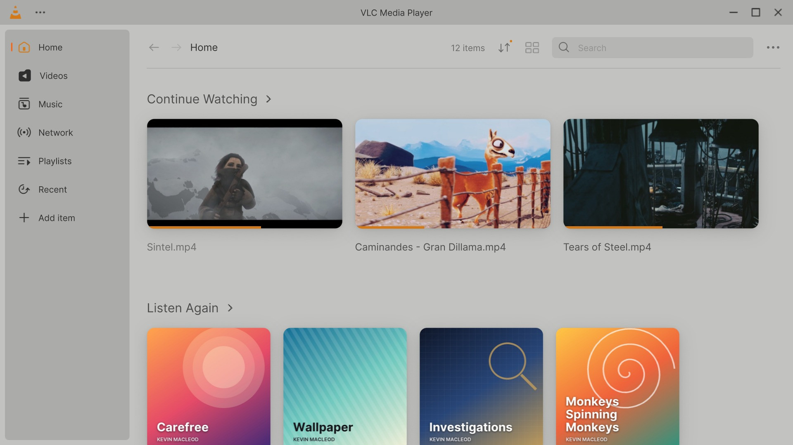
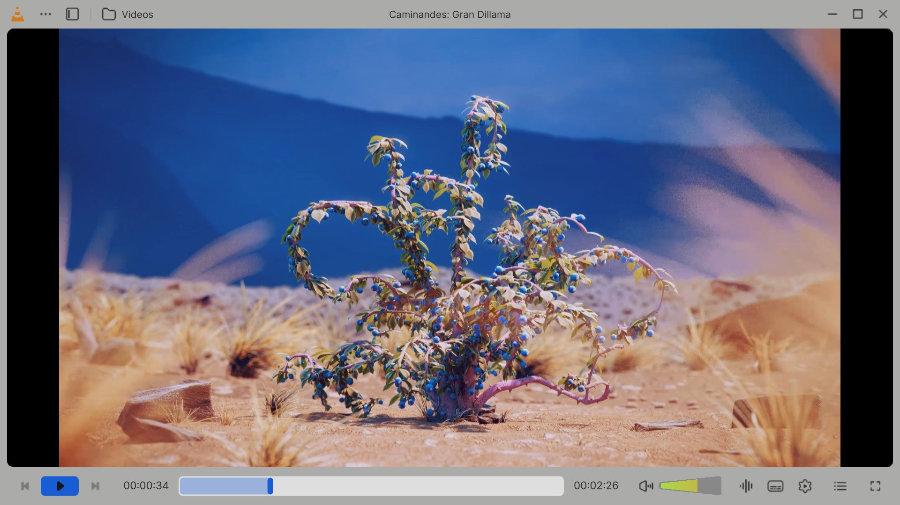
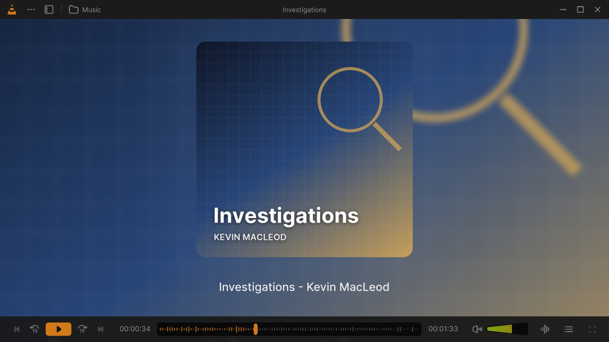

# Colours and themes

VLC Redesign has the two themes of the design, **Dark** and **Light**, and a third choice, **System**, that follows
Windows. On top of the theme, one of **nine accent colours** marks what is selected and active. Both change at once, without
a restart, and both can follow a [player profile](Customize-the-Player#profiles).

Settings, General: the light theme, then the blue, green and pink accents, each applied at once; the library in light pink. Click for the MP4 · every clip: [Feature tour](Feature-Tour#themes).

| | Default | Choices |
|---|---|---|
| **Theme** | System | Dark, Light, System |
| **Accent colour** | Orange `#D37918` | Nine colours (below) |
| **Increase text contrast** | Off | On, Off |

## Where to change them

- **Settings → General → Appearance** (<kbd>Ctrl</kbd>+<kbd>P</kbd>): the **Theme** row (Dark / Light / System) and
  the **Accent color** row (the nine swatches). The whole interface shows a change at once; it is kept when the
  window closes. *Reset all settings* (Advanced Options of General) goes back to System and orange. See
  [Settings: General](Settings-General#appearance).
- **The welcome steps.** The second step of the first-run setup, *Select your preferred theme and color.*, shows
  three tiles, **Light**, **Dark** and **System**, and the nine colours as discs under them; the chosen tile has a
  ring in the accent colour, the colours not chosen are dimmed. The setup runs again from **Settings → General →
  Advanced Options → Welcome setup**.
- **Profiles.** A player profile keeps the theme and the accent colour with its other settings, so switching profile
  (**⋯ → Profile**) can change them too: a *Music* profile can be light and green, a *Movies* one dark and orange.
  A built-in profile you have never left keeps the colours in use. See
  [Customize the player](Customize-the-Player#profiles).

## The themes

| Theme | What it does |
|---|---|
| **Dark** | The colours of the design's player and library: near-black backgrounds, light grey text. |
| **Light** | The *Player - Light* frame of the design: light grey backgrounds, dark grey text, the icons recoloured to its greys. |
| **System** (default) | Dark or Light as Windows' app mode says (*Windows Settings → Personalization → Colors*). It follows a change of Windows while VLC runs. |

The whole interface follows the theme: the library, the player, the panels and menus, the Settings window, the
welcome steps, and VLC's classic windows (*Open Media*, *Convert*, *Media Information*…).

| Light theme, library | Light theme, player |
|---|---|
|  |  |

## The accent colours

| | Colour | Value |
|---|---|---|
| 1 | Orange (default) | `#D37918` |
| 2 | Red | `#E15033` |
| 3 | Gold | `#C49D24` |
| 4 | Green | `#18A235` |
| 5 | Cyan | `#18AAD3` |
| 6 | Blue | `#185DD4` |
| 7 | Purple | `#8E41FF` |
| 8 | Pink | `#F051B5` |
| 9 | Grey | `#AFAFAF` |

The accent colour marks selections, sliders, the played part of the seek bar, check marks, the current page of the
sidebar and of the Settings window, the ring of the keyboard focus, and the Record button while recording. Two
shades come from it, as the design draws them for orange: a dimmer one (81 % of the colour, `#AB6314` for orange)
and a dark one for the background of selections (26 %, `#371F06` for orange). The images the design draws in
orange are shown as they are with the default accent, and tinted with any other.

### Follow the Windows accent color

New in 0.4.0: a switch under the accent colours, off by default. On, the interface, the classic windows, the
right-click menus and the two-tone icons take the accent colour of Windows, and follow it at once when it changes in
Windows' *Personalization > Colors*. Picking one of the nine colours turns the switch off. A Windows colour too dark
or too light is brought to the range of the built-in accents, so it stays as readable. Outside Windows it follows the
system accent (the desktop's, or orange). Profiles keep the choice.

> **Good to know.** With *System*, VLC Redesign follows Windows' *Choose your default app mode*, not the Windows
> mode: a Windows with a dark taskbar and light apps gives the light theme.

## Increase text contrast

Some texts of the design are dim on purpose (hints, descriptions, watched videos). **Settings → Interface →
Accessibility → Increase text contrast** draws them brighter in the dark theme, darker in the light one, to the
4.5:1 contrast of the WCAG AA guidelines, and gives the (i) icons at least 3:1. Off (the default), the colours of the
design stay as they are. See [Settings: Interface](Settings-Interface#accessibility).

## Artwork and the light theme

- **The music player** shows the cover over a blurred copy of itself, in both themes. In the dark theme the title
  line measures how bright the artwork is behind it: it keeps the design's grey where that grey reads at 3:1 or
  more, and turns near white or dark, the more readable of the two, over a bright cover. In the light theme the
  title keeps the dark grey of the design. See [The player](The-Player#music).
- **Cover art off.** With *Show cover art in the window when playing audio* off
  ([Settings: Interface](Settings-Interface#advanced-options)), the dark placeholder of the theme takes the place of
  the cover.
- **Videos and covers** keep their own colours: neither the theme nor the accent changes them. The rounded corners
  of the video are drawn in the background colour of the theme.

---

[Settings: General](Settings-General) · [Settings: Interface](Settings-Interface) · [Customize the player](Customize-the-Player) · [Home](Home)
