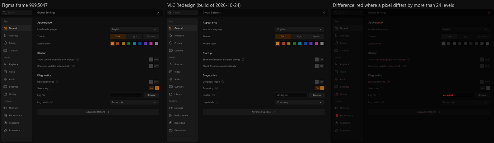

# Design check

Every screen of VLC Redesign follows **["VLC Redesign (Community)"](https://www.figma.com/community/file/1691465999134370980)**,
the Figma file by **[Juxtopposed](https://www.youtube.com/@juxtopposed)** ([CC BY 4.0](https://creativecommons.org/licenses/by/4.0/)).
This page shows how the app is compared with that design, frame by frame, and where it stands.

**Where it stands** (build of 2026-10-24): all **103** frames of the design are in the app, and **101** of them were
captured from the running app and compared pixel for pixel. The two others are hover states, which the capture scripts
cannot show; their values were checked in the code.

*Settings - global (999:5047), captured with the values of the frame. Red: the pixels that differ by more than 24 levels.
One tile of 32 px fails: the Log file field, which holds a file name in the app and is empty in the frame. The other
red pixels are edges of letters and icons, in tiles that pass.*

## The 103 frames

The Figma file has 103 top-level frames: **57 screens** (onboarding, the player, the library, the dialogs, the
settings pages) and **46 component sheets** (a control with all its states: buttons, menus, dropdowns, the effects
panels…). The tables at the end of this page list each one by its node id, the id of the frame in the community file:
duplicate the file into your Figma drafts and open a frame with `?node-id=` and its id, `-` in place of `:`.

## How a frame is checked

1. **Reference.** Each frame is exported from Figma at 1:1 (100 %, and 200 % for the details), with its texts.
2. **Capture.** The app is put in the state the frame draws (window size, media, theme, accent) and captured at the
   same scale: one pixel of the design is one pixel of the screen, without Windows' display scaling. The media come
   from a demo library made to match the design's mock content: the same videos, songs, covers, lengths, progress
   lines and playback states as the frames. Scripts drive the app into each state.
3. **Compare.** For each pixel, the largest difference of its red, green and blue values (grey levels would hide
   colour fringes); a pixel differs when that is above 24 levels. The images are cut into tiles of 32 × 32 px, and each
   tile is compared at its best shift of up to 4 px. A tile fails when more than 60 of its pixels still differ.
4. **Pass.** A frame passes when no tile fails, apart from anti-aliased edges and the differences listed below.
5. **Record.** The result goes into the frame tables of the project plan and onto this page; a failure becomes a
   *Design mismatch* to fix.

Text can only match when it is drawn like Figma draws it: the app uses Inter with Figma's metrics and line box, as
distance-field text without hinting.

## Results by area

| Area | Frames | In the app | Compared pixel for pixel |
|---|---|---|---|
| Onboarding | 11 | 11 | 11 |
| Player | 7 | 7 | 7 |
| Player - Music | 2 | 2 | 2 |
| Player - customize | 9 | 9 | 9 |
| Player - hide UI | 1 | 1 | 1 |
| Player - Light | 1 | 1 | 1 |
| Add Subtitles | 4 | 4 | 4 |
| Keyboard Shortcuts | 1 | 1 | 1 |
| Open network stream | 1 | 1 | 1 |
| New playlist | 1 | 1 | 1 |
| Settings pages | 19 | 19 | 19 |
| **Screens** | **57** | **57** | **57** |
| Components | 46 | 46 | 44 |
| **All** | **103** | **103** | **101** |

Not compared yet: **177:98** *Icon Wrapper* (the hover state of an icon button) and **2151:9673** *thumbnail* (the
frame preview of the seek bar, shown on hover). The capture scripts send their clicks and keys to the app as window
messages, and a hover cannot be shown that way; the sizes, colours and positions of both were checked in the code.

## What differs, and why

Most of what remains after a comparison is the **values** of the test profile: a switch on where the frame draws it
off, another choice in a dropdown, a path in a field. Besides those:

**On purpose**
- The fullscreen button is in the control bar, not in the title bar ([issue #1](https://github.com/KuchiSofts/vlc-redesign/issues/1)):
  the right group of the bar is one button further left.
- *Settings - performance*: *Process priority* is a dropdown (Normal, High…), not the number field of the design.
- *Settings - privacy*: the design's second "Last.fm username" row is the password. Typos of the design are fixed:
  "include subtitles" (Recording) reads "Include subtitles", "changew" reads "changes".
- Sections that are not in the design come after its sections, so that each page starts as the design draws it:
  *Second Language & Online Subtitles* (Subtitles), *Player Bar* and *Accessibility* (Interface).
- *Onboarding*, the accent states (1902:4020 to 1902:4940): *Back* stays, as in 1902:3670.
- *Keyboard Shortcuts*: an action with several keys shows each one (Next track: N, Shift+>, >, VLC's defaults).
- *Add Subtitles* from OpenSubtitles (1919:9278): before the first search VLC asks for the account the service
  requires, a row the design does not draw. The answers of the service are listed in the rows of 1919:8707.
- *Show the playlist as a tree* (Settings - interface): VLC 4's queue is flat, so the folders of its media are
  headings over their rows.
- *HDR Options* (2372:8733): HDR10+ and Dolby Vision are listed but cannot be chosen, with the reason under the
  pointer (Windows offers no way for a player to send them to a display).
- *Setting Preset* (2372:8834) is drawn on no screen of the design: it is the presets of the Effects window, with the
  same colours and rows.
- No background blur behind floating panels: they are solid at 95 %, so at most 5 % of what is behind would show
  through (13 grey levels at most, 4 measured under the ⋯ menu), under the tolerance; weak graphics cards are spared a
  blur pass. The artwork backdrop of the music player is blurred, as designed.
- *Player - Light* (2425:13624) draws the video to the right edge of the window; its dark frames (187:328, 247:445)
  and the app keep the 10 px frame there.

**The design's mock data**
- The seek handles of Figma are not where their times are (2:10 drawn at 1:57).
- The title bar reads "VLC Media Player" over a playing film, and a title has a typo ("The Wand_S01E04").
- The mini player is where it was put (it can be dragged): the design draws it on the left (970:3792) and on the
  right (970:2703, 970:3308); it starts on the left.
- *Customize Player*: eight of its nine frames are steps of a drag in the editor; the bars are compared with a profile
  of the same controls.

## Frame by frame

Status: 🟢 every element and state of the frame is in the app. Pixel: 🟢 compared pixel for pixel, ⏳ not compared
yet.

### Onboarding (11)

| Node | Name | Size (px) | What it is | Status | Pixel |
|---|---|---|---|---|---|
| 1899:3055 | Onboarding | 1090 × 759 | Step 1, Welcome: title, description, media folder (Browse), Next | 🟢 | 🟢 |
| 1902:3670 | Onboarding | 1090 × 759 | Step 2: Light / Dark / System over the small player, 9 accents | 🟢 | 🟢 |
| 1902:4020 | Onboarding | 1090 × 759 | Step 2, state 2 of 9: another theme or accent, control bar sample | 🟢 | 🟢 |
| 1902:4325 | Onboarding | 1090 × 759 | Step 2, state 3 of 9 | 🟢 | 🟢 |
| 1902:4634 | Onboarding | 1090 × 759 | Step 2, state 4 of 9 | 🟢 | 🟢 |
| 1902:4940 | Onboarding | 1090 × 759 | Step 2, state 5 of 9 | 🟢 | 🟢 |
| 1902:5245 | Onboarding | 1090 × 759 | Step 2, state 6 of 9 | 🟢 | 🟢 |
| 1902:5550 | Onboarding | 1090 × 759 | Step 2, state 7 of 9 | 🟢 | 🟢 |
| 1902:6160 | Onboarding | 1090 × 759 | Step 2, state 8 of 9 | 🟢 | 🟢 |
| 1902:6465 | Onboarding | 1090 × 759 | Step 2, state 9 of 9 | 🟢 | 🟢 |
| 1902:6770 | Onboarding | 1090 × 759 | Last step: 12 shortcuts with DM Mono keycaps, Back, Finish | 🟢 | 🟢 |

### Player (7)

| Node | Name | Size (px) | What it is | Status | Pixel |
|---|---|---|---|---|---|
| 187:328 | Player | 1920 × 1080 | Player with the compact library open beside the video | 🟢 | 🟢 |
| 247:445 | Player | 1920 × 1080 | Player alone: the video framed between the bars | 🟢 | 🟢 |
| 970:2703 | Player | 1920 × 1080 | Library shell: sidebar, address bar, a folder's grid, mini player | 🟢 | 🟢 |
| 970:3308 | Player | 1920 × 1080 | Library: video grid, the mini player playing | 🟢 | 🟢 |
| 970:3792 | Player | 1920 × 1080 | Library: a folder as a list (rows 406 × 32, 10 apart) | 🟢 | 🟢 |
| 970:4028 | Player | 1920 × 1080 | Library: a folder as cards, the Videos icon filled | 🟢 | 🟢 |
| 6261:15078 | Player | 1920 × 1080 | Library Home: Continue Watching, Listen Again, Frequently Visited | 🟢 | 🟢 |

### Player - Music (2)

| Node | Name | Size (px) | What it is | Status | Pixel |
|---|---|---|---|---|---|
| 4767:23726 | Player - Music | 1920 × 1080 | Music: artwork (738 × 737) over its blur, waveform, resume card | 🟢 | 🟢 |
| 4778:25123 | Player - Music | 1920 × 1080 | The same with the queue | 🟢 | 🟢 |

### Player - customize (9)

| Node | Name | Size (px) | What it is | Status | Pixel |
|---|---|---|---|---|---|
| 2107:5604 | Player - customize | 1920 × 1080 | Customize Player open: profile picker, palette, Cancel, Save | 🟢 | 🟢 |
| 2160:6137 | Player - customize | 1920 × 1080 | The timeline dragged to a row of its own | 🟢 | 🟢 |
| 2160:6564 | Player - customize | 1920 × 1080 | A control dragged from the palette onto the bar | 🟢 | 🟢 |
| 2160:7005 | Player - customize | 1920 × 1080 | Controls moved along the bar | 🟢 | 🟢 |
| 2160:7437 | Player - customize | 1920 × 1080 | Library toggle and ⋯ menu moved into the bar | 🟢 | 🟢 |
| 2160:7869 | Player - customize | 1920 × 1080 | The edited bar, ready to save | 🟢 | 🟢 |
| 6587:19923 | Player - customize | 1920 × 1080 | Another profile being edited | 🟢 | 🟢 |
| 2160:8301 | Player - customize | 1920 × 1080 | The player after editing: the active profile's bar | 🟢 | 🟢 |
| 2160:8732 | Player - customize | 1920 × 1080 | Saved layout: file name in the bar, two rows, library left | 🟢 | 🟢 |

### Player - hide UI (1)

| Node | Name | Size (px) | What it is | Status | Pixel |
|---|---|---|---|---|---|
| 3328:11554 | Player - hide UI | 1920 × 1080 | The video alone in its 10 px frame (Ctrl+\\, right-click) | 🟢 | 🟢 |

### Player - Light (1)

| Node | Name | Size (px) | What it is | Status | Pixel |
|---|---|---|---|---|---|
| 2425:13624 | Player - Light | 1920 × 1080 | The light theme, greys measured from this frame | 🟢 | 🟢 |

### Add Subtitles (4)

| Node | Name | Size (px) | What it is | Status | Pixel |
|---|---|---|---|---|---|
| 1911:7545 | Add Subtitles to Playlist/Folder | 1048 × 800 | To a folder, from the computer: a row per video | 🟢 | 🟢 |
| 3336:11929 | Add Subtitles to Playlist/Folder | 1048 × 800 | The same, several subtitles per video | 🟢 | 🟢 |
| 1919:8707 | Add Subtitles to Playlist/Folder | 1048 × 800 | One subtitle for the folder, origin dropdown | 🟢 | 🟢 |
| 1919:9278 | Add Subtitles to Playlist/Folder | 1048 × 800 | To one file, from OpenSubtitles, English | 🟢 | 🟢 |

### Keyboard Shortcuts (1)

| Node | Name | Size (px) | What it is | Status | Pixel |
|---|---|---|---|---|---|
| 2437:14832 | Keyboard Shortcuts | 1048 × 800 | Search, Action / Hotkey / Global Hotkey by group, Save | 🟢 | 🟢 |

### Open network stream (1)

| Node | Name | Size (px) | What it is | Status | Pixel |
|---|---|---|---|---|---|
| 6216:13614 | Open network stream | 1048 × 631 | Network URL (several links), Playlist Name (optional), Save | 🟢 | 🟢 |

### New playlist (1)

| Node | Name | Size (px) | What it is | Status | Pixel |
|---|---|---|---|---|---|
| 6259:14954 | new playlist | 713 × 589 | Title and thumbnail, Select Files (drop zone), Save | 🟢 | 🟢 |

### Settings pages (19)

| Node | Name | Size (px) | What it is | Status | Pixel |
|---|---|---|---|---|---|
| 999:5047 | Settings - global | 1048 × 865 | Appearance (language, theme, accent), Startup, Diagnostics | 🟢 | 🟢 |
| 3046:9282 | Settings - global | 1048 × 865 | Advanced: warnings, command line, log, statistics, reset | 🟢 | 🟢 |
| 3046:10057 | Settings - interface | 1048 × 865 | Skin, Window, Playback Controls, Notifications, Playlist | 🟢 | 🟢 |
| 3062:11379 | Settings - interface | 1048 × 865 | Advanced: opacity, minimized, cover art, fullscreen controls | 🟢 | 🟢 |
| 3062:11911 | Settings - privacy | 1048 × 865 | History, Network (cover art, Last.fm) | 🟢 | 🟢 |
| 3062:12552 | Settings - playback | 1048 × 865 | Startup, Tracks, Order, Seeking, Files & Discs | 🟢 | 🟢 |
| 3072:13408 | Settings - playback | 1048 × 865 | Advanced: time-shift buffer | 🟢 | 🟢 |
| 3073:14187 | Settings - video | 1048 × 865 | Output, Picture, Deinterlacing, Framing, Snapshots | 🟢 | 🟢 |
| 3073:15375 | Settings - video | 1048 × 865 | Advanced: aspect and crop ratios, pixel aspect ratio | 🟢 | 🟢 |
| 3073:15879 | Settings - audio | 1048 × 865 | Output, Volume, Loudness, Effects, Tracks, Visualization | 🟢 | 🟢 |
| 3180:17398 | Settings - audio | 1048 × 865 | Advanced: pass-through, Dolby Surround, resampling, media role | 🟢 | 🟢 |
| 3180:17989 | Settings - subtitles | 1048 × 865 | Languages, Loading, Appearance, Timing, On-Screen Messages | 🟢 | 🟢 |
| 6536:13908 | Settings - subtitles | 1048 × 865 | Advanced: folders, ASS/SSA styling, shadow angle, direction | 🟢 | 🟢 |
| 6536:14482 | Settings - controls | 1048 × 865 | Shortcuts, skip amounts, mouse, web remote | 🟢 | 🟢 |
| 6542:15251 | Settings - library | 1048 × 865 | Opening files, folders, metadata, media library | 🟢 | 🟢 |
| 6543:15649 | Settings - network | 1048 × 865 | Buffering presets, proxy, certificates, ciphers | 🟢 | 🟢 |
| 6571:15958 | Settings - performance | 1048 × 865 | Decoding, smooth playback, priority, plugins, developer | 🟢 | 🟢 |
| 6571:16429 | Settings - recording | 1048 × 865 | Recording, Casting, Streaming | 🟢 | 🟢 |
| 6575:17137 | Settings - extensions | 1048 × 865 | Add-ons list (784 × 194), find more, add, remove, on startup | 🟢 | 🟢 |

### Components (46)

**Icons and buttons**

| Node | Name | Size (px) | What it is | Status | Pixel |
|---|---|---|---|---|---|
| 42:356 | Icon | 548 × 812 | The icon set: 96 names with their states | 🟢 | 🟢 |
| 177:98 | Icon Wrapper | 72 × 122 | Icon button: default, hover | 🟢 | ⏳ |
| 500:3063 | Button | 400 × 140 | Dialog button: neutral, accent | 🟢 | 🟢 |
| 848:1712 | play | 94 × 116 | Play, pause | 🟢 | 🟢 |
| 536:1014 | Toggle | 120 × 194 | ON / OFF | 🟢 | 🟢 |

**Player controls**

| Node | Name | Size (px) | What it is | Status | Pixel |
|---|---|---|---|---|---|
| 491:1780 | Controls | 1960 × 11139 | Control bar and its 15 panel states (queue, tracks…) | 🟢 | 🟢 |
| 244:184 | volume | 130 × 646 | Cone volume, 13 states from 0 to 200 % | 🟢 | 🟢 |
| 2245:9805 | audio value | 121 × 37 | The value shown while the volume changes | 🟢 | 🟢 |
| 1904:7238 | Current Time | 114 × 164 | Elapsed time: default, hover, click | 🟢 | 🟢 |
| 1905:7312 | Duration | 114 × 164 | Length: default, click (remaining time) | 🟢 | 🟢 |
| 2151:9673 | thumbnail | 272 × 189 | Seek bar frame preview with its time | 🟢 | ⏳ |
| 970:3091 | Miniplayer | 431 × 2816.375 | Library mini player, 5 states | 🟢 | 🟢 |

**Library**

| Node | Name | Size (px) | What it is | Status | Pixel |
|---|---|---|---|---|---|
| 848:1996 | sidebar | 4492 × 1028 | Sections column, 10 states | 🟢 | 🟢 |
| 856:2215 | Sorting Options | 265 × 776 | Sort menu | 🟢 | 🟢 |
| 858:3290 | View Options | 265 × 104 | Grid or list | 🟢 | 🟢 |
| 2404:9167 | media | 377 × 228 | Video card: watched, unwatched, hover of each | 🟢 | 🟢 |
| 2459:9352 | playlist | 377 × 228 | Playlist card: unwatched, hover | 🟢 | 🟢 |

**Menus**

| Node | Name | Size (px) | What it is | Status | Pixel |
|---|---|---|---|---|---|
| 6062:13354 | menu | 375 × 585 | The ⋯ main menu, with shortcuts | 🟢 | 🟢 |
| 6648:20666 | Profiles | 651 × 633 | Profile submenu: Movies, Shows, Music, Work, New | 🟢 | 🟢 |
| 6065:13616 | right-click menu | 292 × 683 | Player right-click menu (Qt menu drawn to frame) | 🟢 | 🟢 |
| 2107:5903 | context menu | 265 × 296 | Library item menu | 🟢 | 🟢 |
| 2139:8935 | folder context menu | 265 × 296 | Folder menu | 🟢 | 🟢 |
| 2404:13340 | file context menu | 265 × 584 | File menu | 🟢 | 🟢 |
| 2459:9389 | playlist context menu | 265 × 392 | Playlist menu | 🟢 | 🟢 |
| 2107:5935 | option | 301 × 292 | Menu row: default, hover, selected | 🟢 | 🟢 |

**Add Subtitles parts**

| Node | Name | Size (px) | What it is | Status | Pixel |
|---|---|---|---|---|---|
| 1915:8397 | subtitle multiple | 519 × 239 | A video with several subtitles: default, hover | 🟢 | 🟢 |
| 1919:9121 | subtitle one | 519 × 239 | A video with one subtitle: default, selected | 🟢 | 🟢 |
| 1959:5325 | target | 240 × 520 | To this folder / file, and its dropdown | 🟢 | 🟢 |
| 1963:5465 | origin | 240 × 525 | From the computer / OpenSubtitles, dropdown | 🟢 | 🟢 |

**Settings controls**

| Node | Name | Size (px) | What it is | Status | Pixel |
|---|---|---|---|---|---|
| 3021:9835 | setting category | 228 × 140 | Sidebar item: selected or not | 🟢 | 🟢 |
| 2372:8300 | Dropdown | 406 × 369 | Dropdown: default, open | 🟢 | 🟢 |
| 804:1208 | Values | 253 × 404 | Segmented choice of 2 or 3 values | 🟢 | 🟢 |
| 3176:16556 | Values | 360 × 216 | Vertical values (startup volume) | 🟢 | 🟢 |
| 3178:16769 | EQ | 824 × 628 | Inline equalizer: closed, open | 🟢 | 🟢 |
| 2372:8487 | EQ presets | 406 × 460 | Equalizer preset dropdown | 🟢 | 🟢 |
| 6456:13892 | sub filename | 406 × 422 | Subtitle file name matching dropdown | 🟢 | 🟢 |
| 2372:8834 | Setting Preset | 406 × 412 | A preset dropdown: default, open | 🟢 | 🟢 |
| 2372:8639 | Audio Visualizer | 406 × 369 | Visualizer choice: default, open | 🟢 | 🟢 |
| 2372:8733 | HDR Options | 406 × 422 | Auto, Off, HDR10, HDR10+, Dolby Vision, HLG | 🟢 | 🟢 |

**Effects panels**

| Node | Name | Size (px) | What it is | Status | Pixel |
|---|---|---|---|---|---|
| 536:1513 | Audio - Compressor Settings | 400 × 821 | Collapsed, expanded | 🟢 | 🟢 |
| 6114:13610 | Audio - Equalizer | 400 × 1623 | Preamp and 10 bands | 🟢 | 🟢 |
| 536:1703 | Audio - Spatializer Settings | 400 × 821 | Collapsed, expanded | 🟢 | 🟢 |
| 612:1223 | Audio - Stereo Widener | 400 × 821 | Collapsed, expanded | 🟢 | 🟢 |
| 536:1855 | Video - Essential | 400 × 821 | Collapsed, expanded | 🟢 | 🟢 |
| 543:990 | Video - Crop | 400 × 821 | Collapsed, expanded | 🟢 | 🟢 |
| 614:1430 | Video - Colors | 400 × 888 | Collapsed, expanded | 🟢 | 🟢 |

---

Design: **Juxtopposed**, ["VLC Redesign (Community)"](https://www.figma.com/community/file/1691465999134370980),
[CC BY 4.0](https://creativecommons.org/licenses/by/4.0/). The reference image above is an export of a frame of that
file. Juxtopposed does not endorse this project. · [Credits and license](Credits-and-License) · [Home](Home)
