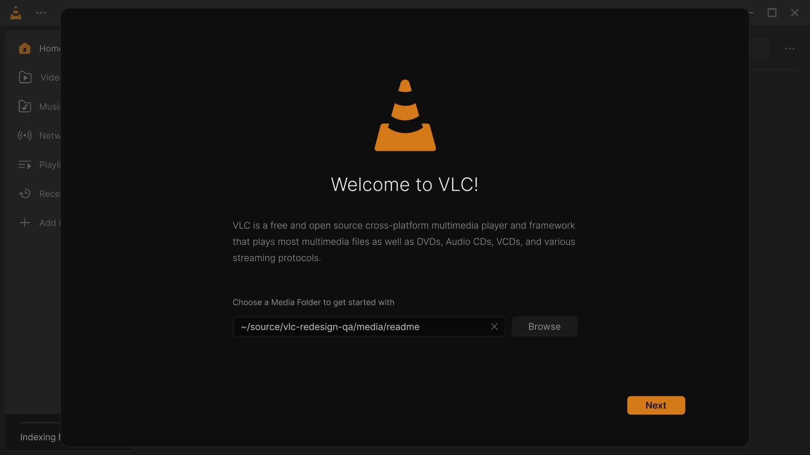

# VLC Redesign wiki

**VLC 4 with the interface designed by [Juxtopposed](https://www.youtube.com/@juxtopposed), for Windows 10 and 11.**
The real VLC engine, the same codecs, the same "plays everything"; only the interface is new, built screen by screen
from the design. This wiki explains every screen, every option and every switch of it.

The 56-second tour (animated picture). [Watch it in full quality (MP4)](https://github.com/KuchiSofts/vlc-redesign/blob/main/docs/media/tour/tour.mp4).
Every picture is the real app, with free films and music.
Every feature of 0.4.0 in short clips, Windows, Linux, macOS and the Android app in testing: the **[Feature tour](Feature-Tour)**.

> **Design by Juxtopposed.** Every screen comes from the
> ["VLC Redesign (Community)"](https://www.figma.com/community/file/1691465999134370980) Figma file by Juxtopposed,
> licensed under [CC BY 4.0](https://creativecommons.org/licenses/by/4.0/).
> [Watch the video: *I Redesigned VLC After 25 Years*](https://www.youtube.com/watch?v=ERFeOgqk324) ·
> [YouTube channel](https://www.youtube.com/@juxtopposed). Juxtopposed does not endorse this project.

> [!IMPORTANT]
> **Unofficial.** VLC Redesign is not made, affiliated with, or endorsed by [VideoLAN](https://www.videolan.org/).
> *VLC*, *VLC media player* and the cone logo are trademarks of VideoLAN. It is based on the VLC 4.0 development
> branch: report problems [here](https://github.com/KuchiSofts/vlc-redesign/issues), not to VideoLAN.

## Quick facts

| | |
|---|---|
| **Current version** | **0.4.0**, released 2026-10-29 ([release page](https://github.com/KuchiSofts/vlc-redesign/releases/tag/v0.4.0), [changelog](https://github.com/KuchiSofts/vlc-redesign/blob/main/CHANGELOG.md)) |
| **Runs on** | Windows 10 (version 1809 or later) and Windows 11, 64-bit. Other systems: [Platforms](Platforms) |
| **Based on** | VLC 4.0 (development branch), with fixes from VideoLAN merged in regularly |
| **Download** | An installer (59.4 MB, no administrator rights) or a portable zip (107.8 MB): [Install and update](Install-and-Update) |
| **Updates** | In the app, a few megabytes at a time: only the files that changed ([small updates](Install-and-Update#small-updates)) |
| **Languages** | English and 72 others, switched live; right-to-left languages laid out right to left ([Languages](Languages)) |
| **Privacy** | No telemetry, no ads, no account. Two features go online by themselves, and both are asked about first |
| **Next to an official VLC** | Yes: its own folder, settings, library and history; an installed VLC is never touched |
| **License** | GNU GPL v2 or later, like VLC; the design is CC BY 4.0 ([Credits and license](Credits-and-License)) |

## Start here

| Page | What it covers |
|---|---|
| **[Feature tour](Feature-Tour)** | Every feature of 0.4.0 in short clips, platform by platform, each linked to the page that explains it |
| **[Install and update](Install-and-Update)** | The installer page by page, silent install switches, the portable zip, [small updates](Install-and-Update#small-updates), uninstalling |
| **[The player](The-Player)** | Every control of the player: seek bar previews, volume up to 200 %, the panels above the bar, speed, sleep timer, A-B loop, picture in picture |
| **[Library](Library)** | Home, Videos, Music, Network, Playlists, Recent, media folders, and the library next to the video |
| **[Live TV](Live-TV)** | The TV channels of your own IPTV playlist or Xtream Codes account: channel lists with what is on, a programme guide, catch-up, channel up and down; an add-on you can leave out |
| **[Queue and playlists](The-Player#the-queue-card)** | The queue card of the player; [playlists](Library#playlists) in the library |
| **[Subtitles](Subtitles)** | Tracks and languages that learn, online search, sync, position and size, dual subtitles |
| **[Effects](Effects)** | Equalizer, compressor, spatializer, stereo widener, video effects, presets |
| **[Customize the player](Customize-the-Player)** | Drag buttons into and out of the control bar; profiles |
| **[Colours and themes](Colours-and-Themes)** | Dark, Light or System, and nine accent colours |
| **[Languages](Languages)** | The language of the interface, right to left, translating |
| **[Keyboard shortcuts](Keyboard-Shortcuts)** | The default keys, and how to change them |
| **[Casting to a TV](Casting)** | Chromecast and DLNA TVs; [when a TV does not play](Casting-Troubleshooting); [TV compatibility](TV-Compatibility) |
| **[Settings](Settings)** | Every option of the Settings window, page by page |
| **[Troubleshooting and FAQ](Troubleshooting-and-FAQ)** | SmartScreen, where settings live, logs, video problems, reporting a bug |
| **[Platforms](Platforms)** | Windows today; Linux and macOS in progress, Windows on ARM64 planned, the Android app in testing; what is not planned |
| **[Building from source](Building-from-Source)** | The Windows build in Docker, the release script, signing |
| **[Design check](Design-Check)** | How the app is compared with the 103 frames of the Figma design, and the results |
| **[Credits and license](Credits-and-License)** | Who made what, and the licenses |

## In one minute

1. **Download** the installer from the [latest release](https://github.com/KuchiSofts/vlc-redesign/releases/latest)
   and run it. It needs no administrator rights; a new install goes through Welcome, Options, Languages and
   Privacy, then installs in about a minute. Or unzip the portable version anywhere and run `vlc.exe`.
2. The first start shows the **welcome steps**: a media folder, the theme and accent colour, your subtitle
   languages, what VLC does online, and the basic keys.
3. **Play** something: drop a file on the window, open one from Explorer, or pick it on [Home](Library#home).
4. VLC Redesign checks for a new release once a day and offers a **small update** when one is out.

The welcome steps of 0.4.0, from the media folder to Home. Click for the MP4; every clip: [Feature tour](Feature-Tour).

| The first start | What may go online |
|---|---|
|  |  |

> **Good to know.** VLC Redesign keeps its settings, library and history in a `portable` folder next to its
> `vlc.exe`, so it never reads or changes an installed official VLC. See
> [Where are my settings?](Troubleshooting-and-FAQ#where-are-my-settings)

## Get help

| Where | For |
|---|---|
| **[Discussions](https://github.com/KuchiSofts/vlc-redesign/discussions)** | Questions (the **Q&A** category) and ideas (the **Ideas** category); talking with other users |
| **[Issues](https://github.com/KuchiSofts/vlc-redesign/issues/new/choose)** | Bug reports, design mismatches, suggestions, translations and TV reports, each with its own form ([what to include](Troubleshooting-and-FAQ#report-a-bug)) |
| **[Troubleshooting and FAQ](Troubleshooting-and-FAQ)** | The common questions, answered first |
| **[VideoLAN](https://www.videolan.org/vlc/)** | Problems with the official VLC only |

Security problems: see [SECURITY.md](https://github.com/KuchiSofts/vlc-redesign/blob/main/SECURITY.md) instead of a
public issue. To help: [CONTRIBUTING.md](https://github.com/KuchiSofts/vlc-redesign/blob/main/CONTRIBUTING.md), and
[TRANSLATING.md](https://github.com/KuchiSofts/vlc-redesign/blob/main/docs/TRANSLATING.md) for translations.

## About this wiki

The pages are written in the repository, in
[`docs/wiki`](https://github.com/KuchiSofts/vlc-redesign/tree/main/docs/wiki), and copied to this wiki by a GitHub
workflow whenever they change. A correction is welcome as a pull request on those files. The pictures are captures
of version 0.3.1; the clips of the [Feature tour](Feature-Tour) and at the top of the pages are version 0.4.0.
