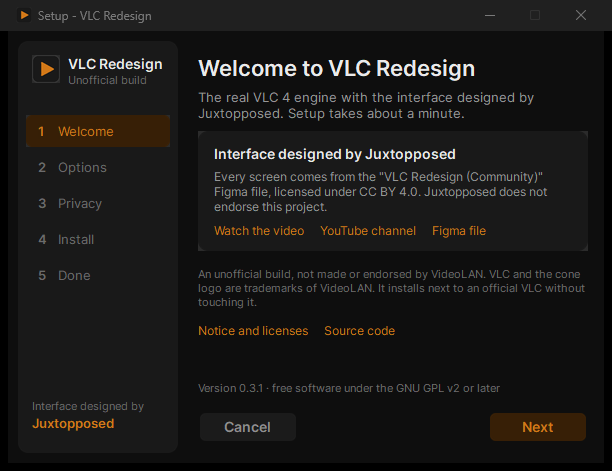

# Install and update

VLC Redesign 0.5.0 is released for **Windows**, **Linux**, **macOS** and **Android**, every file on the
[latest release](https://github.com/KuchiSofts/vlc-redesign/releases/latest).

- **Windows 10 (version 1809 or later) or Windows 11, 64-bit**: an **installer** and a **portable zip**. It installs
  next to an official VLC without touching it: its settings, library and history stay in its own `portable` folder.
- **Windows 11 on ARM64** (Snapdragon PCs): a native ARM64 installer and portable zip. See
  [Windows on ARM64](#windows-on-arm64).
- **Linux, x86_64 or ARM64, with glibc 2.38 or later** (Ubuntu 24.04 and later, Debian 13, Fedora 39 and later): a
  .deb, an .rpm, an AppImage and a folder to run from. They install next to the distribution's own `vlc`: see
  [Linux](#linux).
- **macOS 12 Monterey or later, Apple Silicon or Intel**: a disk image for each. See [macOS](#macos).
- **Android 8.0 or later**, phones and tablets: an APK, installed beside VLC. See [Android](#android).

This page goes through the Windows installer page by page, the switches of a silent install, the portable copy, the
updates and uninstalling, then Linux, macOS and Android.

## The release files

The files of version 0.5.0 ([release page](https://github.com/KuchiSofts/vlc-redesign/releases/tag/v0.5.0)).

**Windows** (x64, and ARM64 for Snapdragon PCs):

| File | Size | What it is |
|---|---|---|
| `vlc-redesign-0.5.0-win64-setup.exe` | 59.5 MB | **The installer.** Recommended: no administrator rights, a Start menu entry, file types, small updates. |
| `vlc-redesign-0.5.0-win64.zip` | 107.8 MB | **The portable copy**: unzip anywhere and run `vlc.exe`. |
| `vlc-redesign-0.5.0-winarm64-setup.exe` | 45.8 MB | **The installer for Windows 11 on ARM64** (see [Windows on ARM64](#windows-on-arm64)). |
| `vlc-redesign-0.5.0-winarm64.zip` | 82.2 MB | **The portable copy for Windows 11 on ARM64.** |
| `vlc-redesign-0.5.0-delta-from-0.4.1.vrdelta` | 10.2 MB | A small update from 0.4.1, used by the app itself (see [Small updates](#small-updates)). |
| `vlc-redesign-0.5.0-delta-from-0.4.0.vrdelta`, `...-from-0.3.1.vrdelta` | 10.2 MB and 26.2 MB | The small updates from 0.4.0 and from 0.3.1. |
| `vlc-redesign-0.5.0-winarm64-delta-from-0.4.1.vrdelta` | 9.2 MB | The small update of Windows on ARM64 from 0.4.1. |
| `vlc-redesign-0.5.0-source.tar.gz` | | The source code of this release. |
| `SHA256SUMS.txt` | | The SHA-256 of every file of the release, to check a download. |
| `SHA256SUMS.txt.sig` | | The signature of `SHA256SUMS.txt`: from 0.4.0 on, the app installs only an update whose list is signed. |

You never need to download a `.vrdelta` file yourself: the app picks the one for your version.

### Windows on ARM64

On a Windows 11 PC with an ARM64 processor (Snapdragon), take `vlc-redesign-0.5.0-winarm64-setup.exe` (or the
portable `vlc-redesign-0.5.0-winarm64.zip`): a native ARM64 build, not the x64 one run in emulation. It installs and
works like the x64 build. Its first release was 0.5.0; from 0.5.0 on, the app updates it with small updates as on x64. It was tested on GitHub's ARM64 Windows runner (the window
opens, a clip plays to its end, the installer installs, starts, plays and uninstalls), not yet by hand on an ARM64
PC.

**Linux** (x86_64; the ARM64 files are in [Which file](#which-file)):

| File | Size | What it is |
|---|---|---|
| `vlc-redesign_0.5.0_amd64.deb` | 161 MB | **For Ubuntu 24.04 and later and Debian 13.** Installs in `/opt/vlc-redesign`, the command `vlc-redesign`. |
| `vlc-redesign-livetv_0.5.0_amd64.deb` | | The Live TV add-on for the .deb (optional). |
| `vlc-redesign-0.5.0-1.x86_64.rpm` | 161 MB | **For Fedora 39 and later.** Installs in `/opt/vlc-redesign`, the command `vlc-redesign`. |
| `vlc-redesign-livetv-0.5.0-1.x86_64.rpm` | | The Live TV add-on for the .rpm (optional). |
| `vlc-redesign-0.5.0-x86_64.AppImage` | 172 MB | **One file for any distribution with glibc 2.38 or later** (Arch among them), with its `.zsync`. |
| `vlc-redesign-0.5.0-linux-x86_64.tar.xz` | 130 MB | A folder to run from, nothing installed. |
| `vlc-redesign-0.5.0-x86_64.flatpak` | 133 MB | **A Flatpak** (its runtime comes from Flathub): `flatpak install --user vlc-redesign-0.5.0-x86_64.flatpak`. |
| `SHA256SUMS-linux-x86_64.txt` | | The SHA-256 of the Linux files, to check a download. |

**macOS** (12 Monterey or later):

| File | What it is |
|---|---|
| `vlc-redesign-0.5.0-macos-arm64.dmg` | **For a Mac with Apple Silicon.** |
| `vlc-redesign-0.5.0-macos-x86_64.dmg` | **For a Mac with an Intel processor.** |

**Android** (8.0 or later):

| File | What it is |
|---|---|
| `vlc-redesign-0.5.0-android.apk` (125 MB) | **For phones and tablets** (ARM64, ARMv7, x86 and x86_64 in one file). |

`SHA256SUMS.txt`, signed by the project, lists every file of the release (Windows, Linux, macOS and Android). The small
updates in the app are for Windows only: on Linux and macOS, install the new version's file to update.

> **Good to know.** Windows SmartScreen may warn about an unknown publisher the first time, because the releases are
> not code-signed yet: see
> [Troubleshooting and FAQ](Troubleshooting-and-FAQ#windows-protected-your-pc-smartscreen). To check a download, in
> PowerShell: `Get-FileHash .\vlc-redesign-0.5.0-win64-setup.exe`, and compare with `SHA256SUMS.txt`.

## The installer

Drawn like the app: the steps in a sidebar card on the left (**Welcome, Options, Privacy, Install, Done**), Inter,
the ON / OFF toggles of the settings, the orange accent, always dark. A new install takes a few clicks and about a
minute.

| Page | Shown | What it asks |
|---|---|---|
| [Welcome](#welcome) | Always | Nothing: the credit, the notice, the version |
| [Options](#options) | Always | The folder, file types, right-click menu, desktop shortcut |
| [Languages](#languages) | Once per copy (a new install, or a copy with no language yet) | Interface and subtitle language; right to left |
| [Privacy](#privacy) | Once per copy (skipped when the choices were made before) | The update check and online subtitles |
| [Installing](#installing-and-done) | Always | Nothing: the progress and a tip |
| [Done](#installing-and-done) | Always | Default apps; open VLC Redesign now |



### Welcome

*Welcome to VLC Redesign. The real VLC 4 engine with the interface designed by Juxtopposed. Setup takes about a
minute.*

- A card **Interface designed by Juxtopposed**: *Every screen comes from the "VLC Redesign (Community)" Figma file,
  licensed under CC BY 4.0. Juxtopposed does not endorse this project.*, with links to **Watch the video**, the
  **YouTube channel** and the **Figma file**.
- The notice: *An unofficial build, not made or endorsed by VideoLAN. VLC and the cone logo are trademarks of
  VideoLAN. It installs next to an official VLC without touching it.*
- Links to **Notice and licenses** (shown in the installer) and **Source code**.
- *Version 0.5.0 · free software under the GNU GPL v2 or later.*

### Options

*Where it goes, and what it opens.*

| Row | What it does | New install |
|---|---|---|
| **Install to** + **Browse** | The folder. Default: `%LOCALAPPDATA%\Programs\VLC Redesign` (*For you only, without administrator rights.*). An update shows *Updates the copy in this folder.* | |
| **Install for everyone** | A link under the folder: Setup starts again with administrator rights (`/ALLUSERS`) to install in `C:\Program Files\VLC Redesign` (*For everyone on this PC.*). | |
| **Open videos with VLC Redesign** | Makes it the player of the video types VLC plays (64 types: MP4, MKV, AVI, WebM, MOV, TS...), wherever you have not chosen another app yourself. | ON |
| **Open music with VLC Redesign** | The same for music (51 types: MP3, FLAC, M4A, Opus, WAV...). | ON |
| **Open playlists with VLC Redesign** | The same for playlists (14 types: M3U, M3U8, PLS, XSPF, CUE...). | ON |
| **Play with VLC Redesign in right-click menus** | Adds *Play with VLC Redesign* and *Add to VLC Redesign queue* to the right-click menu of media files and of folders. | ON |
| **Desktop shortcut** | A shortcut on the desktop. | ON |

VLC Redesign is always offered in *Open with* and in Windows' *Default apps* for the types VLC plays, whatever you
choose. Windows keeps the default apps you chose yourself: Setup never takes a type away from another app you
picked. An update shows the choices of the last install. A folder that is not a full path (such as `C:\...` or
`\\server\...`) is refused with *Choose a folder to install to.*

### Languages

*The language of the app and of your subtitles.* Shown once per copy: on a new install, and on an update of a copy
that has no interface language yet (an install from before 0.3.1). A copy that has a language keeps it.


| Row | What it does | To begin with |
|---|---|---|
| **Interface language** | The language of the app: *English*, *English (United Kingdom)* and the 72 other complete languages, each by its own name. | Setup's language (or `/UILANG=`) |
| **Subtitle language** | The default language of the subtitles. *Subtitles in this language show by themselves: from the video, a file next to it, or online. Change both any time in Settings.* | The interface language, until you choose another |
| **Right-to-left layout** | Only shown when the interface language is written right to left: **Hebrew, Arabic, Persian, Urdu or Central Kurdish**. *The sidebar on the right and the controls in reverse order, for reading from right to left. Off: the design's layout, from left to right.* | ON (OFF with `/LEFTTORIGHT`) |

All three can be changed later in **Settings → General → Appearance** (interface language, layout direction) and
**Settings → Subtitles** (the subtitle language): see [Languages](Languages) and
[Settings: Subtitles](Settings-Subtitles).

### Privacy

*Two features go online by themselves. Each sends only this:*

| Toggle | What it sends | New install |
|---|---|---|
| **Check for updates once a day** | *A request for the latest release, to GitHub (api.github.com).* | ON |
| **Find subtitles online automatically** | *The film's name and a fingerprint of the file, to subtitle services (OpenSubtitles.org, Wizdom, Gestdown, YIFY); its name to IMDb, Wikidata and Cinemeta.* | ON |

A card says *No telemetry, no ads, no account. Nothing else goes online unless you ask for it. Change both later in
Settings.*, with a link to the **Privacy and code signing policy**. An update skips the page when the choices were
made before (in Setup or in the welcome steps of the app). Both stay in Settings:
[General](Settings-General#startup) for the updates, [Subtitles](Settings-Subtitles) for the subtitles. The answers
are written to `portable\setup-choices.ini`, which VLC Redesign reads into its settings at its next start and then
deletes; the welcome steps then do not ask them again.

### Installing and Done

*Installing. This takes about a minute.*, with a progress bar and a tip: *Make the player yours. Drag buttons into
and out of the control bar with ⋯ → Customize Player, and keep your layouts as profiles.*

If VLC Redesign is open from the folder being installed to, Setup says *VLC Redesign is open. Setup will close it now
and open it again when it's done.* It asks VLC to close, ends it after 15 seconds if it has not, and opens it again
afterwards on what was playing. If it still does not close: *VLC Redesign didn't close. Close it and click Retry.*

*VLC Redesign is ready. Find it in the Start menu.*

- A card **Make it your default player**: *Windows keeps the apps you chose before. Open Default apps and choose VLC
  Redesign for your media.*, with the button **Open Default apps**.
- **Open VLC Redesign now** (ON): starts it when you click Finish.
- *Enjoy the design by Juxtopposed.* and a **Subscribe on YouTube** link.

At the end Setup also starts VLC Redesign and its helpers once, hidden, so that Windows' first check of a new
program happens then and not when you open your first file.

### The language of Setup

Setup starts in English. When Windows is shown in one of the languages Setup speaks, it first asks, in that
language and in English side by side (*Windows is in German. Install VLC Redesign in German?*); **Yes** starts Setup
again in it, and the app is then installed in that language too. Hebrew and Arabic are laid out right to left.

Setup speaks **29 languages**: English, Arabic, Armenian, Brazilian Portuguese, Bulgarian, Catalan, Czech, Danish,
Dutch, Finnish, French, German, Hebrew, Hungarian, Italian, Japanese, Korean, Norwegian, Polish, Portuguese, Russian,
Slovak, Slovenian, Spanish, Swedish, Tamil, Thai, Turkish and Ukrainian. The app itself speaks more (see
[Languages](Languages)): the *Interface language* list offers all of them, whatever the language of Setup. An update
and the uninstaller run in the language of the install.

### Per user or for everyone

| | For you (default) | For everyone |
|---|---|---|
| Folder | `%LOCALAPPDATA%\Programs\VLC Redesign` | `C:\Program Files\VLC Redesign` |
| Administrator rights | No | Yes (asked when you click *Install for everyone*) |
| Settings | In the `portable` folder of the install | In the `portable` folder of the install, writable by every user (one profile shared by all) |
| File types | For your Windows account | For every account |
| Updates | Small updates | The installer (it needs the rights) |

An update keeps the mode of the install.

### Silent install

The standard switches of Inno Setup work (`/SILENT`, `/VERYSILENT`, `/SUPPRESSMSGBOXES`, `/DIR="..."`, `/ALLUSERS`,
`/LOG="..."`). A silent install asks nothing: a new copy starts in English, with both privacy features on; a copy
that already has settings keeps them. These switches change that:

| Switch | What it does |
|---|---|
| `/UILANG=he` | The interface language of the app: a code of its languages (`he`, `de`, `pt_BR`, `en_GB`, `zh_CN`...). A copy that has a language already keeps it. |
| `/SUBLANG=en` | The default language of the subtitles (the same codes). |
| `/LANG=hebrew` | Setup in that language, and the app too (a copy that has a language keeps it). The names: `english`, `hebrew`, `arabic`, `german`, `french`, `brazilianportuguese`, `portuguese`... |
| `/RIGHTTOLEFT` | The app laid out right to left. |
| `/LEFTTORIGHT` | The app laid out left to right. Without either, the app follows its language. |
| `/NOUPDATECHECK` | No daily update check. |
| `/NOONLINESUBS` | No automatic online subtitles. |

Examples:

```
vlc-redesign-0.5.0-win64-setup.exe /VERYSILENT /UILANG=he /SUBLANG=en
vlc-redesign-0.5.0-win64-setup.exe /VERYSILENT /ALLUSERS /NOUPDATECHECK /NOONLINESUBS
```

On a Setup that shows its pages, `/UILANG=` and `/SUBLANG=` preselect the lists, `/LEFTTORIGHT` starts the
right-to-left toggle off, and `/NOUPDATECHECK` and `/NOONLINESUBS` start their toggles off.

## The portable zip

1. Unzip it anywhere (a USB drive works).
2. Run `vlc.exe`.

Nothing is installed: the settings, library and history go in the `portable` folder next to `vlc.exe`. It starts in
English, left to right, and its welcome steps ask for a media folder, the theme and accent, the subtitle languages
and the two online features, and show the basic keys. File types are not registered; use *Open with* in Explorer, or
the installer, for that. To remove it, delete its folder.

### Settings carried over

A new copy (installed or portable) whose `portable` folder is still empty starts with the settings of the copy you
used last: settings, theme and accent, library, playlists, history and downloaded subtitles. The copy it came from
stays as it was. Each copy notes its profile under `HKCU\Software\VLC Redesign\Profiles` for that.

> **Good to know.** An empty file named `standalone` in a copy's `portable` folder keeps that copy to itself: it
> neither takes the settings of another copy nor gives its own.

## Small updates

VLC Redesign looks for a new release at most once a day, a few seconds after it starts (**Check for updates
automatically**, [Settings: General](Settings-General#startup), on by default), and whenever you click **Check for
updates** in **⋯ → About VLC**. When one is out, a card offers it:

| Card | Buttons |
|---|---|
| *VLC Redesign 0.5.0 is available* · *You have 0.4.0.* | **What's new**, **Skip**, **Update now · 3.6 MB** (or **Download**) |
| *Downloading VLC Redesign 0.5.0… 40%* · *Only what changed: keep watching, it's checked in the background.* | **×** (cancels) |
| *Preparing VLC Redesign 0.5.0…* | |
| *VLC Redesign 0.5.0 is ready* · *It takes a few seconds: restart now, or it's done when you close VLC Redesign.* | **Restart now**, **Later** |
| *Couldn't update* and why | **Retry**, **Release page** |

**Skip** hides that version from the daily check; a newer one, or **Check for updates** by hand, shows it again.

### What happens

- **A small update** (a copy installed for you, or a portable copy): only the files that changed since your version,
  many of them as binary patches. The `.vrdelta` file is downloaded in the background, checked against the release's
  `SHA256SUMS.txt`, and every new file is checked against its own SHA-256. **Restart now** puts it in place in about
  two seconds and opens VLC Redesign again on what was playing, where it was; **Later** puts it in place when you
  close VLC Redesign. Your `portable` folder is never touched.
- **If anything goes wrong** (a file held by another program, for example), every file goes back as it was and the
  update is tried again next time. If a file of VLC Redesign was changed since it was installed, the card says the
  small update can't be used: update with the installer (**Release page**).
- **The installer** is used when no small update fits: a version more than three releases behind (or older than
  0.2.4), or a copy installed for everyone. The card then says *VLC Redesign will close, update and open again where
  you were.* The installer is downloaded, checked against its checksum, and run without questions; it reopens VLC
  Redesign where you were.
- **Download** (a portable copy with no small update to take): opens the release page.

Only HTTPS files from GitHub are used, downloads follow Windows' proxy settings, and each step gives up after
30 seconds without data. Running a newer installer by hand works too: it closes a running VLC Redesign politely and
opens it again afterwards.

| Your copy | How it updates |
|---|---|
| Installed for you | Small update; the installer when too far behind |
| Installed for everyone | The installer (asks for administrator rights) |
| Portable | Small update; otherwise download the new zip from the release page |

## Uninstalling

**Windows Settings → Apps → Installed apps → VLC Redesign → Uninstall** (or *Add or remove programs* on Windows 10).

- If VLC Redesign is open, the uninstaller closes it first.
- It removes the program **with its settings, library and history** (the `portable` folder), without asking, and
  the files that small updates added.
- It gives every file type back to the app it had before, and removes the right-click menu entries and the
  *Default apps* entry.
- The copy is taken out of the list a new copy reads its settings from (`HKCU\Software\VLC Redesign\Profiles`).

To keep your settings, copy the `portable` folder somewhere else before uninstalling. A portable copy: delete its
folder.

An update never removes your settings, and a new version in another folder starts with them (see
[Settings carried over](#settings-carried-over)).

## Linux

VLC Redesign for Linux needs **glibc 2.38 or later** (Ubuntu 24.04 and later, Debian 13, Fedora 39 and later), on
x86_64 or ARM64. Older systems (Ubuntu 22.04, Debian 12) are refused: apt does not install the .deb, and the AppImage
and the folder say which glibc they need instead of starting. There is no Flatpak in this release; it comes next.

The .deb and the .rpm install VLC Redesign **next to the distribution's own `vlc`** and replace nothing of it: the
program goes in `/opt/vlc-redesign`, the command is `vlc-redesign`, and the menu entry is *VLC Redesign*.

### Which file

| Your system | x86_64 (most PCs) | ARM64 |
|---|---|---|
| Ubuntu 24.04 or later, Debian 13 | `vlc-redesign_0.5.0_amd64.deb` (+ `vlc-redesign-livetv_0.5.0_amd64.deb`) | `vlc-redesign_0.5.0_arm64.deb` (+ `vlc-redesign-livetv_0.5.0_arm64.deb`) |
| Fedora 39 or later | `vlc-redesign-0.5.0-1.x86_64.rpm` (+ `vlc-redesign-livetv-0.5.0-1.x86_64.rpm`) | `vlc-redesign-0.5.0-1.aarch64.rpm` (+ `vlc-redesign-livetv-0.5.0-1.aarch64.rpm`) |
| Any other distribution with glibc 2.38 or later (Arch…) | `vlc-redesign-0.5.0-x86_64.AppImage` | `vlc-redesign-0.5.0-aarch64.AppImage` |
| A folder to run from, nothing installed | `vlc-redesign-0.5.0-linux-x86_64.tar.xz` | `vlc-redesign-0.5.0-linux-aarch64.tar.xz` |
| Checksums | `SHA256SUMS-linux-x86_64.txt` | `SHA256SUMS-linux-aarch64.txt` |

The ARM64 files are about the same size as the x86_64 ones. To check a download, in the folder of the files:
`sha256sum --check --ignore-missing SHA256SUMS-linux-x86_64.txt` (ARM64: `SHA256SUMS-linux-aarch64.txt`).

### Installing

In a terminal, in the folder of the downloads (ARM64: the same with the ARM64 file names):

- **Ubuntu, Debian:**
  `sudo apt install ./vlc-redesign_0.5.0_amd64.deb ./vlc-redesign-livetv_0.5.0_amd64.deb`
- **Fedora:**
  `sudo dnf install ./vlc-redesign-0.5.0-1.x86_64.rpm ./vlc-redesign-livetv-0.5.0-1.x86_64.rpm`
- **The AppImage:** `chmod +x vlc-redesign-0.5.0-x86_64.AppImage`, then run it
  (`./vlc-redesign-0.5.0-x86_64.AppImage`).
- **The folder:** `tar -xf vlc-redesign-0.5.0-linux-x86_64.tar.xz`, then run `vlc-redesign/vlc`.

After a .deb or .rpm, start **VLC Redesign** from the menu, or `vlc-redesign` in a terminal.

**Hardware decoding with the AppImage and the folder** uses the system's VA-API (Intel, AMD): install
`libva2 libva-drm2 libva-x11-2 libva-wayland2` (Ubuntu, Debian), `libva` (Fedora, Arch) and the driver of your
graphics card. Without them VLC still plays every video, decoded on the CPU (on a Wayland desktop without
`libva-wayland2`, the VA-API decoder for Wayland is the one left out). The .deb and the .rpm recommend these packages,
so apt and dnf install them by default. The AppImage and the folder use the libraries every desktop has (graphics,
X11, D-Bus, ALSA, fonts) from the system; if one is missing (a server, a minimal install), VLC says which to
install instead of starting.

**Live TV is an add-on you can leave out**, as in the Windows installer. With the .deb and .rpm it is the package
`vlc-redesign-livetv`: leave its file out of the command above, or remove it later
(`sudo apt remove vlc-redesign-livetv`, `sudo dnf remove vlc-redesign-livetv`); VLC then has no TV page, button or
setting. The AppImage and the folder carry it: turn it off in *Settings › General › Live TV (IPTV) add-on*.

### Updating

There is no update in the app on Linux. To update, download the new version's files and install them as above: apt
and dnf replace the older version, and a new AppImage or folder replaces the old one.

### Uninstalling

- **Ubuntu, Debian:** `sudo apt remove vlc-redesign vlc-redesign-livetv`
- **Fedora:** `sudo dnf remove vlc-redesign vlc-redesign-livetv`
- **The AppImage or the folder:** delete it.

The distribution's own `vlc` is not touched.

## macOS

VLC Redesign for macOS needs **macOS 12 Monterey or later**. Take the disk image of your Mac (*Apple menu › About
This Mac* shows its chip or processor):

| Your Mac | File |
|---|---|
| Apple Silicon | `vlc-redesign-0.5.0-macos-arm64.dmg` |
| Intel | `vlc-redesign-0.5.0-macos-x86_64.dmg` |

### Installing

1. Open the disk image and drag **VLC Redesign** to **Applications**.
2. Open VLC Redesign from Applications.

**The first time, macOS refuses to open it.** The app is signed ad hoc, not by Apple (the project has no Apple
developer account yet), so macOS says Apple cannot check it for malicious software. Open it once this way:

- **macOS 15 Sequoia and later:** after the refusal, open **System Settings › Privacy & Security**, click **Open
  Anyway**, and confirm with your password.
- **macOS 12 to 14:** Control-click (or right-click) the app in Applications, choose **Open**, then **Open** again.

After that it opens like any other app. Because the signature is ad hoc, the Mac may ask again for access to folders
and the microphone after an update.

VLC Redesign has its own bundle id (`org.kuchisofts.vlcredesign`): its settings, library and caches stay apart from
an official VLC's, and both can be installed side by side. The Live TV add-on comes in the app; *Settings › General ›
Live TV (IPTV) add-on* turns it off.

### Updating

There is no update in the app on macOS. To update, download the new version's disk image and drag VLC Redesign to
Applications again, replacing the old one; the settings stay.

### Uninstalling

Drag **VLC Redesign** from Applications to the Trash. Its settings, library and caches stay under the name
`org.kuchisofts.vlcredesign` in `~/Library/Preferences`, `~/Library/Application Support` and `~/Library/Caches`;
delete those too to remove everything.

---

[Languages](Languages) · [Platforms](Platforms) · [Troubleshooting and FAQ](Troubleshooting-and-FAQ) · [Settings: General](Settings-General) · [Home](Home)

## Android

VLC Media Player Redesign for Android is a separate app: VLC for Android with the design
([source](https://github.com/KuchiSofts/vlc-redesign-android)). It is not on Google Play.

1. On the phone, download `vlc-redesign-0.5.0-android.apk` from the
   [latest release](https://github.com/KuchiSofts/vlc-redesign/releases/latest).
2. Open it. Android asks once to allow installing apps from your browser (or file manager): allow it, then *Install*.
3. The app is *VLC Media Player Redesign* (package `org.kuchisofts.vlcredesign`). It installs **beside** VLC from
   Google Play, which stays as it is, with its own settings and library.

To update, install the newer APK over it: your settings and library stay. Every release is signed with the same key,
so Android accepts it as an update. Uninstall it like any app.
