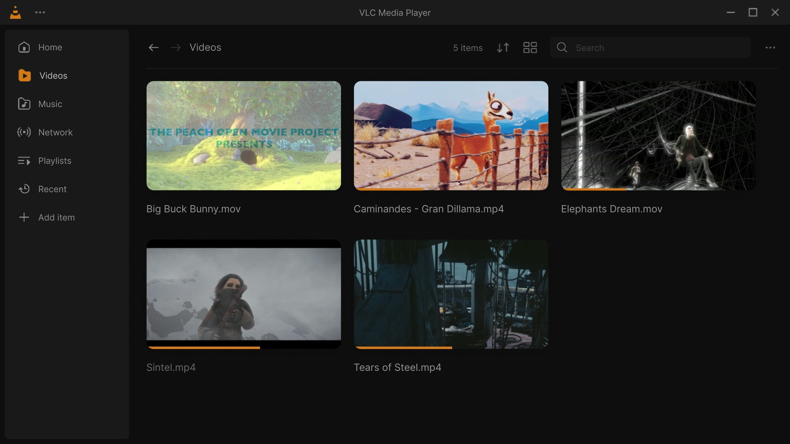
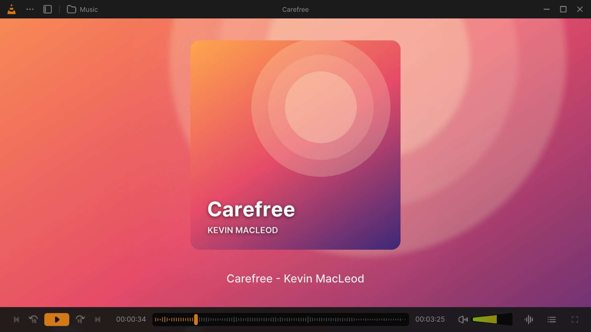
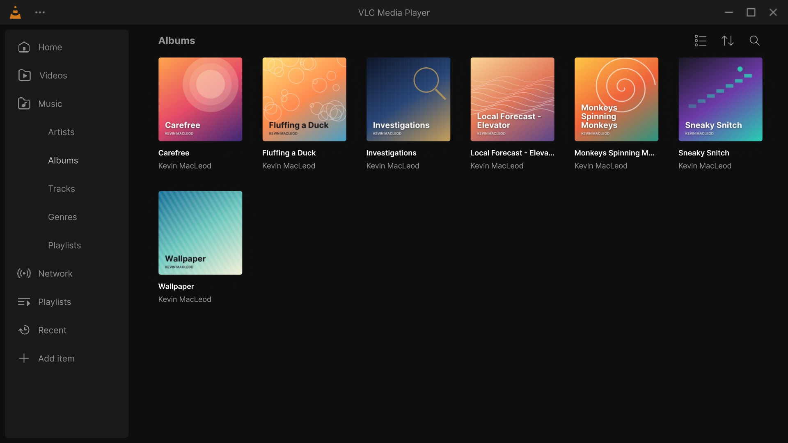

# Library

The library is the window VLC Redesign opens on: your videos and music, the media you played last, your playlists
and the network. It is VLC's media library: it reads the folders you add to it and keeps track of what you played,
how far, and how often.

Home with Continue Watching and the folders, then Videos, Music, Albums and Tracks. Click for the MP4 · every clip: [Feature tour](Feature-Tour#library).

## The sidebar

| Entry | What it shows |
|---|---|
| **Home** | Continue Watching, Listen Again, Frequently Visited Folders, Favorites, New Videos and New Music. |
| **Videos** | Every video of the library. |
| **Music** | The music of the library. While open, its pages are listed under it: **Artists**, **Albums**, **Tracks**, **Genres**, **Playlists**. |
| **Network** | Folders, this computer, devices and the shares of the local network. |
| **Playlists** | Every playlist, of videos and of songs. |
| **Recent** | The media played last, videos and songs together. |
| **TV** | The channels of your IPTV sources and their guide, while the Live TV add-on is on (new in 0.4.0): see [Live TV](Live-TV). |
| **Add item** (**+**) | Opens files to play (as <kbd>Ctrl</kbd>+<kbd>O</kbd>). |

- While the library reads its folders, a progress bar shows under the entries (*Scanning …*, *Indexing Medias
  (40%)*).
- **Edit Sidebar** (new in 0.4.0): right-click the sidebar, or *Settings > Interface > Sidebar*, to put its pages in
  your order (drag them, or use the arrows), hide the ones you do not use, or reset them.
- Drag the edge of the sidebar to make it wider or narrower. In a small window it shows its icons only; a click on
  **Music** then opens its pages as a menu.
- Without the media library ([Settings: Library](Settings-Library)), Home offers only **Open File** and **Open
  Disc**, and Videos, Music, Playlists and Recent have nothing to list.

## Home

Home lists what is recent, the newest first. Each section shows one row of cards (five rows in the list view); its
arrow (**›**) opens all of it. A section with nothing in it is not shown.

| Section | What it holds |
|---|---|
| **Continue Watching** | Videos you started, the last played first, with how far you got (an accent line under the picture). |
| **Listen Again** | The songs you played, the last played first. |
| **Frequently Visited Folders** | The folders of the media you play, the most played first. A folder opens the videos of the library grouped by folder. |
| **Favorites** | The media you marked as favorite (the **Favorite** button of the player, or *Favorite* in a right-click menu). |
| **New Videos** | The videos added to the library last. |
| **New Music** | The songs added to the library last. |

The header shows how many media the library has (*12 items*) and **Sort** (*Title A-Z*, *Title Z-A*, and the
duration up or down) for the cards of the sections. An empty library shows **Open File** and **Open Disc** instead.

## Videos

All the videos of the library, as cards or as a list.

- **A card** shows the picture, the file name, and an accent line under the picture for how far you watched. A
  video played to the end at least once has its name dimmed.
- **Sort**: *Title A-Z*, *Title Z-A*, and the duration up or down.
- **Group**, in the same menu after the orders: *Do not group videos*, *Group by name* or *Group by folder*.
- The videos' **Playlists** are a tab of the page too.

## Music

| Page | What it lists | Sort |
|---|---|---|
| **Artists** | The artists; one opens its albums and songs. | Title, number of tracks |
| **Albums** | The albums; one opens its tracks. *Play as Album* plays one in order. | Title, duration, date, artist |
| **Tracks** | Every song, as a table: title, album, artist, duration... | Title, album, artist, duration, track number, disc number |
| **Genres** | The genres; one opens its albums and songs. | Title |
| **Playlists** | The playlists of songs. | |

The pages of Music have a compact header: the page's name, then the list or grid view, **Sort** and **Search**.

## Network

The Network page lists **Folders**, **Computer** (the drives of this PC), **Devices** and **Network** (the shares
found on the local network; *No network shares found* when there are none). A place opens as a folder, with a path
of breadcrumbs. The header of a folder has **Add to medialibrary**, or **Remove from medialibrary** when it is in
the library already.

To play a stream: **⋯ → Open Network Stream** (<kbd>Ctrl</kbd>+<kbd>N</kbd>). Put one link per line to open several
at once, optionally saved as a playlist. Only links and paths are taken; the dialog says which word is not one.
Network access is set in [Settings: Network](Settings-Network).

## Playlists

Every playlist, of videos and of songs.

**Make one:** **New playlist** asks for a *Playlist title* (*e.g., Favorite Videos*), a thumbnail of your own
(*Choose a thumbnail*) and files (*Drag files into the box or click here to select files.*). A playlist can be saved
with its title alone and filled later. From anywhere in the library, **Add to Playlist** in a right-click menu adds
media to a playlist.

**A playlist's right-click menu:** **Play**, **Shuffle**, **Add to Queue**, **Favorite** / **Remove from
Favorites**, **Rename**, **Export Playlist** (to a playlist file), **Properties & Metadata** (its name, its media,
their length and its file), **Add Subtitle Tracks**, **Add Audio Tracks**, **Delete**.

**Opened**, a playlist lists its media, with **Add files**, **Move up** / **Move down**, **Remove Selected** (or
<kbd>Delete</kbd>) and *Subtitles…* for a media.

Removing media (*Remove selected media from this playlist?*) and deleting a playlist (*Do you really want to delete
the selected playlist?*) are confirmed first while *Show confirmation and error dialogs* is on
([Settings: General](Settings-General)).

## Recent

The media played last, videos and songs together, the last played first. What is remembered, and how to clear it,
is in [Settings: Privacy](Settings-Privacy).

## The right-click menu of a media

A right-click on a video, a song, an album, a folder or a file opens the menu card of the design. Depending on what
it is:

| Row | What it does |
|---|---|
| **Play**, **Play as Audio**, **Play as Album** | Plays it (a video without its picture, an album in order). |
| **Add to Queue**, **Add Album to Queue** | Adds it to the end of the play queue. |
| **Add to Playlist** | Adds it to a playlist (also *Add to a Video-only Playlist*, *Add to an Audio-only Playlist*). |
| **Favorite** / **Remove from Favorites** | Marks it as a favorite (Home › Favorites). |
| **Mark as Watched** / **Mark as Unwatched** | Changes what Continue Watching and the dimmed titles show. |
| **Show in File Explorer** | Opens its folder in Windows, the file selected. |
| **Go to Source** | Opens the folder of the library it was found in. |
| **Information**, **Properties & Metadata** | Its details, and the media information window. |
| **Add Subtitle Tracks**, **Add Audio Tracks** | Attaches subtitle or audio files to it for good (see [Subtitles](Subtitles#attach-subtitles-for-good)). |
| **Convert**, **Stream** | VLC's Convert / Save and Stream windows. |
| **Delete File From System** | Deletes the file from the disk, after *Are you sure you want to delete this file?* |

## The header: search, sort and views

Home, Videos, Network, Playlists, Recent and the folders share one header:

- **Back** and **Next** arrows, then the address of the page as breadcrumbs (each part opens its place).
- The count of items (*42 items*).
- **Sort**: the orders of the page, named as the design names them: *Title A-Z* / *Title Z-A*, *Newest First* /
  *Oldest First*, *Watched First* / *Unwatched First* (in a folder), *Album A-Z*, *Artist A-Z*, *Track Number
  Ascending*, *Disc Number Ascending*, *URI Ascending*...; an order without a name of the design (the duration)
  shows an arrow up or down. The library starts on **Title A-Z**; Home's sections keep the newest first. An order
  you pick stays.
- **List/Grid**: *Grid View* or *List View*.
- **Search**: looks through the page as you type. <kbd>/</kbd> or <kbd>Ctrl</kbd>+<kbd>K</kbd> opens it. *No media
  matches the search* when nothing does.
- **⋯** (more): *Open media* — *File…*, *Folder…*, *Disc…*, *Network stream…*, *Capture device…*, *Convert…*,
  *Stream…* — and **Add folder to library…**. In a folder, *Add File* and *Add Folder* come first.

In a narrow window, the count, Sort, the view, Search and ⋯ move under the address.

## Media folders

The library holds the media of the folders you add to it:

- the **media folder** chosen in the first-run setup (*Choose a Media Folder to get started with*);
- **⋯ → Add folder to library…** in the header of any page;
- **Add to medialibrary** in the header of a folder of the Network page; **Remove from medialibrary** takes it out
  again.

The library reads the new files of its folders by itself; **Rescan library** (in the **More** menu of the library
next to the video) reads them again. The list of folders, how files open and what VLC reads about them (metadata,
artwork) are in [Settings: Library](Settings-Library).

## The library mini player

While something plays and the library shows, it stays at hand:

- **A video** goes on in a small player over the library (picture in picture): drag it anywhere, click to pause,
  double-click to go back to the player.
- **The mini player card** shows the picture or the cover, a seek bar, the title and the controls. **Show queue**
  opens the queue on the card: drag a row by its handle to move it, **−** removes the selected row, **+** adds
  files.
- **The player bar** at the bottom: the cover and title (a click opens the player), the controls of the profile
  (Shuffle, Previous, Play, Next, Repeat in *Default*), the volume and **Switch Player**. With *Always show the
  player bar* ([Settings: Interface](Settings-Interface)) it stays while nothing plays.

See [The player](The-Player#the-mini-player). The buttons of the player bar change with the profile: see
[Customize the player](Customize-the-Player#the-built-in-profiles).

## The library next to the video

In the player, **Library** (top bar) or <kbd>L</kbd> opens a compact library over the left of the video:

- **Home** with the sections of Home (*See all* lists a whole section), **Videos** and its folders, **Music**
  (*Songs*, *Albums*, *Artists*, *Genres*; songs read *title - artist*), **Network** (*Add Network Stream*, the
  services of the network), **Playlists** (*Create playlist*) and **Recent**.
- Each place has its **Search**, **Sort** (*Title A-Z*, *Title Z-A*, *Newest First*, *Oldest First*), the grid or
  list **View**, *Play all*, *Add all to queue*, *Up one folder* in a folder, and a **More** menu (*Rescan
  library*, *Add folder to library…*, *Add network stream…*).
- **Open in the library** leaves the player for the same place in the library window.

## Good to know

- **A video is missing.** Its folder is not in the library: add it with **⋯ → Add folder to library…**, or wait for
  the scan to end (the progress bar under the sidebar).
- **A video is listed with its file name.** The library shows the file name of a video, extension included.
- **Watched or not.** **Mark as Watched** / **Mark as Unwatched** in the right-click menu set the dimmed title of a
  video by hand, for several selected videos at once too.
- **The library's title bar** reads *VLC Media Player*; it no longer keeps the name of the last song after playback
  stops.
- The theme and the accent colour of the library: [Colours and themes](Colours-and-Themes).

---

[The player](The-Player) · [Subtitles](Subtitles) · [Settings: Library](Settings-Library) · [Colours and themes](Colours-and-Themes) · [Home](Home)
