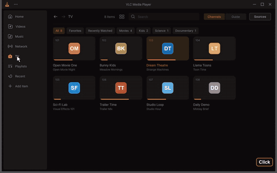
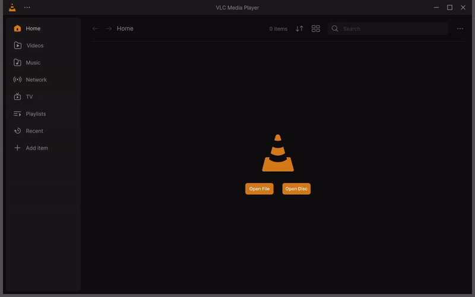

# Live TV

Watch the TV channels of your own IPTV provider in VLC Redesign, like on a TV box: the channels with their
logos and numbers, what is on now and next, a programme guide, channel up and down, and the past programmes
when your provider keeps an archive (catch-up).

Page Up and Page Down change channel; at every switch the banner shows the number, the programme on now with its progress, and its description. Click for the MP4 · every clip: [Feature tour](Feature-Tour#live-tv).

Live TV is an **add-on**: its own plugin, `plugins\misc\libiptv_plugin.dll` (on Linux and macOS
`plugins/misc/libiptv_plugin.so` / `.dylib`). It is on by default. You can turn it off in **Settings > General >
Live TV (IPTV) add-on**, or leave it out when installing (the installer's *Live TV (IPTV) add-on* component).
Off or left out, nothing of it is loaded or shown: no TV entry, no TV settings, no TV keys in the player.

VLC does not come with any channels. You add your own link, or one of the free, legal channel lists of the
catalog.

## Add your TV

Open **TV** in the sidebar, then **Add a Link** (or **Sources** at the top of the TV page, **Settings > TV > Manage
Sources**, or **TV** in the player's library next to the video).

| Source | What to type |
|---|---|
| **Playlist (M3U)** | The M3U or M3U8 link your provider gave you, or a playlist file (**Browse**). The guide it names in its header (`url-tvg`, `x-tvg-url`) is used by itself. A list behind a login (Basic or Digest): its user name and password, optional. |
| **Xtream Codes** | The server (`http://host:port`), your user name and password. The live channels, the guide of the account, and its films and series. |
| **Guide (XMLTV)** | A programme guide link (`.xml` or `.xml.gz`) for a source added before. |

You can also add **guide links** of your own to any source, one per line. Several guides are merged; the first
ones win when two describe the same channel. The order of the sources (the ▲ button in *Your Sources*) is the
order of their guides.

Links and passwords are kept in VLC's keystore (the Windows credential encryption, the Secret Service or KWallet
on Linux, the Keychain on macOS), never written to the log.

### Your servers and tuners (Accounts)

**Accounts** in TV Sources adds the TV of your own server or tuner, its channels and its guide:

| Type | What to type | What it uses |
|---|---|---|
| **Jellyfin** | The server's address (`http://192.168.1.10:8096`), your user name and password, or an API key made in its dashboard | Its Live TV: the channels, their guide (7 days), each channel opened as the server serves it (direct, else HLS, else its transcode) |
| **Emby** | The same | The same, through its `/emby` API |
| **Tvheadend** | Its address (port 9981); a user and password when it asks for one (Basic or Digest) | Its channel list (`/playlist/channels.m3u`) and guide (`/xmltv/channels`) |
| **NextPVR** | Its address (port 8866) and PIN (0000 when none was set) | Its channels and listings (its JSON API, a session signed in by the PIN) |
| **Channels DVR** | Its address on your network (port 8089), no account | Its channel list and guide (`/devices/ANY/…`) |
| **HDHomeRun** | Its address, no account | Its lineup (the channels without DRM) and its free guide |
| **Schedules Direct** | Your user name and password | A paid guide (the US, Canada and more): the stations of your account's lineups, for the channels of every source, matched by their names and call signs. Only the SHA-1 of the password is kept, as the service asks |

**Test** (or **Sign in**) answers *Signed in as …*, *Server found*, *Wrong user name or password* (*Key refused*)
or *No answer, try again*. **Sign Out** (when you edit an account) forgets its password and key and turns it off.
A server that refuses the sign-in later says *Sign-in refused: check it* on its row in *Your Sources*.

**Found on your network**: Jellyfin and Emby (they answer on UDP 7359), HDHomeRun tuners (UDP 65001, and the list
of HDHomeRun's own service for when the network blocks it) and Channels DVR (Bonjour) are looked for when Accounts
opens; one click fills in the address. **Look again** looks once more.

Plex is not there: its Live TV needs a Plex Pass and plays only through its transcoder's sessions, with no
stream another player can open; its free channels are in the catalog.

### The catalog

Sources and the catalog of free, legal lists, then the channels of a source with their logos, numbers, groups and what is on (a made-up demo provider). Click for the MP4 · every clip: [Feature tour](Feature-Tour#live-tv).

**Catalog** lists free, legal channel lists, with what each one has: the number of channels, a guide, catch-up,
films and series, free or paid, its languages and countries. Filter them by language, country, category or what
they can do, search, sort, and **Add** one in a click (with its guide). **For you** (the first order) puts the
lists of your country and languages first; **Recommended** shows only those. The lists of
[iptv-org](https://github.com/iptv-org/iptv) of every country and category with channels are there, made from its
API, each country's with the guide that names its channels by iptv-org's ids.

Every list and guide of the catalog is checked every day: one that fails twice in a row says *Not answering* and
comes last (it stays). The catalog of the version is built in; the one checked last is downloaded once a day from
the project's website (offline: the one built in).

### The guides (Guides)

**Guides** in TV Sources shows each source with how many of its channels have a guide, and each of its guides:
how many programmes it has (or its error), where it comes from (*Added by you*, *From the playlist*, *Found for
you*), **Turn Off** / **Turn On** and **Remove** (the playlist's own guides can only be turned off). **Update**
downloads the source and its guides again; **Edit** changes them.

**The automatic guide**: a source whose guides miss channels has them matched to
[iptv-org's database](https://iptv-org.github.io/api/) of channels: by their guide id (`tvg-id`), else by their
name and country (without case, accents, *HD*/*FHD*, country prefixes like *UK:* and notes like *(1080p)*; a *+1*
channel gets the guide of the one it repeats, an hour later). The free guides of the catalog that carry those
countries are attached, and a message says *Guide found for 112 of 130 channels*, with **Undo**. It runs by itself
after an update, once a week at most; **Find a Guide** runs it now, and **Remove** (on its guides) takes it away
for good. iptv-org's list (8 MB) is downloaded once a week and only the names, ids and countries are kept.

**Guide Id…** in a channel's menu (right-click on the TV page): the id the guides give that channel. Yours comes
first; empty, the one of its list or the one found for it is used.

**Suggest a Service** opens a new discussion on the project's GitHub with the form to fill in (its name, website,
links, languages, catch-up, films, free or paid, and why). Nothing is sent by VLC. Suggestions are reviewed before
they reach the catalog.

## The TV page

- **Channels**: a row per channel with its number, its logo, its name, what is on with the progress of it and
  what is next. Or **Grid View** (the List/Grid button of the header). The search of the header finds a channel by
  its name or its number.
- The **groups** of your provider are the chips above the list, with **All**, **Favorites** and **Recently
  Watched** (the mouse wheel goes along them when they run past the width).
- **Right-click** a channel: *Watch*, *Watch from the start* (with catch-up), *Favorite*, *Show in the Guide*,
  *What's On*.
- The marks at the end of a row: ↺ *7 d* is a channel with an archive of the past 7 days; the heart a favourite.

### The guide

The guide: the line of now and each programme's progress, *Later* and *Now*, and the Kids group. Click for the MP4 · every clip: [Feature tour](Feature-Tour#live-tv).

**Guide** at the top of the TV page: the channels down, the time across, the accent line at now.

- **Now** goes back to now; **Earlier** and **Later** move by the hours shown; drag the hours, use Shift and the
  wheel, or Left and Right (half an hour).
- Click a programme for its details (title, episode, time, category, description): **Watch** (on now), **Watch**
  a past one from the archive, **Watch from the Start**, or **Remind Me** for one to come. A reminder shows a
  minute before the start with *Watch*.
- Double-click a programme to watch it.

## Watching

A channel plays alone in the queue, as a TV switches channels, and is not added to the library or the history.

| Key | What it does |
|---|---|
| **Page Up / Page Down** (Channel Up / Down) | the next and the previous channel of the group you chose it in |
| **0 – 9** | type a channel number (it plays after a moment, or with Enter) |
| **Backspace** | back to the previous channel |
| **Enter** | the channel list over the video: Up and Down, Enter plays, Left and Right switch the group, Esc closes |
| **I** | the banner of the channel again |
| **Left / Right** (banner shown) | the programmes before and after on the channel's guide; Enter watches a past one from the archive or sets a reminder for one to come, Esc goes back to what is on (elsewhere they seek, as always) |

At every switch the **banner**, a slim bar centred over the video, shows the channel, what is on with its
progress and the time left, and what is next; with *Show programme descriptions* it grows for the episode, the
category and three lines of the description. It hides by itself, and stays while you type a number or browse the
guide (its ‹ › buttons, or a swipe across a touchpad). Its buttons: the programme on now from its start (with
catch-up), the channel up and down, the channel list. While a programme of the archive plays, **Back to Live**
returns. When a channel has no archive, VLC says so.

**The library next to the video** (the player's **Library** button, or <kbd>L</kbd>) has **TV** after *Network*:
the channels with their groups and the search, a click switches channel while the video stays. Opened while a
channel plays, it shows that channel in the group you chose it in. See
[The library next to the video](The-Player#tv-next-to-the-video).

**Subtitles** are for films and videos: a live channel (and music) has no subtitle files, online search or sync,
and the *Languages and tracks* button only shows when the stream carries subtitle or audio tracks to choose from.
Films and series of an Xtream account have every subtitle feature.

**Customize Player** has a **TV** button (while the add-on is on): the channel list over the video while a channel
plays, the TV page otherwise. A bar that has it keeps working without the add-on: the button then takes no room.

## The sidebar

**Edit Sidebar…** (right-click the sidebar, or *Settings > Interface > Sidebar*) puts its pages in your order: drag
a page by its handle, or move it with ▲ ▼ (Ctrl+Up and Ctrl+Down), show or hide each one (one at least stays),
**Reset to Default**. TV takes its place after Network while the add-on is on; off, its place is kept for when it
comes back.

## Settings > TV

| Setting | What it does |
|---|---|
| Sources | each source with its channels; *Update*, *Manage Sources*, *Browse the Catalog* |
| Update the channels and the guide | never, every 6 or 12 hours, every day (default), every week, in the background |
| Days of the guide kept | the days before and after today that are kept (1 to 14, default 7) |
| Hours across the guide | the time the guide shows across (1 to 12 hours, default 3) |
| Guide languages | keep only the programmes in these languages when a guide gives several (`en, he`) |
| Channel banner | channel, now and next / channel and now / channel only / nothing |
| Start on the last channel | when VLC opens with nothing to play |
| Show the progress of what is on, Show what is next, Show programme descriptions | in the lists and the banner |
| Show adult channels | off by default |

## How it works

The add-on downloads the playlists and the guides with VLC's own network access (its proxy and network
settings), in the background, and keeps them on disk: the channels show at once when VLC starts, and Live TV works
offline with what was downloaded last. A guide of hundreds of megabytes is read as it is inflated, keeping only
the channels of your playlists and the days around today; the descriptions stay on disk until shown. The
channels are matched with the guide by the guide id you gave them (**Guide Id…**), their `tvg-id`, then by their
name (without "HD", country prefixes and the like), then by the iptv-org id the automatic guide found, and
`tvg-shift` moves a channel's guide by its hours.

Your servers' channels and guides are asked by their APIs and written next to the source as a playlist and a
guide, read as any other source; the passwords and keys stay in the keystore (an empty field when you edit keeps
them), and a Jellyfin or Emby session lasts while VLC runs.

Catch-up uses what the playlist says (`catchup`, `catchup-source`, `catchup-days`, `tvg-rec`): the *default*
and *append* modes, templates (`{utc}`, `{duration}`, `{Y}{m}{d}`...), Flussonic archives and Xtream Codes
timeshift.
