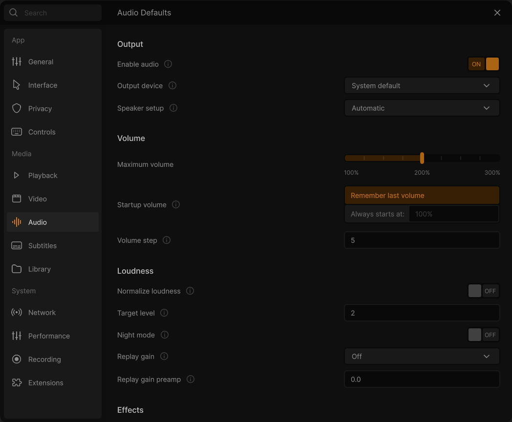
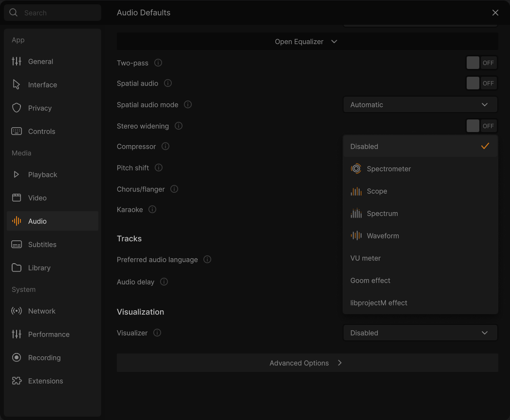

# Settings: Audio

**⋯ → Settings → Audio** (or <kbd>Ctrl</kbd>+<kbd>P</kbd>). The audio output, the volume at startup, loudness, the equalizer and audio effects, visualizations.

Rows under **Advanced Options** are in the collapsed bar at the bottom of the page. Rows marked *Developer mode only* appear there once **Developer mode** is on ([General](Settings-General)). See [how the Settings window works](Settings).

### Output
- **Enable audio**: toggle. Default: on. Turns audio output off completely, so audio is not even decoded. This saves processing power. VLC option: `audio`
- **Output device**: dropdown: System default, then the audio devices found. Default: System default. Selects your audio output device. *(Windows: MMDevice audio output.)* VLC option: `mmdevice-audio-device`
- **Speaker setup**: dropdown: Automatic / Stereo / Reverse stereo / Left / Right / Dolby Surround / Mono. Default: Automatic. How the stereo output is arranged. VLC option: `stereo-mode`

### Volume
- **Maximum volume**: slider from 100 % to 300 % (ticks every 25 %). Default: 200 %. Highest volume the volume slider and keys allow. VLC option: `qt-max-volume`
- **Startup volume**: special two-choice widget: **Remember last volume** or **Always starts at:** with a percentage field (0–125 %). Default: Remember last volume (100 % when the other choice is picked). Whether VLC starts at the volume you last used or always at a fixed volume. VLC option: `volume-save` (remember) and `mmdevice-volume` (the starting volume)
- **Volume step**: number field, in percent. Default: 5 (stored as 12.8 of 256). How much each volume-up or volume-down step changes the volume. VLC option: `volume-step`

### Loudness
- **Normalize loudness**: toggle. Default: off. Adds the `normvol` filter to `audio-filter`. Turns on VLC's volume normalizer, which evens out loud and quiet passages.
- **Target level**: number field. Default: 2.0. When the average power over recent audio goes above this value, the volume is normalized. Values from 0.5 to 10 are sensible. VLC option: `norm-max-level`
- **Night mode**: toggle. Default: off. Turns on the `compressor` filter with ratio 8:1, threshold −30 dB and makeup gain +9 dB. Turning it off restores the previous compressor settings. Reduces the gap between loud and quiet sounds for quiet listening.
- **Replay gain**: dropdown: Off / Track / Album. Default: Off. Uses the replay-gain information in files to level volume per track or per album. VLC option: `audio-replay-gain-mode`
- **Replay gain preamp**: number field (dB, one decimal). Default: 0.0. Changes the default target level (89 dB) for streams with replay-gain information. VLC option: `audio-replay-gain-preamp`

### Effects
- **Equalizer**: toggle. Default: off. Adds the `equalizer` filter to `audio-filter`. Turns on the 10-band equalizer.
- **Equalizer preset**: dropdown: None, then Flat, Classical, Club, Dance, Full bass, Full bass and treble, Full treble, Headphones, Large Hall, Live, Party, Pop, Reggae, Rock, Ska, Soft, Soft rock, Techno, each with the curve of its bands (the design's *EQ presets*). It reads None while the equalizer is off. Default: Flat. The preset to use. Choosing one clears custom band values and sets the preamp to the preset's value. *Changed in 0.3.0: None and the curves; the presets of the Effects window are the same list.* VLC option: `equalizer-preset`
- **Open Equalizer / Close Equalizer**: expandable panel with 11 vertical sliders: Preamp, 60 Hz, 170 Hz, 310 Hz, 600 Hz, 1 kHz, 3 kHz, 6 kHz, 12 kHz, 14 kHz, 16 kHz. Each goes from −20 to +20 dB in 0.1 dB steps, works with drag or the mouse wheel, and shows its value in dB underneath. Defaults: preamp 12 dB, bands from the chosen preset. Lets you set the bands by hand instead of using a preset. VLC option: `equalizer-preamp` (preamp) and `equalizer-bands` (the 10 bands)
- **Two-pass**: toggle. Default: off. Filters the audio twice for a stronger effect. VLC option: `equalizer-2pass`
- **Spatial audio**: toggle. Default: off. Adds the `spatializer` filter to `audio-filter`. Turns on VLC's audio spatializer, a room or reverb effect.
- **Spatial audio mode**: dropdown: Automatic / Stereo / Headphone virtualization / 4.0 / 5.1 / 7.1. Default: Automatic. How audio is mixed for the output. "Headphone virtualization" is binaural rendering for headphones. VLC option: `mix-mode`
- **Stereo widening**: toggle. Default: off. Adds the `stereo_widen` filter. A simple stereo-widening effect.
- **Compressor**: toggle. Default: off. Adds the `compressor` filter. A dynamic range compressor that reduces the difference between loud and quiet sounds.
- **Pitch shift**: number field (semitones, two decimals, −12 to +12). Default: 0.00. Any non-zero value also turns on the `scaletempo_pitch` filter. Shifts the pitch of the audio in semitones. VLC option: `pitch-shift`
- **Chorus/flanger**: toggle. Default: off. Adds the `chorus_flanger` filter. A chorus/flanger sound-delay effect.
- **Karaoke**: toggle. Default: off. Adds the `karaoke` filter. A simple karaoke filter that removes centre-panned vocals.

### Tracks
- **Preferred audio language**: dropdown: Automatic, System language, then the same 30 languages as the menu language. Default: Automatic. Language of the audio track VLC picks by default. VLC option: `audio-language`
- **Audio delay**: number field, in ms. Default: 0. Delays the audio output. Useful if the audio lags behind or runs ahead of the video. VLC option: `audio-desync`

### Visualization

- **Visualizer**: dropdown (the design's *Audio Visualizer*): Disabled, Spectrometer, Scope, Spectrum, Waveform (with their icons), VU meter, then the other visualizations of this build (Goom effect, libprojectM effect…). *Automatic* is listed only while it is the one chosen. Default: Disabled. Adds a visualization while audio plays. *Changed in 0.3.0: the effects of the visualizer are listed by name (before: one "Visualizer filter").* VLC options: `audio-visual`, and `effect-list` for Spectrometer to VU meter (`audio-visual` = `visual`)

### Advanced Options
- **Audio output module**: dropdown of the audio output modules. Default: Automatic (`any`). The method VLC uses to output audio. Automatic picks the best available. *(Developer mode. Hidden if the build has no choices.)* VLC option: `aout`
- **Output gain**: slider from 0 to 8 with a numeric value. Default: 1.00. A linear gain applied to the audio output. *(Developer mode only.)* VLC option: `gain`
- **Keep the pitch when changing the speed**: toggle. Default: on. Plays audio slower or faster without changing its pitch. *(Developer mode only.)* VLC option: `audio-time-stretch`
- **Pass compressed audio to the receiver**: toggle. Default: off. Forces S/PDIF pass-through when the audio output can't negotiate it. *(Windows, macOS and Android builds.)* VLC option: `spdif`
- **Detect Dolby Surround**: dropdown: Automatic / On / Off. Default: Automatic. Use it when a stream is (or is not) Dolby Surround but is detected wrongly. VLC option: `force-dolby-surround`
- **Resampling quality**: dropdown: Fastest / Fast / Balanced / High / Best. Default: Balanced. Quality of the SoX resampler, traded against CPU use. *(Needs the soxr module.)* VLC option: `soxr-resampler-quality`
- **Media role**: dropdown: Video / Music / Communication / Game / Notification / Animation / Production / Accessibility / Test. Default: Video. Tells the operating system what kind of audio VLC plays, for its audio policy. VLC option: `role`
- **Visualization size**: dropdown: Match window / 1280 × 720 / 1920 × 1080 (plus a custom size already set). Default: Match window (800 × 500). The size the visualizations are drawn at. VLC option: `effect-width` and `effect-height`

---

← [Video](Settings-Video) · [All settings](Settings) · [Subtitles](Settings-Subtitles) →
