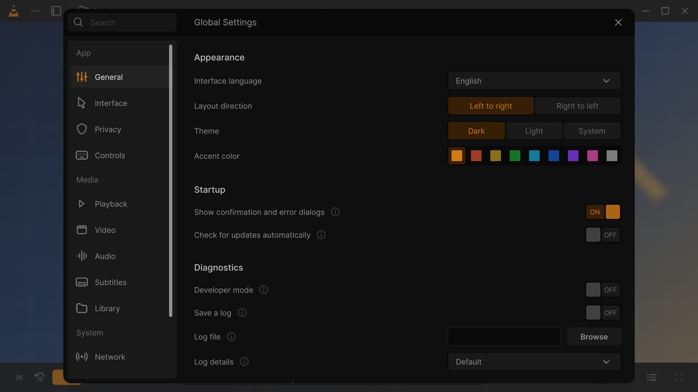

# Settings: General

**⋯ → Settings → General** (<kbd>Ctrl</kbd>+<kbd>P</kbd>; the header reads *Global Settings*). The language and look
of the app, the update check, the logs, Developer mode and the reset button. See
[how the Settings window works](Settings#how-the-window-works).

## Appearance

These four rows preview at once: the whole interface changes while the window is open, and the choice is kept when
it closes. They are interface settings, not VLC options.

| Option | Choices / default | What it does |
|---|---|---|
| **Interface language** | Dropdown: *Auto* (the language of Windows), then the complete languages, then the partial ones marked *(partial)*. Default: *English*; an installed copy starts in the language chosen in Setup. | The language of every menu and window of VLC Redesign. It changes at once, without a restart. See [Languages](Languages). |
| **Layout direction** | Segmented: *Left to right* / *Right to left*. Default: the direction of the language. | Mirrors the interface. Choosing a language sets it (Hebrew, Arabic, Persian… switch to *Right to left*); you can change it afterwards, for example to keep a right-to-left language laid out left to right. See [Languages](Languages#layout-direction). |
| **Theme** | Segmented: *Dark* / *Light* / *System*. Default: *System*. | The colour scheme of the whole interface. *System* follows Windows' app mode, also while VLC runs. See [Colours and themes](Colours-and-Themes). |
| **Accent color** | Nine swatches: orange `#D37918`, red `#E15033`, gold `#C49D24`, green `#18A235`, cyan `#18AAD3`, blue `#185DD4`, purple `#8E41FF`, pink `#F051B5`, grey `#AFAFAF`. Default: orange. | The colour of selections, sliders, toggles and active items. Stored as `redesign/accent`. |

On systems other than Windows, VLC follows the system language: the **Interface language** row shows
*System language (xx_YY)* as plain text, with the note *VLC follows the system language.*

## Startup

| Option | Choices / default | What it does | VLC option |
|---|---|---|---|
| **Show confirmation and error dialogs** | Toggle. Default: on. | On: VLC's errors appear at the bottom of the window (a media that cannot open, for example), and VLC asks before removing media from a playlist or from the play queue, or deleting playlists. Off: errors are only kept in VLC's messages and those removals happen at once. Deleting a file from the disk is always confirmed. | `qt-error-dialogs` |
| **Check for updates automatically** | Toggle. Default: on. | Looks for a new release of VLC Redesign on GitHub when VLC starts, at most once a day. See [Install and update](Install-and-Update). | `redesign-update-check` |

## Diagnostics

| Option | Choices / default | What it does | VLC option |
|---|---|---|---|
| **Developer mode** | Toggle. Default: off. | Shows the expert rows (marked *Developer mode* on these pages) under the Advanced Options of every page, and adds **All VLC options** to this page. | `redesign/developer-mode` (interface setting) |
| **Save a log** | Toggle. Default: off. | Writes VLC's messages to a text file. The log starts or stops when the Settings window closes; no restart is needed. | `file-logging` |
| **Log file** | Path field with **Browse** (a save dialog titled *Choose a log file*). Default: empty. | Where the log is written. Empty: `vlc-log.txt` (`vlc-log.html` in HTML format) in VLC's working folder, which is often not writable for an installed copy, so choose a full path. | `logfile` |
| **Log details** | Dropdown: *Default* / *Information* / *Errors only* / *Errors and warnings* / *Everything (debug)*. Default: *Default*. | How much goes into the log file. *Default* follows **Show minor warnings** below. | `log-verbose` (−1, 0, 1, 2, 3) |

### Good to know

- **What each level really logs.** VLC's file logger adds one level to the value chosen (upstream VLC behaviour,
  `modules/logger/file.c`), so the file holds more than the names say: *Default* and *Information* log errors and
  information; *Errors only* also logs warnings; *Errors and warnings* and *Everything (debug)* log everything,
  debug messages included. For a bug report choose *Everything (debug)*.
- The log is **appended** to the file, and each line is written at once, so the last lines survive a crash. Delete
  the file to start a new one.
- While the **Messages** window (<kbd>Ctrl</kbd>+<kbd>M</kbd>) is open it takes the messages; the log file
  continues once it closes. See [Save a log](Troubleshooting-and-FAQ#save-a-log).

## Advanced Options

| Option | Choices / default | What it does | VLC option |
|---|---|---|---|
| **Show minor warnings** | Toggle. Default: off (0). On writes 1. | Raises VLC's verbosity from errors and information to warnings as well. It applies when the window closes, but VLC never saves this option (it is volatile), so it is off again at the next start. To keep it, add `--verbose=1` to the next row. | `verbose` |
| **Additional command line options** | Text field. Default: empty. | Options VLC reads at every start, as if written on its command line, for example `--no-osd --network-caching=3000`; quote a value that contains spaces. The real command line wins when it gives the same option. Files to open, and options only a command line can give (`--help`, `--config`, `--reset-config`…), are ignored. Shows *Applies the next time VLC starts* once changed. | `extra-options` |
| **Log format** | Dropdown: *Plain text* / *HTML*. Default: *Plain text*. | The format of the log file. HTML colours errors, warnings and debug lines. | `logmode` (`text` / `html`) |
| **Collect playback statistics** | Toggle. Default: on. | Collects local statistics of the playing media (bitrates, lost and displayed frames…) for the *Statistics* of the media information window. Nothing is sent anywhere. | `stats` |
| **Open configurations folder** | Button **Open**. | Opens VLC Redesign's settings folder (`vlcrc`, `vlc\vlc-qt-interface.ini`, the media library…) in File Explorer. | |
| **Reset all settings** | Red button **Reset**. | Asks *Reset all settings?* (*Every setting of VLC media player goes back to its default.*). **Reset** puts every VLC option and every interface setting back to its default, the interface language back to English and the layout to its direction, then closes the window. The media library and its history are kept. | |
| **Welcome setup** | Button **Open**. | Closes Settings (keeping your changes) and runs the first-run welcome steps again. | |
| **All VLC options** *(Developer mode)* | Button **Open**. | Closes Settings and opens VLC's classic preferences, which list every option of VLC and its modules. | |

**Developer Options** (a heading with four rows) appears between *Reset all settings* and *Welcome setup* only in
builds that have VLC's POSIX system logger, so **not on Windows**:

| Option | Choices / default | What it does | VLC option |
|---|---|---|---|
| **Write to the system log** | Toggle. Default: off. | Sends VLC's messages to the system log (syslog). | `syslog` |
| **Include debug messages in the system log** | Toggle. Default: off. | Adds debug messages. | `syslog-debug` |
| **System log identity** | Text. Default: `vlc`. | The process name the messages are logged under. | `syslog-ident` |
| **System log facility** | Dropdown: `user`, `daemon`, `local0` to `local7`. Default: `user`. | The syslog facility. | `syslog-facility` |

## When to change what

- **Something goes wrong:** turn on **Save a log**, set **Log file** to a full path (for example on the Desktop)
  and **Log details** to *Everything (debug)*, reproduce the problem, then attach the file to a
  [bug report](Troubleshooting-and-FAQ#report-a-bug).
- **A command-line option you always use:** put it in **Additional command line options** instead of editing a
  shortcut.
- **Start over:** **Reset all settings**. To reset only the keys, use **Reset all shortcuts** on
  [Controls](Settings-Controls).

---

[All settings](Settings) · [Interface](Settings-Interface) →
