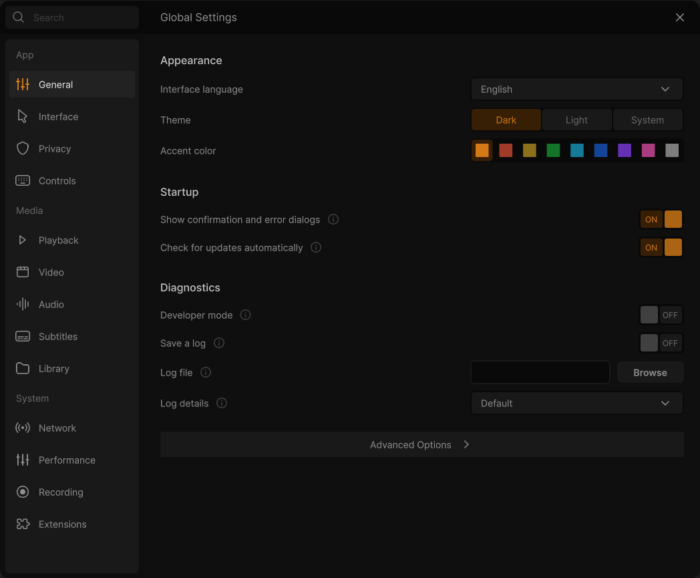
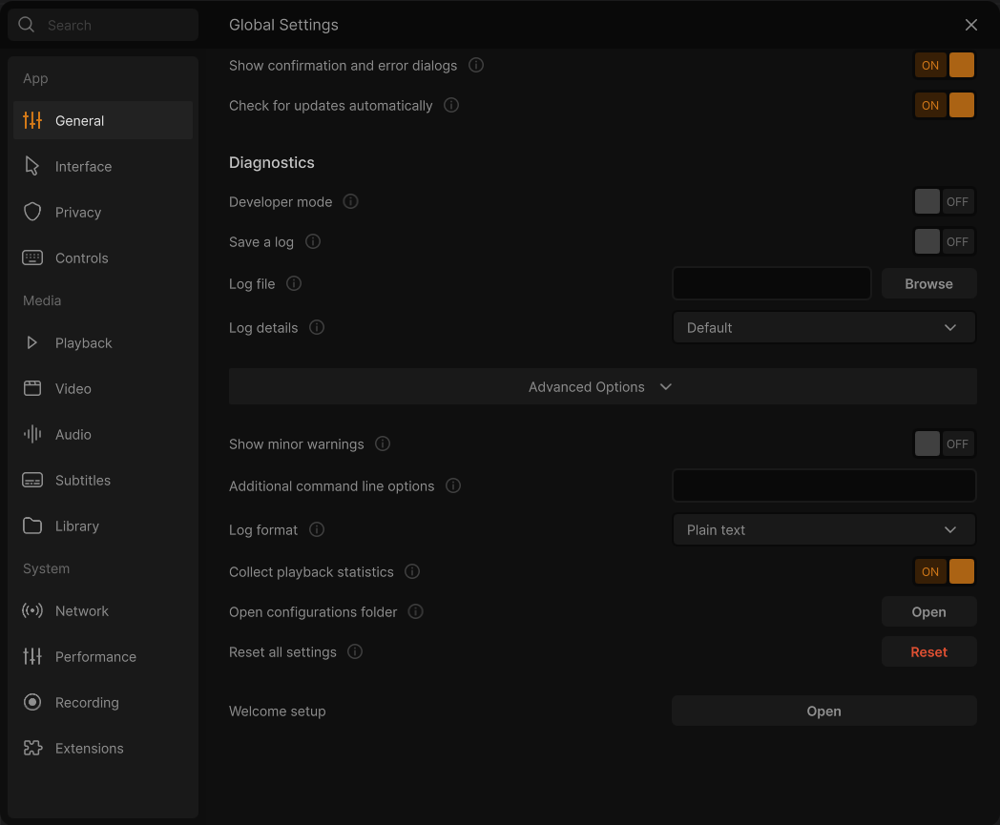

# Settings: General

**⋯ → Settings → General** (or <kbd>Ctrl</kbd>+<kbd>P</kbd>). The look of the app (theme, accent colour, language), updates, logs and the reset button.

Rows under **Advanced Options** are in the collapsed bar at the bottom of the page. Rows marked *Developer mode only* appear there once **Developer mode** is on ([General](Settings-General)). See [how the Settings window works](Settings).

### Appearance
- **Interface language**: dropdown of the interface languages VLC ships, starting with Auto (the language of Windows). Default: English: VLC Redesign starts in English until you choose a language here, whatever the language of Windows, and *Reset all settings* comes back to English. Stored by the interface's own language setting, not a vlcrc option. It picks the language of VLC's menus and windows. A new language applies at once, without a restart (since 0.3.0): see [Languages](Languages). *(The dropdown is shown on Windows. On other systems the row shows read-only text, "System language (xx_YY)", plus the note "VLC follows the system language.")*
- **Theme**: segmented control: Dark / Light / System. Default: System. Interface theme setting. Changes the colour scheme of the whole interface. You see the preview immediately, and it is saved when the window closes. See [Colours and themes](Colours-and-Themes).
- **Accent color**: row of 9 colour swatches: orange `#D37918`, red `#E15033`, gold `#C49D24`, green `#18A235`, cyan `#18AAD3`, blue `#185DD4`, purple `#8E41FF`, pink `#F051B5`, grey `#AFAFAF`. Default: orange `#D37918`. The highlight colour used for selections, sliders and active items. It applies immediately. Interface setting: `redesign/accent`

### Startup
- **Show confirmation and error dialogs**: toggle. Default: on. *New in 0.3.0.* On, the errors of VLC show at the bottom of the window (a media that cannot open, for example), and VLC asks before removing media from a playlist or from the play queue, or deleting playlists. Off, the errors are only kept in VLC's messages and these removals are done at once. Deleting a file from the disk is always confirmed. VLC option: `qt-error-dialogs`
- **Check for updates automatically**: toggle. Default: on. Looks for a new release of VLC Redesign on GitHub when VLC starts, at most once a day. VLC option: `redesign-update-check`

### Diagnostics
- **Developer mode**: toggle. Default: off. Shows the expert options under the Advanced Options of each page, and adds **All VLC options** to this page. Interface setting: `redesign/developer-mode`
- **Save a log**: toggle. Default: off. *Applies after a restart.* Writes all VLC messages to a text file. VLC option: `file-logging`
- **Log file**: file-path field with a **Browse** button (save-file dialog, "Choose a log file"). Default: empty, which makes VLC write `vlc-log.txt` (`vlc-log.html` in HTML format). *Applies after a restart.* Where the log is saved. VLC option: `logfile`
- **Log details**: dropdown: Default / Information / Errors only / Errors and warnings / Everything (debug). Default: Default. *Applies after a restart.* How much detail goes into the log file. "Default" uses the same level as VLC's general verbosity. VLC option: `log-verbose`

### Advanced Options

- **Show minor warnings**: toggle. Off = errors only (0), on = also warnings (1). Default: off. *Applies after a restart.* Raises VLC's message verbosity so warnings are included as well as errors. *Note: VLC declares `verbose` as a volatile option and never saves it to vlcrc, so this toggle may not survive a restart.* VLC option: `verbose`
- **Additional command line options**: text field. Default: empty. *New in 0.3.0.* *Applies after a restart.* Options VLC reads at every start, as if they were written on its command line; the command line wins when it gives the same option. Write them as on a command line, for example `--no-osd --network-caching=3000`, and quote a value with spaces. Files to open, and the options only a command line can give (`--help`, `--config`, `--reset-config`…), are left out. VLC option: `extra-options`
- **Log format**: dropdown: Plain text / HTML. Default: Plain text. *Applies after a restart.* Format of the saved log file. VLC option: `logmode`
- **Collect playback statistics**: toggle. Default: on. Collects local statistics about the playing media, such as bitrates and lost frames, shown in the media information window. VLC option: `stats`
- **Open configurations folder**: button **Open**. Opens the folder that holds VLC's settings files (vlcrc and so on) in the file manager.
- **Reset all settings**: red button **Reset**. Asks "Reset all settings?" ("Every setting of VLC media player goes back to its default."), then resets every VLC option and every interface setting and closes the window.
- *Developer Options* heading. *(Only on systems with a POSIX system log, so not on Windows.)*
  - **Write to the system log**: toggle. Default: off. Key `syslog`. [restart] Sends VLC's log messages to the system log.
  - **Include debug messages in the system log**: toggle. Default: off. Key `syslog-debug`. [restart] Also sends debug messages to the system log.
  - **System log identity**: text field. Default: `vlc`. Key `syslog-ident`. [restart] The process name the messages appear under.
  - **System log facility**: dropdown: user, daemon, local0 to local7. Default: user. Key `syslog-facility`. [restart] Which system log facility is used.
- **Welcome setup**: button **Open**. Closes Settings and runs the first-run Welcome setup again.
- **All VLC options**: button **Open**. Closes Settings and opens the classic VLC preferences, which list every option of VLC and its modules. *(Shown when Developer mode is on.)*

---

[All settings](Settings) · [Interface](Settings-Interface) →
