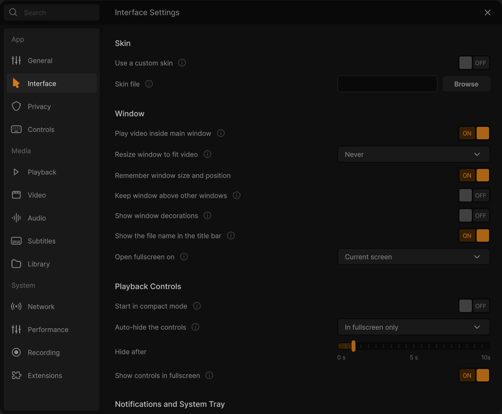
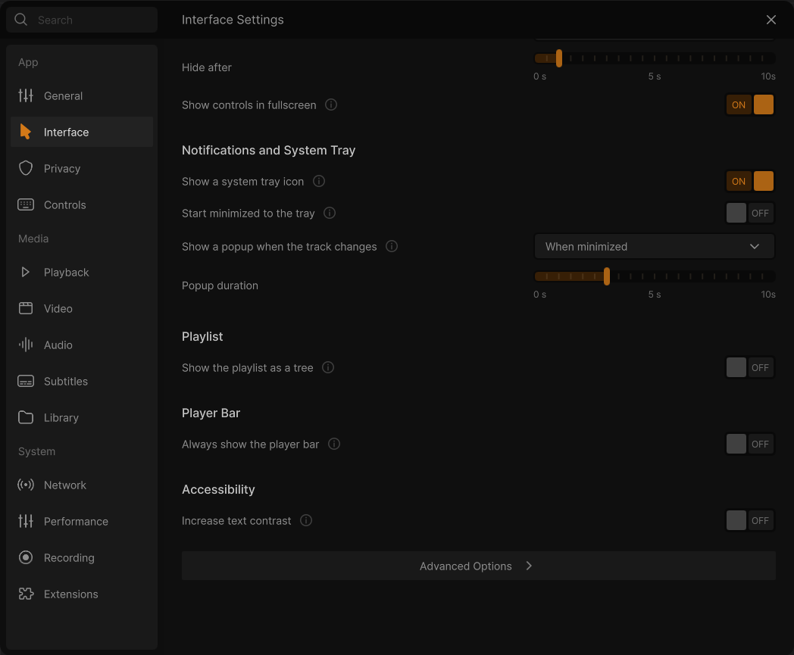
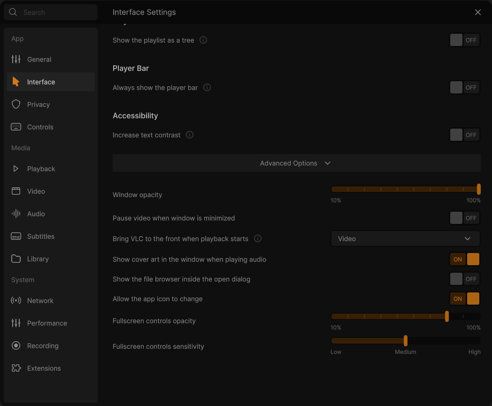

# Settings: Interface

**⋯ → Settings → Interface** (<kbd>Ctrl</kbd>+<kbd>P</kbd>; the header reads *Interface Settings*). The main window,
the playback controls, notifications and the tray icon, the play queue as a tree, the player bar, text contrast,
and VLC's classic skins. Every row applies when the Settings window closes, except **Use a custom skin**. See
[how the Settings window works](Settings#how-the-window-works).

## Skin

Shown only in builds that include VLC's *skins2* interface. A skin replaces this interface entirely: VLC starts
with one or the other.

| Option | Choices / default | What it does | VLC option |
|---|---|---|---|
| **Use a custom skin** | Toggle. Default: off. | Starts VLC with the skin chosen below instead of this interface. Shows *Applies the next time VLC starts* once changed. Turning it off brings back the default interface. | `intf` (on = `skins2`) |
| **Skin file** | Path field with **Browse** (*Choose a skin*, filter *Skin files (\*.vlt \*.wsz \*.xml)*). Default: empty. | The skin the skins interface opens. | `skins2-last` |

To come back from a skin, start VLC once with `--intf=qt` (for example from a shortcut), open Settings and turn
**Use a custom skin** off.

## Window

| Option | Choices / default | What it does | VLC option |
|---|---|---|---|
| **Interface size** | Dropdown: *Automatic (N %)* / *100 %* / *110 %* / *125 %* / *150 %* / *175 %* / *200 %*. Default: *Automatic*. | How large the pages, texts and controls are drawn; applies at once. *Automatic* picks the size that suits the screen the window is on: 100 % when the system already scales that screen, larger only on a dense screen the system does not scale. The zoom keys step through the same choices. Windows, dialogs and menus stay inside the screen at every size and scroll when they are taller than the window. New in 0.6.0. | `redesign/interface-size` (0 = Automatic) |
| **Play video inside main window** | Toggle. Default: on. | On: the video plays inside the main window. Off: each video opens in a separate window. Applies to the next video. | `embedded-video` |
| **Resize window to fit video** | Dropdown: *Never* / *Always*. Default: *Never*. | *Always*: the window resizes to the video's own size when a video starts (never larger than the screen). *Never*: the window keeps the size you gave it and the video fits in it. | `qt-video-autoresize` |
| **Remember window size and position** | Toggle. Default: on. | Opens the window where it was, at the size it had, when VLC was last closed. | `redesign/remember-window-geometry` (interface setting) |
| **Keep window above other windows** | Toggle. Default: off. | Keeps the VLC window on top of every other window. | `video-on-top` |
| **Show window decorations** | Toggle. Default: off on Windows (on elsewhere). | On: the system's title bar and frame. Off: no system title bar; the window buttons are drawn in the interface (client-side decoration), as in the design. | `qt-titlebar` |
| **Show the file name in the title bar** | Toggle. Default: on. | Shows the name of the playing song or video in the window title (and the taskbar). | `qt-name-in-title` |
| **Open fullscreen on** | Dropdown: *Current screen*, then *Screen 1 (name)*, *Screen 2 (name)*… Default: *Current screen*. | The monitor used for fullscreen video. *Current screen* uses the screen the window is on. A screen that is no longer connected stays listed as *Screen N*. | `qt-fullscreen-screennumber` (−1, 0, 1…) |

## Playback Controls

| Option | Choices / default | What it does | VLC option |
|---|---|---|---|
| **Start in compact mode** | Toggle. Default: off. | Opens VLC in the compact (minimal) view. Changing it also switches the view at once. | `qt-minimal-view` |
| **Auto-hide the controls** | Dropdown: *Always* / *In fullscreen only*. Default: *In fullscreen only*. | *In fullscreen only*: in a window, the bars sit above and below the video and stay; they only hide in fullscreen. *Always*: the bars float over the video and hide in a window too. | `qt-pin-controls` (*In fullscreen only* = on) |
| **Hide after** | Slider 0 s to 10 s, in steps of 0.5 s (labels *0 s*, *5 s*, *10s*). Default: 1 s. | How long the mouse must stay still before the pointer and the controls hide. | `mouse-hide-timeout` (ms) |
| **Show controls in fullscreen** | Toggle. Default: on. | On: moving the mouse in fullscreen shows the controls. Off: only the keyboard shows them (<kbd>I</kbd>). Skins read it for their fullscreen controller too. | `qt-fs-controller` |
| **When you use a shortcut in full screen** | Dropdown: *Show the controls* / *Show only the progress* / *Show only a message*. Default: *Show the controls*. Under it: "Moving the mouse or pressing Tab still shows the controls." | What a key of VLC's shortcuts (seek, jump, pause, speed, frame step, delays, tracks, subtitle size and position, aspect ratio, zoom…) shows in fullscreen. *Show the controls*: the bars, as before. *Show only the progress*: a thin line of the progress on the bottom edge (the played part in your accent colour) and a message at the top centre, never over the subtitles, that grows with the screen (24 px text at 1080p, never under 18 px): what the key did and the time (`+30 s  00:02:50 / 00:25:40`, *Paused*, `1.5×`, or what VLC says, such as *Subtitle track: English*). *Show only a message*: that message alone. Jumps in a row add up (`+1:10` past a minute; the other way starts again); the message goes 1.5 s after the last key; the volume keys show the volume indicator (Settings › Audio). VLC's own message on the video is not drawn meanwhile: one message, never two. The mouse, <kbd>Tab</kbd>, <kbd>Enter</kbd>, the menu key and <kbd>I</kbd> still show the controls; a key that an open panel, the queue, the library or Live TV's list uses works as before (Live TV's channel keys keep their banner). In a window nothing changes. Right to left, the words follow the language while the times and the line run like the seek bar. Requested in [#72](https://github.com/KuchiSofts/vlc-redesign/issues/72). | `qt-fs-shortcut-feedback` (0, 1, 2) |

## Notifications and System Tray

| Option | Choices / default | What it does | VLC option |
|---|---|---|---|
| **Show a system tray icon** | Toggle. Default: on. | A VLC icon in the notification area of the taskbar (on macOS, in the menu bar), with a menu for basic playback control and, while the window is hidden, *Show VLC Redesign* (on macOS a click on the Dock icon shows it too). It appears or goes at once. | `qt-system-tray` |
| **Start minimized to the tray** | Toggle. Default: off. | VLC starts with only its tray icon, without showing its window. | `qt-start-minimized` |
| **Show a popup when the track changes** | Dropdown: *Never* / *When minimized* / *Always*. Default: *When minimized*. | A notification with the artist and title when the playing item changes. *When minimized*: only while the window is minimized or hidden. Needs the tray icon. | `qt-notification` (0, 1, 2) |
| **Popup duration** | Slider 0 s to 10 s, in steps of 0.5 s. Default: 3 s. | How long the track-change popup stays on screen. | `redesign/notification-duration` (interface setting, ms) |

## Playlist

| Option | Choices / default | What it does | VLC option |
|---|---|---|---|
| **Show the playlist as a tree** | Toggle. Default: off. | The play queue shows its media under the folder (or the website) they come from, as headings. Rows still move, select and drop as before. | `playlist-tree` |

## Player Bar

| Option | Choices / default | What it does | VLC option |
|---|---|---|---|
| **Always show the player bar** | Toggle. Default: off. | Keeps the player bar at the bottom of Home and the library while nothing plays (its times read `--:--`). Its Play button starts the play queue, or opens files when the queue is empty; its cover opens the empty player. | `redesign/always-show-player-bar` (interface setting) |

## Accessibility

| Option | Choices / default | What it does | VLC option |
|---|---|---|---|
| **Increase text contrast** | Toggle. Default: off. | Draws the dim texts of the design (hints, descriptions, watched items) brighter in the dark theme (`#8A8A8A`) and darker in the light theme (`#333333`), to the 4.5:1 contrast of WCAG AA. The (i) icons get at least 3:1. See [Colours and themes](Colours-and-Themes#increase-text-contrast). | `redesign/increase-contrast` (interface setting) |

## Advanced Options

| Option | Choices / default | What it does | VLC option |
|---|---|---|---|
| **Window opacity** | Slider 10 % to 100 %. Default: 100 %. | The opacity of the main window. Applies at once. | `qt-opacity` (0.1 to 1) |
| **Pause video when window is minimized** | Toggle. Default: off. | Pauses playback when the window is minimized. | `qt-pause-minimized` |
| **Bring VLC to the front when playback starts** | Dropdown: *Never* / *Video* / *Audio* / *Audio and video*. Default: *Video*. | Shows and raises the window when that kind of media starts playing. | `qt-auto-raise` (0 to 3) |
| **Show cover art in the window when playing audio** | Toggle. Default: on. | Shows the cover art of the playing audio in the player (the cone in the compact view). Off: a plain placeholder takes its place, which also avoids screen burn-in. | `qt-bgcone` |
| **Show the file browser inside the open dialog** | Toggle. Default: off. | The Open dialog shows VLC's own file browser instead of the Windows file dialog. | `qt-embedded-open` |
| **Allow the app icon to change** | Toggle. Default: on. | Kept from the design; the app icon is the designer's logo all year in VLC Redesign (no seasonal cone), so it changes nothing. | `qt-icon-change` |
| **Fullscreen controls opacity** | Slider 10 % to 100 %. Default: 80 %. | The opacity of the controls shown in fullscreen. | `qt-fs-opacity` (0.1 to 1) |
| **Fullscreen controls sensitivity** | Slider *Low* / *Medium* / *High*. Default: *Medium*. | How far the mouse must move before the fullscreen controls appear: Low = 12 pixels, Medium = 3, High = 1. Dimmed while **Show controls in fullscreen** is off. | `qt-fs-sensitivity` (pixels) |

## Good to know

- **Controls keep hiding the subtitles or the picture?** Keep **Auto-hide the controls** on *In fullscreen only*:
  in a window the bars then sit outside the video.
- **The controls pop up when the mouse is merely touched in fullscreen:** set **Fullscreen controls sensitivity**
  to *Low*, or raise **Hide after**.
- **No track-change popups:** they need **Show a system tray icon** on; with *When minimized* they only show while
  the window is minimized or hidden.
- **Two monitors:** **Open fullscreen on** sends fullscreen video to the other screen while you keep working on this one.
- **A skin and nothing else:** after **Use a custom skin**, VLC starts with the skin only; this Settings window is
  not part of the skin.

---

← [General](Settings-General) · [All settings](Settings) · [Privacy](Settings-Privacy) →
