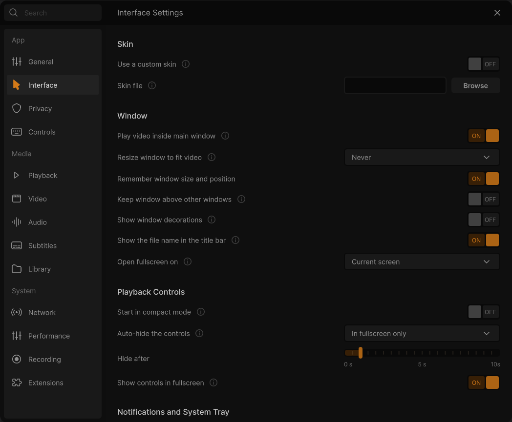
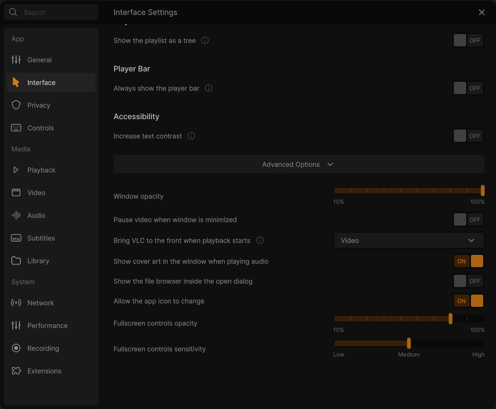

# Settings: Interface

**⋯ → Settings → Interface** (or <kbd>Ctrl</kbd>+<kbd>P</kbd>). The window, the control bar, notifications and the system tray, and VLC's classic skins.

Rows under **Advanced Options** are in the collapsed bar at the bottom of the page. Rows marked *Developer mode only* appear there once **Developer mode** is on ([General](Settings-General)). See [how the Settings window works](Settings).

### Skin
*(This section appears only in builds that include the skins2 interface.)*
- **Use a custom skin**: toggle. Default: off. *Applies after a restart.* Starts VLC with the skin chosen below instead of this interface. VLC option: `intf` (on = `skins2`)
- **Skin file**: file-path field with a **Browse** button (filter "Skin files (*.vlt *.wsz *.xml)"). Default: empty. *Applies after a restart.* The skin file to use. VLC option: `skins2-last`

*Changed in 0.3.0:* the row *Show the fullscreen controls of the skin* became **Show controls in fullscreen**, under Playback Controls.

### Window
- **Play video inside main window**: toggle. Default: on. Embeds the video in the main interface instead of opening a separate video window. VLC option: `embedded-video`
- **Resize window to fit video**: dropdown: Never / Always. Default: Never. *Applies after a restart.* With Always, the interface resizes to the native video size. With Never, the video fits the window you have. VLC option: `qt-video-autoresize`
- **Remember window size and position**: toggle. Default: on. Opens the window where it was when VLC was closed. Interface setting: `redesign/remember-window-geometry`
- **Keep window above other windows**: toggle. Default: off. Always places the video window on top of other windows. VLC option: `video-on-top`
- **Show window decorations**: toggle. Default: off on Windows, on elsewhere. On uses the system title bar. Off removes it and moves the window buttons into the interface (client-side decoration). VLC option: `qt-titlebar`
- **Show the file name in the title bar**: toggle. Default: on. *Applies after a restart.* Shows the name of the playing song or video in the window title. VLC option: `qt-name-in-title`
- **Open fullscreen on**: dropdown: Current screen, then "Screen 1 (name)", "Screen 2 (name)" and so on. Default: Current screen. Which monitor fullscreen video uses, instead of the screen the interface is on. VLC option: `qt-fullscreen-screennumber`

### Playback Controls
- **Start in compact mode**: toggle. Default: off. Starts VLC in the minimal view, without menus. VLC option: `qt-minimal-view`
- **Auto-hide the controls**: dropdown: Always / In fullscreen only. Default: In fullscreen only. With "In fullscreen only", the control bars sit above and below the video in a window and only hide in fullscreen. With "Always", they float over the video and hide in windowed mode too. VLC option: `qt-pin-controls` (In fullscreen only = pinned)
- **Hide after**: slider from 0 s to 10 s in 0.5 s steps. Default: 1 s. How long the mouse must be still before the cursor and the controls hide. VLC option: `mouse-hide-timeout`
- **Show controls in fullscreen**: toggle. Default: on. *New in 0.3.0.* Shows the playback controls in fullscreen when the mouse moves. Off, only the keyboard shows them (the <kbd>I</kbd> key). It applies at once; the skins read it for their fullscreen controller too. VLC option: `qt-fs-controller`

### Notifications and System Tray
- **Show a system tray icon**: toggle. Default: on. *Applies after a restart.* Shows a VLC icon in the system tray for basic playback control. VLC option: `qt-system-tray`
- **Start minimized to the tray**: toggle. Default: off. VLC starts with only an icon in the taskbar or tray. VLC option: `qt-start-minimized`
- **Show a popup when the track changes**: dropdown: Never / When minimized / Always. Default: When minimized. *Applies after a restart.* Shows a notification with the artist and track name when the playing item changes. VLC option: `qt-notification`
- **Popup duration**: slider from 0 s to 10 s in 0.5 s steps. Default: 3 s. How long the track-change popup stays on screen. Interface setting: `redesign/notification-duration`

### Playlist
- **Show the playlist as a tree**: toggle. Default: off. *New in 0.3.0* (the last row of the design's Interface page). The play queue shows its media under the folder (or the website) they come from, as headings; the rows move, select and drop as before. It applies at once. VLC option: `playlist-tree`

### Player Bar
*(Not in the design: after its sections.)*
- **Always show the player bar**: toggle. Default: off. *New in 0.3.0.* Keeps the player bar at the bottom of Home and the library while nothing plays (its times read `--:--`). Its Play starts the play queue, or opens files when the queue is empty; its cover opens the empty player, with the pixel cat of the design. Interface setting: `redesign/always-show-player-bar`

### Accessibility
- **Increase text contrast**: toggle. Default: off. *New in 0.3.0.* Draws the dim texts of the design (hints, descriptions, watched videos) brighter, to the contrast the WCAG accessibility guidelines ask for (AA, 4.5:1): `#8A8A8A` instead of `#6B6B6B` and `#5F5F5F` in the dark theme, `#333333` instead of `#5A5A59` and `#4D4D4D` in the light one. The (i) icons get at least 3:1. Off, the colours of the design stay as they are. Interface setting: `redesign/increase-contrast`

### Advanced Options

- **Window opacity**: slider from 10 % to 100 %. Default: 100 %. *Applies after a restart.* Opacity of the main interface, play queue and extended panel. Only works on Windows and on X11 with compositing. VLC option: `qt-opacity`
- **Pause video when window is minimized**: toggle. Default: off. *Applies after a restart.* Pauses playback automatically when the window is minimized. VLC option: `qt-pause-minimized`
- **Bring VLC to the front when playback starts**: dropdown: Never / Video / Audio / Audio and video. Default: Video. Shows and raises the interface automatically when playback of that kind of media starts. VLC option: `qt-auto-raise`
- **Show cover art in the window when playing audio**: toggle. Default: on. *Renamed in 0.3.0* (it was *Show the VLC cone when there is no video*). Shows the cover art of the audio playing in the player (and the cone in the compact view). Off, the dark placeholder of the theme takes its place, which also avoids screen burn-in. VLC option: `qt-bgcone`
- **Show the file browser inside the open dialog**: toggle. Default: off. Embeds the file browser in the Open dialog instead of using the system file dialog. VLC option: `qt-embedded-open`
- **Allow the app icon to change**: toggle. Default: on. Lets the interface change its icon on some occasions, such as a seasonal cone. VLC option: `qt-icon-change`
- **Fullscreen controls opacity**: slider from 10 % to 100 %. Default: 80 %. Opacity of the controller shown in fullscreen. VLC option: `qt-fs-opacity`
- **Fullscreen controls sensitivity**: three-step slider: Low / Medium / High, stored as 12 / 3 / 1 pixels of mouse movement. Default: Medium (3 px). How far the mouse must move before the fullscreen controls appear. VLC option: `qt-fs-sensitivity`

---

← [General](Settings-General) · [All settings](Settings) · [Privacy](Settings-Privacy) →
