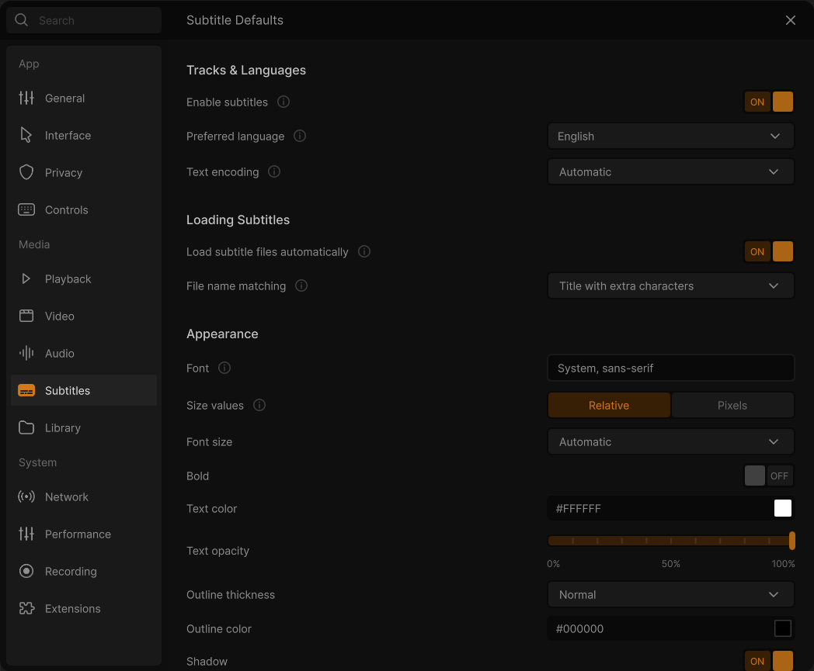
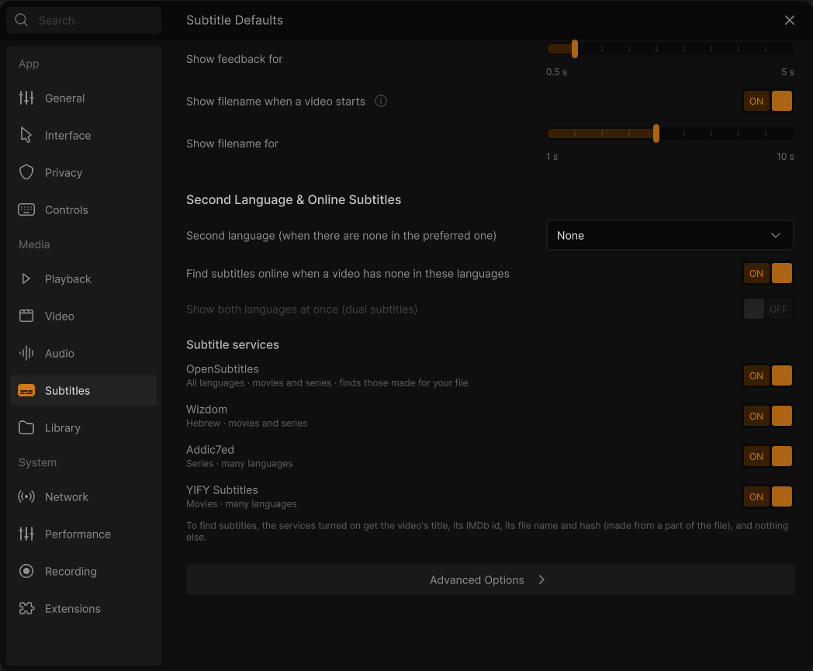
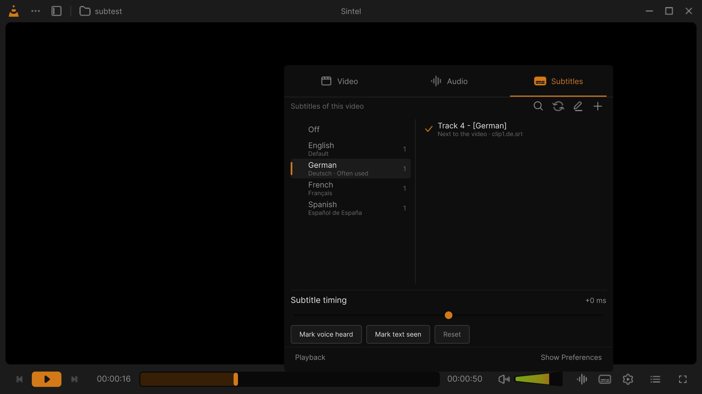

# Settings: Subtitles

**⋯ → Settings → Subtitles** (<kbd>Ctrl</kbd>+<kbd>P</kbd>; the header reads *Subtitle Defaults*). The subtitle
languages and their encoding, the subtitle files VLC loads by itself, how subtitles look, their timing, the messages
VLC shows on the video, and the second language and the online search. These are the defaults of every video; for
the video playing now (another track, a subtitle found online, the timing, the size and the position), use the
player's languages and tracks panel: see [Subtitles](Subtitles). See
[how the Settings window works](Settings#how-the-window-works).

*The picture was taken before 0.3.1, when **Font** was a text field; it is now a list of the installed fonts.*

## Tracks & Languages

| Option | Choices / default | What it does | VLC option |
|---|---|---|---|
| **Enable subtitles** | Toggle. Default: on. | Off: VLC turns off all subtitle and sub-picture processing, so no subtitle track or file is shown. | `spu` |
| **Preferred language** | The language list of the design: a field showing the language (and its own name, *Deutsch* for German) that opens every language with a *Search a language* field (it finds a language by its English or its own name). Default: the language of Windows; English when the list does not have it. | Your default subtitle language: VLC shows a video's subtitles in this language by itself, and the online search looks for it first. The installer and the welcome setup ask for it. Picking the language set as the second one clears the second one. *Changed in 0.3.0: this row picks it (before, a "Default language" row at the top of the page did).* | `sub-language` (written with the second and the learned language, see [Good to know](#good-to-know)) |
| **Text encoding** | Dropdown: *Automatic*, *System codeset*, *Universal (UTF-8)*, *Universal (UTF-16)*, *Universal (big endian UTF-16)*, *Universal (little endian UTF-16)*, *Universal, Chinese (GB18030)*, then the regional encodings (Western and Eastern European, Cyrillic, Arabic, Greek, Hebrew, Turkish, Thai, Baltic, Chinese, Japanese, Korean, Vietnamese…, in their ISO 8859 and Windows code pages). Default: *Automatic*. | The character set of text subtitle files (SRT and the like) that do not state theirs. *Automatic* recognises UTF-8 files by itself and reads the others in the legacy code page of the interface language (Windows-1252 for English, Windows-1255 for Hebrew, Windows-1251 for Russian…). Choose the right one when the letters come out as nonsense. | `subsdec-encoding` (Automatic = empty) |

## Loading Subtitles

| Option | Choices / default | What it does | VLC option |
|---|---|---|---|
| **Load subtitle files automatically** | Toggle. Default: on. | When a video opens, VLC also loads the subtitle files whose name matches it, from the video's folder and from the folders of *Load subtitles from these folders* (Advanced Options). | `sub-autodetect-file` |
| **File name matching** | Dropdown: *Off* / *Any title* / *Contains title* / *Title with extra characters* / *Exact title match*. Default: *Title with extra characters*. | How closely a subtitle file's name must match the video's: *Any title*, any subtitle file of the folder; *Contains title*, a name that contains the video's name; *Title with extra characters*, the video's name followed by more characters (`Film.en.srt` for `Film.mkv`); *Exact title match*, the same name (`Film.srt`); *Off*, no file is loaded by itself. | `sub-autodetect-fuzzy` (0 to 4) |

## Appearance

| Option | Choices / default | What it does | VLC option |
|---|---|---|---|
| **Font** | Dropdown: *System, sans-serif*, then the font families installed on the computer (without the vertical-writing `@` families). Default: *Arial*. | The font of the subtitle text. *System, sans-serif* leaves the choice to VLC, which uses Arial on Windows. A font set another way that is not installed stays in the list. *Changed in 0.3.1: a list of the installed fonts (before: a field to type the name in).* | `freetype-font` |
| **Size values** | Segmented: *Relative* / *Pixels*. Default: *Relative* (*Pixels* when a size in pixels is already set). | Whether the next row gives the size by name, relative to the picture, or in pixels. Switching puts the size of the other kind back to its default, as VLC applies both together. | `redesign/subtitle-size-mode` (interface setting) |
| **Font size** (Relative) | Dropdown: *Smaller* / *Small* / *Automatic* / *Large* / *Larger* / *Largest* (50 / 75 / 100 / 125 / 150 / 200 %). Default: *Automatic* (100 %). | The size of the subtitles relative to the height of the picture. A scale set another way shows as a percentage. | `sub-text-scale` |
| **Font size** (Pixels) | Number field, in px, 0 to 4096. Default: 0, shown as *Automatic*. | The height of the text in pixels of the picture (not of the screen); 0 sizes it from the picture. A size in pixels puts the relative size back to 100 %. | `freetype-fontsize` |
| **Bold** | Toggle. Default: off. | Draws all subtitle text in bold. | `freetype-bold` |
| **Text color** | Colour field: the hex value (type one, `#FFFF00`) and a swatch that opens the colour picker. Default: `#FFFFFF` (white). | The colour of the text. | `freetype-color` |
| **Text opacity** | Slider, 0 % to 100 %, ticks every 10 %. Default: 100 %. | 0 % is invisible. | `freetype-opacity` (0 to 255) |
| **Outline thickness** | Dropdown: *None* / *Thin* / *Normal* / *Thick*. Default: *Normal*. | The outline around the letters, which keeps them readable on a bright picture. | `freetype-outline-thickness` (0 / 2 / 4 / 6) |
| **Outline color** | Colour field. Default: `#000000` (black). | The colour of the outline. | `freetype-outline-color` |
| **Shadow** | Toggle. Default: on. | Draws a shadow behind the text. Off sets the shadow's opacity to 0; on gives it back (128 of 255 unless it was set another way). | through `freetype-shadow-opacity` |
| **Shadow color** | Colour field. Default: `#000000` (black). | The colour of the shadow. | `freetype-shadow-color` |
| **Shadow distance** | Dropdown: *Small* / *Medium* / *Large*. Default: *Medium*. | How far the shadow is offset. A distance set another way shows as its number. | `freetype-shadow-distance` (0.03 / 0.06 / 0.1) |
| **Background** | Dropdown: *None* / *Box*. Default: *None*. | *Box* draws a box behind the subtitles, in the colour and opacity of the next two rows. | through `freetype-background-opacity` (None = 0) |
| **Background color** | Colour field. Default: `#000000` (black). | The colour of the box. | `freetype-background-color` |
| **Background opacity** | Slider, 0 % to 100 %, ticks every 10 %. Default: 50 %. | How opaque the box is. Kept while *Background* is *None*, used again when it is *Box*. | `redesign/subtitle-background-opacity` (interface setting, copied to `freetype-background-opacity` while Background is Box) |
| **Vertical position** | Slider from *Lower* (−20 %) through *Usual* (0) to *Higher* (60 %), 1 % steps, ticks every 10 %. Default: *Usual*. | How high the subtitles are, in percent of the picture's height above their usual place (below it when negative): the same on any screen and at any window size. The subtitles on the video move as you drag; discarding the change puts them back. While playing, <kbd>Shift</kbd>+<kbd>↑</kbd> / <kbd>Shift</kbd>+<kbd>↓</kbd> move them too. | `sub-position` |

## Timing

| Option | Choices / default | What it does | VLC option |
|---|---|---|---|
| **Subtitle delay** | Slider, −5 s to +5 s in 0.1 s steps, labels −5 s, 0 s, +5 s. Default: 0 s. | Shows every subtitle later (positive) or earlier (negative) in every video. For one video, use the player's subtitle timing ([Subtitles](Subtitles#subtitle-timing-sync-timeline)). | `sub-delay` (tenths of a second) |

## On-Screen Messages

| Option | Choices / default | What it does | VLC option |
|---|---|---|---|
| **Show feedback for shortcuts** | Toggle. Default: on. | Shows VLC's messages on the video (OSD): the volume, a seek, the speed, a snapshot taken… | `osd` |
| **Show feedback for** | Slider, 0.5 s to 5 s in 0.5 s steps. Default: 1 s. | How long those messages stay. | `osd-duration` (ms) |
| **Show filename when a video starts** | Toggle. Default: on. | Shows the title of the media on the video when it starts. | `video-title-show` |
| **Show filename for** | Slider, 1 s to 10 s in 0.1 s steps, ticks every second. Default: 5 s. | How long the title stays. | `video-title-timeout` (ms) |

## Second Language & Online Subtitles

*(Not in the design: after its sections. Changed in 0.3.0: this block came first on the page before.)* These are
interface settings, saved with the rest of the page.

| Option | Choices / default | What it does |
|---|---|---|
| **Second language (when there are none in the preferred one)** | The same language list, with *None* first. Default: English, or *None* when the preferred language is English. | The subtitles VLC takes when a video has none in the preferred language. Choosing the preferred language here sets *None*. |
| **Find subtitles online when a video has none in these languages** | Toggle. Default: on (the installer and the welcome setup ask). | When a video opens with no subtitles in the preferred or the second language, VLC asks the services below and loads the best result. Off, the player's panel searches only when you click its search button. |
| **Show both languages at once (dual subtitles)** | Toggle. Default: off. | Shows the subtitles of both languages together. Dimmed, and turned off, while the second language is *None*. |
| **Subtitle services** | A toggle per service, all on: *OpenSubtitles* (all languages, movies and series, finds those made for your file), *Wizdom* (Hebrew, movies and series), *Addic7ed* (series, many languages), *YIFY Subtitles* (movies, many languages). | The services asked. The note under them: "To find subtitles, the services turned on get the video's title, its IMDb id, its file name and hash (made from a part of the file), and nothing else." |

## Advanced Options

| Option | Choices / default | What it does | VLC option |
|---|---|---|---|
| **Load subtitles from these folders** | Text field, folders separated by commas. Default: `.\subtitles, .\subs`. | More folders where VLC looks for matching subtitle files. A folder that starts with a dot is relative to the video's folder; any other path is used as it is (`D:\Subtitles`). | `sub-autodetect-path` |
| **Outline opacity** *(Developer mode)* | Slider, 0 % to 100 %. Default: 100 %. | The opacity of the outline. | `freetype-outline-opacity` |
| **Shadow opacity** *(Developer mode)* | Slider, 0 % to 100 %. Default: 50 % (128 of 255). | The opacity of the shadow. | `freetype-shadow-opacity` |
| **Shadow angle** | Number field, in degrees, −360 to 360. Default: −45 (down and to the right). | The direction of the shadow. | `freetype-shadow-angle` |
| **Text direction** | Dropdown: *Left to right* / *Right to left* / *Automatic*. Default: *Automatic*. | The base direction of a paragraph for the Unicode bidirectional algorithm. *Automatic* follows the first strong letter, so Hebrew and Arabic lines read right to left; force one if punctuation lands at the wrong end of a line. Needs FriBidi support in the text renderer. | `freetype-text-direction` (0 / 1 / 2) |
| **Monospace font** | Dropdown: *System monospace*, then the font families installed. Default: *Courier New*. | The font of subtitle text that asks for a fixed-width font. | `freetype-monofont` |
| **Visualization size** | The row of the Advanced Options of [Audio](Settings-Audio), repeated here. | Changing it here changes it there. | `effect-width`, `effect-height` |
| **Text alignment** *(Developer mode)* | Dropdown: *Auto* / *Center* / *Left* / *Right*. Default: *Auto*. | The justification of the lines of text subtitles. | `subsdec-align` (−1 / 0 / 1 / 2) |
| **Position of the filename** *(Developer mode)* | Dropdown: *Center*, *Left*, *Right*, *Top*, *Bottom*, *Top-Left*, *Top-Right*, *Bottom-Left*, *Bottom-Right*. Default: *Top*. | Where *Show filename when a video starts* shows the title. VLC Redesign moved it to the top: at the bottom it covered the first subtitle. | `video-title-position` |

## Good to know

- **VLC learns your languages** *(new in 0.3.1)*. Each subtitle language you pick by hand in the player counts once
  per video, and older picks fade (at every new pick, each earlier one keeps 0.9 of its weight). A language with a
  score of 1.5 or more is marked *Often used* in the player's list; at 2.5 or more (about three picks) it becomes the
  **learned language**, the third one VLC shows by itself after the preferred and the second language. This page
  does not show it: it is written into VLC's `sub-language`, which holds the languages in order as ISO 639-2 codes
  (`heb,eng,deu`). See [Subtitles: Learning your languages](Subtitles#learning-your-languages).
- **Before you choose a language**, VLC already shows a video's own subtitle track in the language of Windows
  (unless Windows is in English, or every English film would show its English subtitles). Nothing is saved until you
  choose.
- **The installer** *(since 0.3.1)* asks for the default subtitle language on its *Languages* page (the interface
  language until you pick another one) and for the online search on its *Privacy* page; a silent install takes
  `/SUBLANG=` and `/NOONLINESUBS` ([Install and update](Install-and-Update#silent-install)).
- **Letters come out wrong** (é, boxes, question marks): set *Text encoding* to the file's encoding, for example
  Hebrew (Windows-1255) or Cyrillic (Windows-1251).
- **Subtitles too small on a big screen?** Keep *Size values* on *Relative*: the size follows the height of the
  picture, whatever the screen or the window.
- **ASS/SSA subtitles** keep their own fonts, colours and positions; the Appearance rows apply to plain text subtitles
  (SRT and the like).

**Related pages:** [Subtitles](Subtitles) · [Languages](Languages) · [Install and update](Install-and-Update#languages) · [Keyboard shortcuts](Keyboard-Shortcuts#subtitles)

---

← [Audio](Settings-Audio) · [All settings](Settings) · [Library](Settings-Library) →
