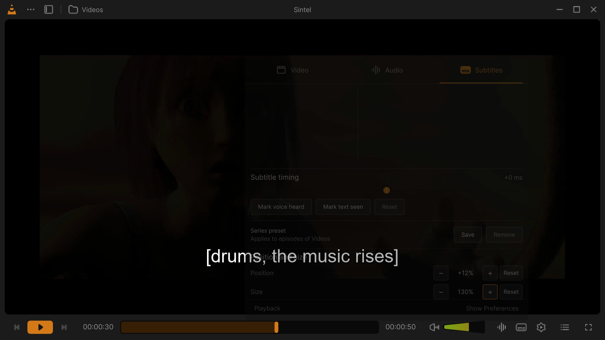
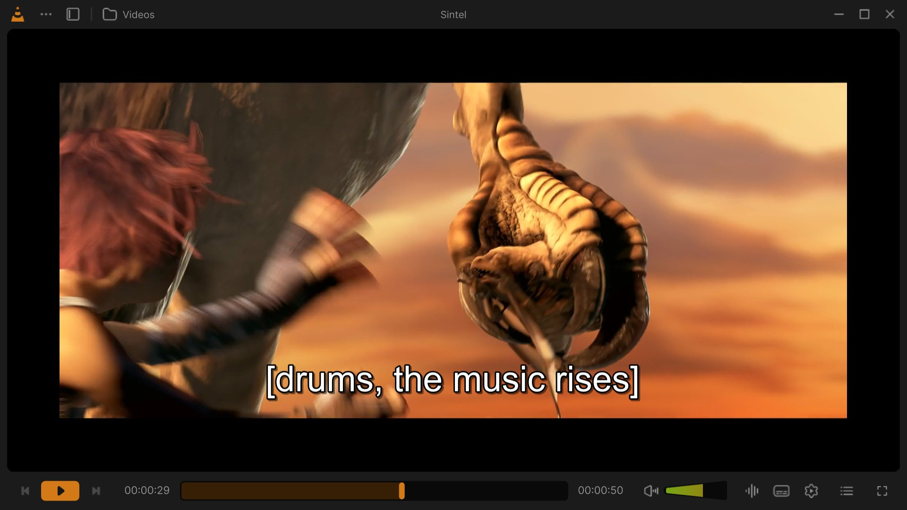

# Subtitles

VLC Redesign shows subtitles in your language by itself: from the video, from a file next to it, or found online.
It learns the languages you pick, remembers the subtitle of each file and the timing of each series, and lets you
fix early or late subtitles, and move or resize them, while you watch.

English, Hebrew, Japanese and Arabic subtitles in turn with <kbd>V</kbd>: sharp, and Hebrew and Arabic in the right order, with their brackets and punctuation. Click for the MP4 · every clip: [Feature tour](Feature-Tour#subtitles).

Everything here happens in the **Subtitles** tab of the **Languages and tracks** panel. The look of the subtitles
(font, colours, outline, shadow, box) and the languages are also in [Settings: Subtitles](Settings-Subtitles).

## Your languages

Three languages decide which subtitles show by themselves:

| Language | Where it is set | Until you choose |
|---|---|---|
| **Default** | *Preferred language* in [Settings: Subtitles](Settings-Subtitles), the installer and the first-run setup | The language of Windows |
| **Second** | *Second language (when there are none in the preferred one)*, same places | English (none when the default one is English) |
| **Learned** | Nothing to set: the language you pick most by hand (see [Learning your languages](#learning-your-languages)) | None |

When a video opens, VLC shows its track in the default language; if it has none, in the second one; if it has
neither, in the learned one. When the video has none of them, the online search looks for them (see
[Subtitles found online](#subtitles-found-online)).

Before you choose any subtitle language, a video's own track in the language of Windows is shown, except for
English: an English film would otherwise always show its English subtitles.

## The Subtitles tab

The Video, Audio and Subtitles tabs of the panel; the subtitle languages of the video, each in its own language; Hebrew picked. Click for the MP4 · every clip: [Feature tour](Feature-Tour#subtitles).

**Languages and tracks** in the control bar opens a panel above the button with three tabs, *Video*, *Audio* and
**Subtitles**; it opens on Subtitles. A second click on the button, a click outside the panel or <kbd>Esc</kbd>
closes it, without pausing the video.

From top to bottom:

1. **The header**: what the online search is doing or found (*Subtitles of this video*, *Identifying the video…*,
   *Searching OpenSubtitles, Wizdom…*, *Breaking Bad · S01E02 · 24 found*), and four buttons:

   | Button | What it does |
   |---|---|
   | Magnifier (*The video is another one: search by its title*) | Opens the title search (see [Wrong title](#when-the-title-found-is-wrong)). |
   | Arrows (*Search subtitles online* / *Search subtitles online again*) | Runs the online search now. |
   | Pencil (*Add subtitles to the library*) | The subtitle window of the library (see [Attach subtitles for good](#attach-subtitles-for-good)). Dimmed for a stream or without the media library: *Library association needs a local media file and media library.* |
   | **+** (*Load a subtitle file for playback*) | Opens a subtitle file for this playback only. |

2. **The languages** on the left, and **the subtitles** of the language chosen on the right.
3. **Subtitle timing**: the delay slider and the sync buttons, then **Series preset**.
4. **Position and size**.

A language or a subtitle you click shows at once on the video.

### The languages

The list starts with **Off** (no subtitles). Then come the languages this video has, in its own tracks or among
the subtitles found online, in this order:

| Order | Marker | Which languages |
|---|---|---|
| 1 | **Default** | Your default language. |
| 2 | **Second** | Your second language. |
| 3 | **Often used** | The languages you pick yourself, the most picked first. A language rises here from the first pick; the marker shows from the second pick in a row. |
| 4 | | The other languages of the video's own tracks, by name. |
| 5 | | The other languages found online, by name. |
| last | | *Unknown language*: tracks that name no language. |

Each row shows the language's name in the language of the interface, its own name for itself (*Deutsch*,
*Français*), and how many subtitles it has. A language you have no subtitle in does not show: there is nothing to
pick.

### The subtitles of a language

The list on the right holds the subtitles of the language chosen: the video's own first, then those found online.
The one showing has a check. Under each, where it comes from:

| Label | Where it comes from |
|---|---|
| **In the video** | A track of the file itself. |
| **Next to the video** · *file* | A subtitle file VLC found next to the video, or in the folders of *Load subtitles from these folders*. |
| **Opened** · *file* (or **Opened file**) | A file you opened yourself. |
| **Downloaded from** *service* | A subtitle downloaded earlier: from the cache. |
| *service* · *downloads* | A subtitle found online, not downloaded yet: its service and how many times it was downloaded (*12k downloads*). |

Badges: **For this file** (made for this very file: the same fingerprint), **HI** (*For the hearing impaired*),
*Foreign parts only* (only the lines of foreign speech).

Click a subtitle to show it. One found online is downloaded first (*Downloading…*).

## Learning your languages

Each time you pick a subtitle language by hand (a language row or one of its subtitles), it counts for that
language, once per video. Every pick is worth 1, and each pick also makes the earlier ones fade: all the scores are
multiplied by 0.9 first. So what you picked recently counts most.

- **It rises.** A language you pick moves up the list, under your default and second languages.
- **It is marked.** From a score of 1.5 (two picks in a row) it reads **Often used**.
- **It is chosen for you.** From a score of 2.5 (three picks in a row) it becomes the **learned language**, the
  third automatic one. A video with no track in your default or second language shows its track in the learned
  language by itself; and when the online search finds nothing in your default or second language either, it
  loads the best subtitle in the learned one.
- **It fades.** If you stop picking it, other picks make it fade, and the language you pick now takes its place.
  Only one language is learned at a time: the one with the highest score.

Your default and second languages never count as learned: they already come first.

> Example: you watch with German subtitles three times. German is now marked *Often used* and is chosen for a film
> that has no subtitles in your default or second language.

## Subtitles found online

When a video opens with no subtitles in your languages, VLC Redesign looks for some online (1.5 seconds after it
starts) and loads the best one: in your default language, else the second one, else the learned one. This is *Find
subtitles online when a video has none in these languages* ([Settings: Subtitles](Settings-Subtitles)), asked by the
installer and the first-run setup. With it off, the search runs only when you click the search button of the header.

How it works:

1. **The video is identified.** Its file name gives the title, the year, and the season and episode (`S01E02`,
   `1x02`, *Season 1 Episode 2*; the folder too, as in *Show Name/Season 1/02.mkv*). IMDb's suggestions, then
   Wikidata, then Stremio's Cinemeta give its IMDb id. The header shows *Identifying the video…*, then the title
   found (*Breaking Bad · S01E02*).
2. **The services are asked together** (*Searching OpenSubtitles, Wizdom…*). Their subtitles of every language are
   listed as they come, those made for this very file first (*3 found for this file*).
3. **A click loads one.** It is downloaded, unpacked (only its subtitles, 16 MB at most), converted to UTF-8, kept
   in the cache and remembered for the file (*Downloading…*).

The services (each can be turned off in [Settings: Subtitles](Settings-Subtitles)):

| Service | What it has |
|---|---|
| **OpenSubtitles** | All languages, movies and series; finds those made for your very file. |
| **Wizdom** | Hebrew, movies and series. |
| **Addic7ed** | Series, many languages (through Gestdown). |
| **YIFY Subtitles** | Movies, many languages. |

**What is sent:** the video's title, its IMDb id, its file name and a fingerprint of the file (its size and its
first and last 64 KB), nothing else. **The cache** keeps the subtitles of the last 500 media and drops those not
used for 60 days.

### When the title found is wrong

Click the magnifier of the header (*The video is another one: search by its title*): a field opens, **Title of the
movie or series**, with the titles that match as you type. Pick the right one; the search runs again for it, and the
choice is remembered for the file.

## Subtitle timing (sync timeline)

**Subtitle timing** shows the delay (*+250 ms*) and a slider from **−10 s** to **+10 s** in steps of 50 ms: earlier
on the left, later on the right. Then three buttons fix a delay by ear:

1. **Mark voice heard**: click it when you **hear** a line spoken (it reads *Voice marked*).
2. **Mark text seen**: click it when you **see** that line's text (it reads *Text marked*).
3. Once both are marked, in either order, the subtitles move by the time between the two clicks.

Click a marked button again to unmark it. **Reset** puts the delay back to 0.

The keys do the same: <kbd>Shift</kbd>+<kbd>H</kbd> (the voice), <kbd>Shift</kbd>+<kbd>J</kbd> (the text),
<kbd>Shift</kbd>+<kbd>K</kbd> (apply), <kbd>Ctrl</kbd>+<kbd>Shift</kbd>+<kbd>K</kbd> (reset). <kbd>H</kbd> and
<kbd>G</kbd> move the subtitles later or earlier step by step. A delay for every video is *Subtitle delay* in
[Settings: Subtitles](Settings-Subtitles).

### Presets per series

**Series preset**, under the timeline, keeps the choices of a series for its other episodes.

- **Save** keeps, from the episode playing: the audio track, the subtitle track (or *Off*), the subtitle delay, the
  delay of the second subtitles and the subtitle speed. The panel reads *Saved for episodes of breaking bad.*, then
  *Applies to episodes of breaking bad*.
- The next episodes of the series apply it by themselves (*Series preset applied.*). If a track it names is not in
  an episode: *A saved audio or subtitle track is unavailable in this episode.*
- **Remove** forgets it (*Series preset removed.*).

A series is the folder of the file plus the name before its `S01E02` (in lower case, dots and dashes read as
spaces). A file without such a name counts its whole folder as the series. Presets need a local file: *Play a
local episode to save its track and timing choices.*

## Position and size

<kbd>Ctrl</kbd> + mouse wheel over the video: the subtitle size up to 200 %, then down to 50 %, from the next line on. Click for the MP4 · every clip: [Feature tour](Feature-Tour#subtitles).

**Position and size**, at the end of the Subtitles tab:

| Row | − / + | Range | Reset |
|---|---|---|---|
| **Position** | *Move the subtitles down* / *Move the subtitles up*, 1 % of the picture's height a click | −20 % (lower) to +60 % (higher); *Usual* at 0 | Back to *Usual* |
| **Size** | *Smaller subtitles* / *Larger subtitles*, 10 % a click near 100 %, then 25 % (the steps of <kbd>Ctrl</kbd>+wheel) | 25 % to 500 %; 100 % as usual | Back to 100 % |

- The buttons repeat while held.
- The subtitles move and grow on the video as you click, and the panel fades meanwhile so you see them behind it.
- The change stays for the next videos and the next starts.

Keys: <kbd>Shift</kbd>+<kbd>Up</kbd> / <kbd>Shift</kbd>+<kbd>Down</kbd> move them (1 % a press, same range);
<kbd>Ctrl</kbd>+wheel over the video makes them larger or smaller, as in classic VLC: 10 % a turn near 100 %, then
25 %, from 25 % to 500 %, with a short *Subtitle size 120%* message; <kbd>Ctrl</kbd>+<kbd>0</kbd> goes back to 100 %.
Elsewhere in the window <kbd>Ctrl</kbd>+wheel zooms the whole interface. ASS/SSA subtitles follow the size while they
play. The same position is *Vertical position* in [Settings: Subtitles](Settings-Subtitles).

While the *Continue where you left off?* card shows, the subtitles rise above it and the controls, and go back down
when it closes.

## Font and style

[Settings: Subtitles](Settings-Subtitles) › *Appearance*: the font (a list of the fonts installed), the size
(relative or in pixels), bold, the text colour and opacity, the outline, the shadow, a box behind the text, and the
vertical position. A change reaches the video playing from its next line.

## Dual subtitles

With **Show both languages at once (dual subtitles)** ([Settings: Subtitles](Settings-Subtitles), once a second
language is chosen), the subtitles of the default language and those of the second one show together; the second
one is found online too when the video lacks it. <kbd>Ctrl</kbd>+<kbd>Shift</kbd>+<kbd>V</kbd> (*Toggle secondary
subtitle control*) makes the subtitle keys (delay, position) act on the second subtitles; the series preset keeps
their delay too.

## Attach subtitles for good

The pencil of the header (*Add subtitles to the library*), or **Add Subtitle Tracks** in the right-click menu of a
video, folder or playlist of the library, opens the subtitle window of the library:

- **From Computer** (files you choose), **From Link** (a *Direct HTTPS link to a subtitle file*) or **From
  OpenSubtitles** (a search with your own *OpenSubtitles API key*, *Username* and *Password*).
- **To This File**, **To This Folder** or **To This Playlist**.

The subtitles attached play with the media every time. **Add Audio Tracks** does the same for audio files. It needs
a local file and the media library.

## Remembered choices

| What | How long |
|---|---|
| The subtitle chosen for a file (a track, a file or one found online), shown again the next time; from the cache when it was downloaded | The last 500 media |
| The title chosen for the online search of a file | The last 500 media |
| The track and timing choices of a series | Until you remove the preset |
| The size and position of the subtitles | For every video, until you change them |
| The languages you pick (learning) | Fading with each new pick |

## Subtitle keys

| Key | Action |
|---|---|
| <kbd>V</kbd> / <kbd>Alt</kbd>+<kbd>V</kbd> | Next / previous subtitle track |
| <kbd>Shift</kbd>+<kbd>V</kbd> | Subtitles on or off |
| <kbd>H</kbd> / <kbd>G</kbd> | Subtitle delay up / down |
| <kbd>Shift</kbd>+<kbd>Up</kbd> / <kbd>Shift</kbd>+<kbd>Down</kbd> | Subtitles higher / lower |
| <kbd>Ctrl</kbd>+wheel over the video | Subtitles larger / smaller (elsewhere in the window it zooms the interface) |
| <kbd>Ctrl</kbd>+<kbd>0</kbd> | Normal size (taken by *play the tenth media played last* while the media library is on: see [Keyboard shortcuts](Keyboard-Shortcuts#keys-that-two-lists-share)) |
| <kbd>Shift</kbd>+<kbd>H</kbd>, <kbd>Shift</kbd>+<kbd>J</kbd>, <kbd>Shift</kbd>+<kbd>K</kbd>, <kbd>Ctrl</kbd>+<kbd>Shift</kbd>+<kbd>K</kbd> | Sync: mark the voice, mark the text, apply, reset |
| <kbd>Ctrl</kbd>+<kbd>Shift</kbd>+<kbd>V</kbd> | Toggle secondary subtitle control |

All of them can be changed: see [Keyboard shortcuts](Keyboard-Shortcuts#subtitles).

## Good to know

- **No subtitles show.** Check *Off* is not chosen in the list, and <kbd>Shift</kbd>+<kbd>V</kbd> (subtitles on or
  off). A video without subtitles in your languages needs the online search on, or a click on the search button.
- **The wrong film's subtitles.** The title was taken for another one: use the magnifier of the header.
- **Out of sync.** Use *Mark voice heard* / *Mark text seen*; for a whole series, **Save** a series preset.
- **Too small or in the way.** Use **Position and size**; the change stays for every video.
- **A language keeps coming back.** It was learned from your picks; pick the one you want a few times and it takes
  over.

---

[The player](The-Player) · [Settings: Subtitles](Settings-Subtitles) · [Languages](Languages) · [Keyboard shortcuts](Keyboard-Shortcuts) · [Home](Home)
