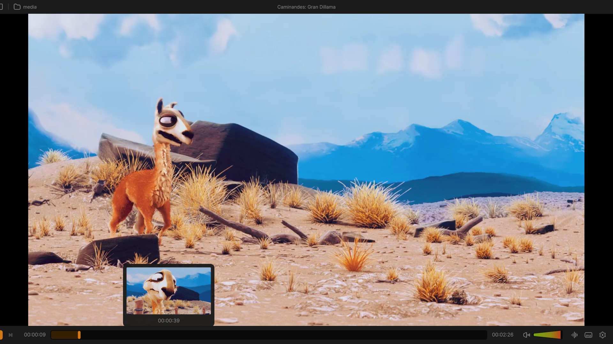
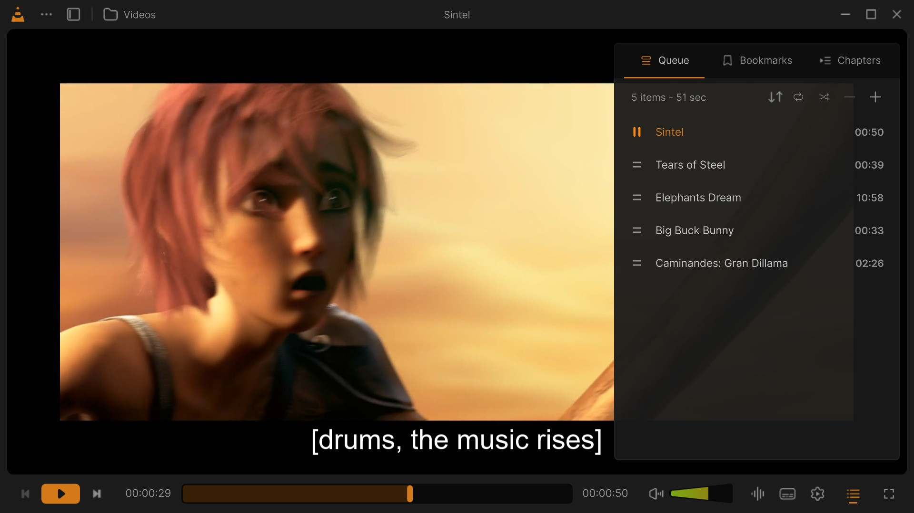
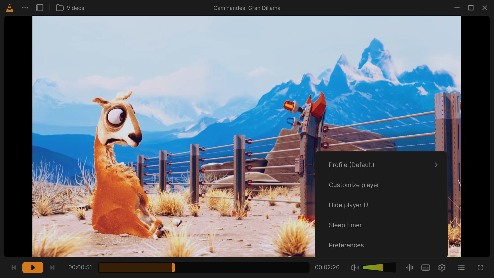

# The player

The player opens when a video or a song plays. A video sits in a frame with rounded corners between the top bar and
the control bar; in fullscreen it fills the screen and the bars float over it. A song opens the music view: the
cover over a blurred copy of itself, the title and the artist, and a waveform for a seek bar.

Play and pause, a drag along the seek bar (its marks are the lines of the subtitle file), and the mouse wheel over the volume. Click for the MP4 · every clip: [Feature tour](Feature-Tour#player).

This page describes every part of the player: the bars, every button the control bar can hold, the panels the
buttons open, the seek bar, the volume, the queue, and what the mouse and the keys do.

> The buttons of the control bar depend on the profile in use (**⋯ → Profile**) and can be moved, added and taken
> out: see [Customize the player](Customize-the-Player). Every key is listed in [Keyboard shortcuts](Keyboard-Shortcuts).

## The top bar

From left to right:

| Part | What it does |
|---|---|
| The VLC cone | The logo. |
| **⋯** (*Menu*) | The main menu: *Open File(s)*, *Open Folder*, *Open Network Stream*, *Open Disc*, *Open Capture Device*, *Convert*, *Open Recent*, *Profile (name)*, *Keyboard Shortcuts*, *Customize Player*, *Settings* and *About VLC*. |
| **Library** (the sidebar icon) | Shows or hides the library next to the video (see [The library next to the video](#the-library-next-to-the-video)). <kbd>L</kbd> does the same. |
| The folder of the media | The name of the folder of a local file (*Videos*, *Music*...). Its tooltip is *Show (folder) in the library*: a click opens that folder in the library. |
| Title (middle) | The title of what plays. With nothing playing, and again after **Stop**, it reads *VLC Media Player*. |
| Window buttons (right) | Minimize, maximize (or restore) and close, drawn by VLC Redesign while *Show window decorations* is off ([Settings: Interface](Settings-Interface), the default on Windows). When the profile's bar has no **Fullscreen** button, a Fullscreen button shows here too. |

The ⋯ menu, the Library button, the title and the folder can be moved into the control bar (they are the *Menu*,
*Library*, *File Name* and *Folder Name* controls). Once in the bar, they leave the top bar.

## The control bar

The bar of the *Default* profile has **Previous**, **Play/Pause** and **Next** on the left, the seek bar with the
times in the middle, and the **Volume**, **Effects**, **Languages and tracks**, **VLC Settings**, **Play Queue** and
**Fullscreen** on the right. The music view has a bar of its own: Previous, Backward 15s, Play/Pause, Forward 15s,
Next, then the Volume, Effects, Play Queue and Fullscreen.

- The bar has three zones, **left**, **center** and **right**. The seek bar sits between them, or on a row of its
  own above them (drag it there in Customize Player).
- When the window is too narrow for every button, the inner buttons hide first: the outer ones (in the *Default*
  profile, *Fullscreen* and *Play Queue*) stay the longest.
- In fullscreen the bars hide once the mouse stops (*Hide after*, [Settings: Interface](Settings-Interface)) and
  come back when it moves. They stay while a panel is open.

### Every button and widget

Names are those of the *Customize Player* palette. The column **Palette** says whether the control can be dragged
in from the palette (see [Customize the player](Customize-the-Player#the-palette)). The others are VLC's own
controls: they show in a bar that has them, but the palette does not offer them.

| Button | Palette | What it does |
|---|---|---|
| **Play** | yes | Play / pause. |
| **Previous**, **Next** | yes | The previous or next media of the play queue. |
| **Backward 15s**, **Forward 15s** | yes | Jump 15 seconds back or forward. |
| **Backward 10s**, **Forward 10s** | yes | Jump 10 seconds back or forward. |
| **Replay** | yes | Back to the start of the media. |
| **Stop** | yes | Stops playback. |
| **Playback Speed** | yes | Shows the speed (*1x*). A click opens the speed popup (see [Speed](#speed)); the wheel over it changes the speed. |
| **Previous Frame**, **Next Frame** | yes | Step one picture back or forward (playback pauses). |
| **A-B Loop** | yes | Loops a part of the media (see [A-B loop](#a-b-loop)). |
| **Repeat** | yes | Cycles *Off*, *Repeat all*, *Repeat one*. Lit while on; its tooltip reads *Repeat one* in that mode. |
| **Shuffle** | yes | Plays the queue in random order. Lit while on. |
| **Record** | yes | Records what plays to a file; in the accent colour while recording. Where recordings go: [Settings: Recording](Settings-Recording). |
| **Snapshot** | yes | Saves the current picture as an image. Where and in which format: [Settings: Video](Settings-Video). |
| **Picture in Picture** | yes | Goes to the library with the video in a small player over it (see [Picture in picture](#picture-in-picture)). |
| **HDR** | yes | Opens the HDR output panel above it (see [HDR](#hdr)). |
| **Zoom** | yes | A list of zoom levels for the video (*Choose a video zoom level*). Dimmed without a video: *Zoom is unavailable without video*. |
| **Right Sidebar** | yes | Shows or hides the queue card, as *Play Queue* does. Lit while it shows. |
| **Play Queue** | yes | Shows or hides the queue card (<kbd>Q</kbd>, <kbd>Ctrl</kbd>+<kbd>L</kbd>). |
| **Languages and tracks** | yes | Opens the languages and tracks panel above it (see [Languages and tracks](#languages-and-tracks)). |
| **Effects** | yes | Opens the effects panel above it (see [Effects](Effects)). |
| **VLC Settings** | yes | Opens the menu of the player above it (see [The VLC Settings menu](#the-vlc-settings-menu)). |
| **Fullscreen** | yes | Enters or leaves fullscreen. |
| **Volume** | yes | The mute button and the volume slider (see [Volume](#volume)). |
| **Menu** | yes | The ⋯ main menu, in the bar. |
| **Quit VLC** | yes | Quits VLC Redesign. |
| **Go Home** | yes | Opens Home in the library. |
| **Playlists** | yes | Opens the Playlists page of the library. |
| **Thumbnail** | yes | The artwork of the media. |
| **File Name** | yes | The title of the media, as text (it leaves the top bar while in the bar). *File name unavailable* when there is none. |
| **Artist Name** | yes | The artist of the song. *Artist unavailable* when there is none. |
| **Folder Name** | yes | The folder of the media (it leaves the top bar while in the bar). *Folder name unavailable* for a stream. |
| **Playlist Name** | yes | The queue and the place of the media in it: *Play Queue (3/10)*. |
| **Properties** | yes | Opens the media information window (<kbd>Ctrl</kbd>+<kbd>I</kbd>). |
| **Chapters** | yes | A menu of the chapters and titles of the media, above the button. |
| **Favorite** | yes | *Add to favorites* / *Remove from favorites* of the library. For a media outside the library it is dimmed: *Available for items in your library*. |
| **Bookmark** | yes | A menu of the bookmarks of the media, above the button, with *Manage* (<kbd>Ctrl</kbd>+<kbd>B</kbd>). |
| **Bookmarks** | yes | Opens the bookmarks window (<kbd>Ctrl</kbd>+<kbd>B</kbd>). Needs the media library. |
| **Cast to TV** | yes | Opens the cast panel above it (see [Casting to a TV](Casting)). |
| **Spacer**, **Divider** | yes | A fixed space, and a thin vertical line, between buttons. |
| **Library** | no | The Library button of the top bar, in the bar. In the accent colour while the library shows. |
| **Slower**, **Faster** | no | Lower or raise the playback speed one step. |
| **Aspect Ratio** | no | A list of aspect ratios for the video. |
| **Previous chapter**, **Next chapter** | no | Go to the previous or next chapter. |
| **Duration**, **FPS**, **Resolution** | no | The length, the frame rate or the size of the video, as text. |
| **High Resolution Time** | no | The time with frames (00:00:00:00). |
| **Open** | no | Opens the open dialog. |
| **Expanding Spacer** | no | A space that fills the room left in its zone (not allowed in the center zone). |
| **DVD menus**, **Navigation**, **Navigation Box** | no | The menus of a disc, and the arrows that move in a disc menu. |
| **Program Button**, **Teletext** | no | The programs of a TV stream, and its teletext. |
| **Trickplay Reverse** | no | Reverse playback, where the media allows it. |
| **Artwork Info**, **Switch Player** | no | In the bar of the library: the cover with the title, and the button that opens the player. |

## The seek bar

- **Click** a place to go there, or **drag** the bar. While you drag, playback pauses (no bursts of sound) and the
  picture follows; playing goes on when you let go. A click close to the start of a chapter goes to that chapter.
- **Frame previews.** With the pointer over the seek bar of a local video, a real frame of the video at that place
  shows above it, with its time. The frames come from the file itself (on a grid of 1/200 of the length, at the
  nearest key frame), and the frames around the pointer are decoded ahead so a sweep along the bar stays quick. A
  stream on the network, a song, and a media that cannot seek have no preview. The setting is *Show thumbnail
  while scrubbing* in [Settings: Playback](Settings-Playback) (option `qt-seek-thumbnail`, on by default).
- **Chapters.** A media with chapters shows them as sections of the bar while the pointer is over it, and for three
  seconds after. The time tooltip adds the name of the chapter.
- **Subtitle lines.** While a subtitle file is shown (one you added, found next to the video, or downloaded by the
  subtitle search), thin grey marks in the bar show where its lines are; the part already played covers them, and
  the frame preview (or the time tooltip) shows the line at the pointer. Subtitles inside the video file have no
  marks. The setting is *Show subtitle lines on the seek bar* in [Settings: Subtitles](Settings-Subtitles) (option
  `qt-seek-subtitle-cues`, on by default).
- **Waveform.** A song shows its waveform in the bar, the part already played lit. It is made for local files up to
  1 GB and 8 minutes; other media get the plain bar.
- **The times.** The time played is on the left, the length on the right, always with hours (`00:02:10`).
  - Click the **time played** to type a time to go to, `1:02:10`, `62:10` or `130` (hours, minutes, seconds), then
    <kbd>Enter</kbd>. <kbd>Esc</kbd> or a click elsewhere leaves it. <kbd>Ctrl</kbd>+<kbd>T</kbd> opens the
    *Go to Time* dialog, drawn in the redesign's look since 0.4.0: it takes a time the same way, with *Start* to go
    back to the beginning.
  - Click the **length** to show the **time left** instead (`-00:41:12`); click again for the length. At a speed
    other than 1x, the tooltip of the time left gives the real time left at that speed.
- **Right to left.** In Hebrew, Arabic and the other right-to-left languages, time still runs from left to right
  on the bar, its chapters and its waveform, as on most players.

## Volume

- The slider goes from 0 to the *Maximum volume* of [Settings: Audio](Settings-Audio): **200 %** by default (100 % to
  300 %). Its fill grows like a cone, as the design draws it, and the speaker icon shows four states: muted, low,
  medium and high.
- While the pointer is on it, while you drag it, and for a moment after the wheel or a key changes it, the value
  shows in a box above the slider (*100 %*). Dragging near 100 % snaps to it.
- The speaker icon mutes and unmutes (<kbd>M</kbd>).
- Keys: <kbd>Ctrl</kbd>+<kbd>Up</kbd> / <kbd>Ctrl</kbd>+<kbd>Down</kbd>, and <kbd>Up</kbd> / <kbd>Down</kbd> in the
  player. The wheel over the video changes it too (see [Mouse on the video](#mouse-on-the-video)).
- The volume at startup is set in [Settings: Audio](Settings-Audio).

## The queue card

**Play Queue** (or <kbd>Q</kbd>, or <kbd>Ctrl</kbd>+<kbd>L</kbd>) opens a card over the right of the video, with
three tabs:

| Tab | What it shows |
|---|---|
| **Queue** | The play queue. Its header gives the number of items and their length, then **Sort**, **Repeat**, **Shuffle**, **−** (*Remove selected items*) and **+** (*Add files to the queue*). Drag rows to reorder them (or drop files on the card), click to select, <kbd>Delete</kbd> removes the selection, right-click for the menu of a row, double-click to play. With *Show the playlist as a tree* ([Settings: Interface](Settings-Interface)) the media are listed under the folder or site they come from. |
| **Bookmarks** | The bookmarks of the media, numbered, with their time. **+** (*Add a bookmark at the current time*) adds one; a row's remove button deletes it; a click on a row goes there. Bookmarks are kept in the media library: without it the tab reads *Bookmarks need the media library*. |
| **Chapters** | The chapters of the media: number, name and start. The current one stands out; a click goes there. *No chapters in this media* otherwise. |

## Panels that open above the bar

Each button lights up while what it opens shows: tracks and subtitles, effects, the player menu, the ⋯ menu ([#10](https://github.com/KuchiSofts/vlc-redesign/issues/10)). Click for the MP4 · every clip: [Feature tour](Feature-Tour#player).

Five buttons open a panel right above them: **Languages and tracks**, **Effects**, **VLC Settings**, **HDR** and
**Cast to TV**.

- **The button shows that its panel is open** (since 0.4.0, suggested in
  [#10](https://github.com/KuchiSofts/vlc-redesign/issues/10)): the accent icon on a tint of the accent, with no
  border, the same look as a toggle that is on. Chapters, Bookmarks, Programs, Zoom, the ⋯ menu, the top bar's menu
  and library buttons and Live TV's channel list do the same while their popup or menu shows.
- A second click on the button closes the panel; so does a click anywhere outside it, and <kbd>Esc</kbd>.
- That outside click only closes the panel: it does not pause the video or press the button under it.
- Opening one panel closes the one that was open.
- While a panel is open the bars stay, the video is not dimmed, and the keyboard shortcuts wait until it closes.
- Opened from a menu or a shortcut (*Effects and Filters*, <kbd>Ctrl</kbd>+<kbd>E</kbd>), the effects open in the
  middle of the window instead, over a dimmed window.

### Languages and tracks

Three tabs, **Video**, **Audio** and **Subtitles**; the panel opens on **Subtitles**. Under them, a footer.

- **Subtitles**: the languages, the subtitles of the chosen one, the online search, the timing, the series preset,
  and the position and size of the subtitles. All of it is on the [Subtitles](Subtitles) page.
- **Audio**: *Embedded Tracks* (the audio tracks of the media, and *None*), *Output Device* (the sound devices, with
  a button that refreshes the list), and *Audio delay*: **−50** and **+50** (milliseconds, from −10 s to +10 s), the
  delay, and **Reset**. <kbd>J</kbd> and <kbd>K</kbd> change it from the keyboard.
- **Video**: *Embedded Tracks* (the video tracks, and *None*).
- **Playback** (footer): *Playback speed* (*Current: 1.00×*, and 0.5×, 0.75×, 1×, 1.25×, 1.5×, 2×), the
  *Chapters* of the media, and *Bookmarks* with *Manage bookmarks…* (*Bookmarks require the media library*
  without it).
- **Show Preferences** (footer): closes the panel and opens the page of Settings the tab is about: Subtitles, Audio,
  Video or Playback.

### Effects

The equalizer, compressor, spatializer and stereo widener, the video effects, and the effect presets. See
[Effects](Effects).

### The VLC Settings menu

| Row | What it does |
|---|---|
| **Profile (*name*)** | The profiles. A click on one switches to it; **New profile…** makes one; the ⋯ of a row renames, clones or deletes it. See [Customize the player](Customize-the-Player#profiles). |
| **Customize player** | Opens *Customize Player*. |
| **Hide player UI** / **Show player UI** | The video alone, without the bars (<kbd>Ctrl</kbd>+<kbd>H</kbd> or <kbd>Ctrl</kbd>+<kbd>\\</kbd>). |
| **Sleep timer** | See [Sleep timer](#sleep-timer). |
| **Preferences** | Opens [Settings: Playback](Settings-Playback). |

### HDR

The output of HDR video: **Auto**, **Off**, **HDR10**, **HDR10+**, **Dolby Vision** and **HLG**.

- **HDR10+** and **Dolby Vision** are listed, as the design has them, but cannot be chosen; the pointer over them
  says why: *Windows offers no way for a player to send this format to a display.*
- **HDR10** and **HLG** use the libplacebo renderer and need a display and a driver that take HDR.
- **Auto** and **Off** go back to the renderer used before (Direct3D 11 by default), with its own HDR output on or
  off.
- A choice applies to the **next** media: *HDR output saved. Applies to the next media.*
- When the build has no renderer for it, the panel reads *HDR unavailable*.

See also [Troubleshooting and FAQ](Troubleshooting-and-FAQ).

### Cast

The Chromecasts, TVs and speakers of your network, and *This computer* to come back. See [Casting to a TV](Casting).

## Speed

- **Playback Speed** opens a popup: a slider from **0.25** to **4.00**, and *Presets:* 0.25, 0.5, 0.75, 0.96, 1.0,
  1.04, 1.25, 1.5, 1.75 and 2. The wheel over the button changes the speed without opening it.
- **Slower** and **Faster** buttons, and the speeds of the *Playback* footer of the languages and tracks panel.
- Keys: <kbd>+</kbd> / <kbd>-</kbd> (a step), <kbd>]</kbd> / <kbd>[</kbd> (a fine step), <kbd>=</kbd> (back to 1x).
- Picture and sound change speed together. Some media (most live streams) cannot change speed: the panel says
  *Speed cannot be changed for this media*.
- The speed every media starts at is *Default playback speed* in [Settings: Playback](Settings-Playback).

## A-B loop

**A-B Loop** (in the bar of the *Work* profile, or add it from the palette):

1. Click it at the start of the part: **A** is marked (half of the icon lit).
2. Click it at the end: **B** is marked, and the part between A and B plays in a loop (the icon lit).
3. Click it a third time to end the loop.

## Sleep timer

**VLC Settings → Sleep timer**:

1. *After* a number of **minutes** (1 to 720; 30 to begin with).
2. **Stop playback** or **Pause playback**.
3. **Start timer**.

While it runs, the sleep timer shows *Remaining: …* and its button reads **Cancel timer**. It goes on across the
media of the queue.

## Picture in picture

**Picture in Picture**, or any other way to the library while a video plays (**Go Home**, **Playlists**, the folder
of the top bar), shows the library with the video in a small player over it:

- Drag it anywhere in the window.
- A click plays or pauses; a double-click goes back to the player.
- Under the pointer: *Previous item*, *Play or pause*, *Next item*, *close video* and *maximize player* (back to
  the player).

## The mini player

In the library, what plays stays at hand:

- **The mini player card** (a song or a video while the library shows): the picture or the cover, a seek bar, the
  title and the controls. **Show queue** opens the queue on the card: drag a row by its handle to move it, click a
  row to select it (**−** removes it), double-click to play it, **+** adds files (*Queue is empty* otherwise).
- **The player bar** at the bottom of the library: the cover with the title, the controls of the profile (in
  *Default*: Shuffle, Previous, Play, Next, Repeat), the volume and **Switch Player** (back to the player). With
  *Always show the player bar* ([Settings: Interface](Settings-Interface)) it stays while nothing plays: its Play
  starts the queue, or opens files when the queue is empty.

## The library next to the video

**Library** in the top bar (or <kbd>L</kbd>) opens a compact library over the left of the video, to pick something
without leaving the player:

- **Places**: *Home* (the sections of the library's Home, each with *See all*), *Videos* and its folders, *Music*
  (*Songs*, *Albums*, *Artists*, *Genres*), *Network* (*Add Network Stream*, the services of the network),
  *Playlists* and *Recent*.
- **In each place**: a search, **Sort** (*Title A-Z*, *Title Z-A*, *Newest First*, *Oldest First*), **View**
  (*Grid View* / *List View*), *Play all*, *Add all to queue*, *Up one folder* in a folder, and **More**
  (*Rescan library*, *Add folder to library…*, *Add network stream…*, and *Create playlist* among the playlists).
  The **+** opens media.
- **Open in the library** leaves the player for the same place in the library window.

See [Library](Library).

## Mouse on the video

| Action | What it does | Where to change it |
|---|---|---|
| Click | Play / pause. | *Single click on the video*: Play / Pause or Nothing ([Settings: Controls](Settings-Controls)) |
| Double-click | Fullscreen. | *Double click on the video*: Nothing or Toggle fullscreen |
| Wheel | Volume. | *Scroll wheel*: Nothing, Volume or Seek |
| Horizontal wheel (or a touchpad swipe) | Seek. | *Horizontal scroll*: Nothing, Volume or Seek; *Reverse scroll direction* reverses seeking |
| <kbd>Ctrl</kbd>+wheel | Subtitles larger or smaller, 25 % to 500 %, with a short *Subtitle size* message; <kbd>Ctrl</kbd>+<kbd>0</kbd> back to 100 %. Elsewhere in the window, <kbd>Ctrl</kbd>+wheel zooms the interface. | [Keyboard shortcuts](Keyboard-Shortcuts#subtitles): *Scale up/down subtitles text* |
| Right-click | The player's menu (below). | |

The right-click menu has: **Play** / **Pause**, **Stop**, **Previous Item**, **Next Item**, **Record**, **Hide UI**
(<kbd>Ctrl</kbd>+<kbd>\\</kbd>); while a media is open, the **Playback**, **Video**, **Audio** and **Subtitle**
menus; **More Settings** (*Effects and Filters*, *Track Synchronization*, *Media Information*, *Codec Information*,
*VLM Configuration*, *Program Guide*, *Messages*, *Plugins and extensions*, *Customize Interface...*,
*Preferences*, *View*, *Help*); **Playlist** (*Play Queue*, *Shuffle*, *Repeat* → *Off* / *Repeat All* /
*Repeat One*, *Save Playlist to File*, *Quit at the end of play queue*); **Open Media** (*Open File(s)*, *Open
Folder*, *Open Network Stream*, *Open Disc*, *Open Capture Device*, *Open Location from Clipboard*, *Convert*,
*Stream*); and **Quit VLC**. Each row shows its key.

The same click, double-click and wheel work on the card shown while a film plays on a TV. A right-click on the
music view or on a visualization opens the same menu.

## Fullscreen

- **Fullscreen**, <kbd>F</kbd>, <kbd>F11</kbd> or a double-click enter it; the same, or <kbd>Esc</kbd>, leave it.
- The bars hide after the mouse stops (*Hide after*, [Settings: Interface](Settings-Interface)) and come back when
  it moves, or with <kbd>I</kbd>.
- Which screen is used: *Open fullscreen on*, in the same settings.
- <kbd>F11</kbd> also makes the library or the music view fill the screen.

## Music

- The cover sits in the middle over a blurred copy of itself, the title and the artist under it; the waveform is
  the seek bar.
- **The title stays readable.** In the dark theme, VLC measures how bright the artwork is behind the title line.
  The title keeps the design's grey where that grey reads at a contrast of 3:1 or more, and turns near white or
  dark grey (the more readable of the two) over a bright cover. The light theme keeps the colours of its design.
- **Lyrics.** A song with synchronized lyrics in its tags shows the current line under the title. The **Lyrics**
  button opens all of them next to the cover; they follow the song. Scrolling them stops the following, and
  *Sync lyrics to playback* starts it again.
- **Visualizer.** A visualization is chosen in [Settings: Audio](Settings-Audio) (*Visualizer*): *Disabled*,
  Spectrometer, Scope, Spectrum, Waveform, VU meter, then the other visualizations of the build (Goom...). While a
  song shows one, a **Visualizer** button above the controls changes it or turns it off.
- The colours of the music view follow the theme and the accent: see [Colours and themes](Colours-and-Themes).

## When a media starts

- **Continue where you left off?** A card next to the controls offers to go on from where a media was left
  (*You've watched till 00:45:08 already.*, **Continue Watching**). It stays about 10 seconds; <kbd>Esc</kbd>
  closes it. Ask, always or never: [Settings: Playback](Settings-Playback). While it shows, the subtitles rise
  above it.
- The file name shows at the top of the picture for a few seconds (*Show filename when a video starts*,
  [Settings: Subtitles](Settings-Subtitles)).
- Subtitles in your languages show by themselves, or are found online: see [Subtitles](Subtitles).
- With nothing to play, the player shows the pixel cat of the design.

## Good to know

- **Nothing happens when I press Space.** A panel is open (languages and tracks, effects...): the keys wait until it
  closes. Press <kbd>Esc</kbd> or click outside it.
- **A button is missing.** Another profile may be in use (**⋯ → Profile**), or the window is too narrow. Add it back
  from the palette: see [Customize the player](Customize-the-Player#the-bars-own-controls).
- **No frame preview on the seek bar.** Previews are for local video files only, and need *Show thumbnail while
  scrubbing* on.
- **HDR choice seems to do nothing.** It applies from the next media.

---

[Library](Library) · [Customize the player](Customize-the-Player) · [Subtitles](Subtitles) · [Effects](Effects) · [Keyboard shortcuts](Keyboard-Shortcuts) · [Casting](Casting) · [Home](Home)
